# my Fund Manager — 도메인 ERD (v2)

## 1. 머리말

[PLAN.md §5](PLAN.md#5-도메인과-회계-규칙)의 테이블을 컬럼·타입·키·관계·제약까지 그린 논리/물리 설계이다. 이 문서는 PostgreSQL 17 기준 v2이며, v1(MVP 8테이블, MySQL)은 커밋 `ecb10d9`에 있다. DDL(`db/` 아래 SQL)과 검증 쿼리가 이 문서의 표를 그대로 옮겨 쓴다.

**진행 상태:** 이 문서는 한 번에 쓰지 않고 두 번에 나눠 제자리에서 다시 쓴다.

| 기능 | 이 문서에서 하는 일 | 상태 |
|---|---|---|
| P0-03 | 공통 규칙, 전체 관계도, 설계 질문 답, **역사 데이터와 종목 풀** 8개 테이블의 확정 정의서 | 이 PR |
| P0-04 | **회원·시즌·계좌·피드·대사** 14개 정의서, 대사 규칙의 v2 이전, 부록 A를 v2로 바꾸고 지우기 | 다음 PR |

**정본 규칙:** 타입·키·제약 이름·구분값은 이 문서가 정본이다. [PLAN.md](PLAN.md)나 [SPRING_JPA.md](SPRING_JPA.md)와 어긋나면 이 문서를 따르고, 어긋난 문서를 같은 PR에서 고친다(PLAN §12).

**표기(D10):** 소유자의 ERDCloud 노트 형식을 따른다. 약어: PK(Primary Key, 기본 키), FK(Foreign Key, 외래 키), UK(Unique Key, 유일 키), NN(NOT NULL, 빈 값 불가). 엔티티는 `논리명 (물리명)`, 컬럼은 `타입 물리명 키 "논리명 | NN | 기본값"`. 선에 붙은 기호는 최소(`o` 선택, `|` 필수), 엔티티 쪽 기호는 최대(`|` 1, `{` N)이고, `--`은 식별 관계, `..`은 비식별 관계이다. Mermaid는 선 모양이 키 구성과 맞는지 검사하지 않으므로 표로 따로 확인한다.

**문서 구성:** 2 공통 규칙 → 3 전체 관계도 → 4 설계 질문 답 → 5 역사 데이터와 종목 풀 → 6 설계 결정 → 7 하류 기능 약속 → 부록 A(v1 계좌 정의, P0-04가 v2로 갱신).

## 2. 공통 규칙 (PostgreSQL 17)

이 절의 규칙은 22개 확정 테이블 모두에 적용된다. P0-04의 14개 정의서도 같은 규칙을 쓴다.

- **DB:** PostgreSQL 17, 스키마는 `public` 하나(D21). DB는 `ENCODING 'UTF8'`로 만든다(구체 명령은 DDL 기능의 `db/README.md`).
- **키:** 모든 테이블은 대리 키 `id BIGINT GENERATED ALWAYS AS IDENTITY`를 쓰고 PK 이름은 `pk_{테이블}`이다. 자연 키(적재에 쓰는 코드)는 `UNIQUE`로만 둔다. 예외는 `cash_account`(P0-04, PK = `season_id`, 식별 1:1)이다(D12, v1 D6).
- **금액:** `NUMERIC(19,4)`(가격·현금·대금·평가액·원장·환율 수준). 원 단위 정수 CHECK(`col = ROUND(col, 0)`, v1 D1)는 **원화 금액**에만 건다(P0-04 테이블). 이 문서의 8개 테이블에서 금액은 `asset_position.base_price`(현지 통화라 원 단위 CHECK 없음)와 `base_fx_rate` 둘이다.
- **비율:** 수익률·환율 변화·변동성·최대 낙폭·참여율·z-score·강도처럼 **금액이 아닌 비율은 모두 `NUMERIC(12,8)`** 하나다(D20). 확률만 `NUMERIC(5,4)`, 포메이션 비중은 `SMALLINT`(P0-04)이다. 엔진 메모리에서 비율을 `float64`로 다루는 것은 PLAN §5.2의 "금지의 범위"에 따르며, 저장값은 이 타입이다. 정수 4자리를 넘는 값은 22003으로 거부된다 — 분모가 0에 가까운 계산은 계산 기능이 처리 규칙을 정한다(임의 0 대입·무통보 절단 금지).
- **금지 타입:** `DOUBLE PRECISION`, `REAL`, `FLOAT`를 컬럼 타입으로 쓰지 않는다(금액은 PLAN §5.2, 비율은 저장값을 정확한 소수로 두기 위해).
- **정수:** 작은 수(순위·개월 수·연속 수·강도 단계)는 `SMALLINT`, 수량은 `INTEGER`(P0-04), 키는 `BIGINT`.
- **문자열:** 모두 `VARCHAR(n)`. 고정 길이 `CHAR` 타입은 쓰지 않는다 — PostgreSQL의 `CHAR`는 뒤 공백을 채우고 비교에서 무시한다(PostgreSQL 17.11에서 확인). Hibernate `validate`가 `bpchar`를 `varchar`와 다른 타입으로 보고 시작을 거부한다는 부분만 **실행 확인 필요** — MVP. 비교는 DB 기본(결정적) 콜레이션이라 대소문자·뒤 공백을 구분하므로 별도 콜레이션을 지정하지 않는다.
- **대소문자 무시 유일성:** 필요한 곳만 `lower(col)` 표현식 UNIQUE 인덱스를 쓴다(`uq_` 접두. 제약이 아니라 인덱스로 존재하므로 `pg_constraint`가 아니라 `pg_index`에 있다). P0-04의 `member.email`에 적용해 v1 동작("`a@x.com` = `A@X.COM`")을 유지한다. 코드값은 대문자 CHECK(`col = UPPER(col)` 또는 목록 CHECK)로 막는다.
- **구분값:** `VARCHAR(n)` + `CHECK (col IN (...))`. PostgreSQL `ENUM` 타입과 코드 테이블은 쓰지 않는다(D8). 값은 대문자 영문과 `_`, 폭은 가장 긴 값. JPA `@Enumerated(EnumType.STRING)`의 enum 상수와 CHECK 목록은 글자 단위로 같아야 한다.
- **날짜·시각:** 달·기준일·상장일 같은 날짜는 `DATE`. 시각(`created_at` 등)은 `TIMESTAMPTZ`(기본값 `now()`, Java `Instant`)이다(D11). DB `timezone = 'Asia/Seoul'`은 표시와 `::date` 변환용이다.
- **감사 컬럼:** 모든 테이블에 `created_at TIMESTAMPTZ NOT NULL DEFAULT now()`. `updated_at`은 가변 엔티티에만(P0-04).
- **외래 키:** 모두 `ON DELETE RESTRICT ON UPDATE RESTRICT`를 DDL에 명시한다. 이유: ① 추가 전용·이력 데이터의 부모가 지워지거나 바뀌며 자식이 따라 사라지면 안 된다. ② `DEFERRABLE`로 선언해도 `RESTRICT`는 즉시 검사한다(`NO ACTION`만 커밋까지 지연된다) — 의도를 정확히 드러낸다. `ON DELETE CASCADE`는 ①의 이유로 쓰지 않는다.
- **FK 인덱스:** PostgreSQL은 FK 컬럼에 인덱스를 자동으로 만들지 않는다. 다른 인덱스·UNIQUE의 **앞 컬럼이 아닌** FK에는 `idx_` 인덱스를 만든다.
- **CHECK:** 모두 컬럼 목록 뒤에 `CONSTRAINT ck_… CHECK (…)` 테이블 제약으로 쓰고 이름을 붙인다(컬럼 CHECK와 위치를 통일). CHECK 식의 결과가 NULL이면 **통과**한다(3값 논리) — NULL을 막는 것은 `NOT NULL`의 일이다.
- **포함 관계 CHECK:** 다른 CHECK에 논리적으로 포함되는 CHECK도 일부러 둔다. 도메인 규칙이 이름 붙은 제약으로 독립해 읽히고, 포함하는 CHECK를 고칠 때 함께 풀리는 실수를 막는 보호막이 된다. 한 행이 CHECK를 여러 개 어기면 PostgreSQL은 NOT NULL 다음에 CHECK를 이름의 알파벳 순으로 검사해 **첫 위반 하나만** 보고한다(PostgreSQL 17.11에서 확인). 검사는 생성 순서가 아니라 제약 이름의 알파벳 순이며 NOT NULL(23502)이 CHECK보다 먼저이다 — 보고된 이름이 원인의 전부라고 가정하지 않는다. 이 문서의 예: `ck_asset_market_currency` ⊇ `ck_asset_market`·`ck_asset_currency`.
- **이름:** 소문자 `snake_case`, 따옴표 없음. 제약·인덱스 이름은 `pk_{t}`, `uq_{t}_{cols}`, `fk_{t}_{부모 또는 컬럼}`, `ck_{t}_{규칙}`, `idx_{t}_{cols}`이며 **63바이트 이하**다(PostgreSQL은 넘는 이름을 NOTICE만 내고 잘라 쓰므로 잘린 이름끼리 충돌할 수 있다). 예약어·함수 이름과 겹치는 컬럼 이름은 피한다(`window` → `window_start`/`window_end`, `position` → `system_position`). `orders`는 `ORDER`가 예약어라 복수형을 유지한다(P0-04).
- **숫자 대입:** `NUMERIC(p,s)`에 소수 자리가 더 많은 값을 넣으면 경고 없이 s자리로 반올림되고, 정수 자리가 넘치면 SQLSTATE 22003으로 거부된다(PostgreSQL 17.11에서 확인: 0.5는 0에서 먼 쪽으로 반올림 — 0.123456785 → 0.12345679, −0.123456785 → −0.12345679). 그래서 입력 원본의 소수 거부는 DB에 넣기 전에 코드가 맡는다.
- **노출 구분:** 정의서 코멘트 앞머리에 `[노출]`(시즌 중 화면·피드에 값이 나갈 수 있음), `[복기 전용]`(시즌 종료 전에는 어디에도 나가지 않음 — 날짜·실제 이름·출처·사후 평가), `[내부]`(사용자에게 나가지 않는 키·관리 컬럼)를 붙인다(PLAN §2 안티목표, §4.2·§4.11, SPRING_JPA §4.6).

### v1에서 바뀐 점

이 표만 v1(MySQL) 토큰을 적는다. 부록 A는 v1 글자 그대로라 예외이다.

| 항목 | v1 (`ecb10d9`) | v2 |
|---|---|---|
| 엔진·문자셋 | MySQL 8.4, InnoDB, `utf8mb4` | PostgreSQL 17, `UTF8` |
| 테이블 옵션 | `ENGINE=InnoDB` | 없음 |
| 금액 타입 | `DECIMAL(19,4)` | `NUMERIC(19,4)` |
| 키 생성 | `BIGINT … AUTO_INCREMENT` | `BIGINT GENERATED ALWAYS AS IDENTITY` |
| 시각 | `DATETIME(6)`에 KST 저장 + 서버 `time_zone` 전제 | `TIMESTAMPTZ`(순간을 저장, 시간대 규칙 불필요) |
| 작은 정수 | `TINYINT` | `SMALLINT` |
| 콜레이션 | `utf8mb4_0900_ai_ci`/`utf8mb4_0900_bin` 지정(P0-02 수정안) | 지정 없음 — 기본 비교가 대소문자·뒤 공백을 구분 |
| CHECK 위반·참조 오류 | ERROR 3819, 3813(컬럼 CHECK의 타 컬럼 참조 거부), 3823(CHECK 컬럼의 FK 동작 제한) | SQLSTATE 23514(check_violation), 23503(foreign_key_violation), 23505(unique_violation). 3813·3823 근거는 삭제 |
| 소수 초과 대입 | 경고 Note 1265 후 반올림 | 경고 없이 반올림, 정수 자리 초과는 22003 |
| FK 인덱스 | 자동 생성 | 자동이 아님 — `idx_`를 직접 만든다 |
| CHECK 다중 위반 | 이름 순 첫 하나 보고 | 알파벳 순 첫 하나 보고(PostgreSQL 17.11에서 확인) |

## 3. 전체 관계도

확정 22개와 MVP 스케치 3개는 3.1에, V2 이후 스케치 16개는 3.2에 따로 그린다. 한 그림이 25개 이하라 읽히고, 확정과 스케치가 그림 단위로 구분된다. 같은 엔티티 이름이 여러 그림에 나오는 것은 앵커이다.

### 3.1 확정 22개 + MVP 스케치 3개

컬럼 없이 이름과 관계선만 그린다(컬럼은 5절과 P0-04 정의서). R1–R8은 5절에서 확정한 관계이고, **R9 이후는 초안 — P0-04가 정의서를 쓰며 확정한다.** 바뀌면 이 그림과 4절 표를 같은 PR에서 고친다. MVP 스케치는 라벨에 "(스케치)"를 붙이며 MVP에서 컬럼을 확정한다.

```mermaid
erDiagram
    ASSET_GROUP["종목 그룹 (asset_group)"]
    ASSET["종목 (asset)"]
    ASSET_POSITION["종목 기준일 (asset_position)"]
    MONTH_BLOCK["월 블록 (month_block)"]
    ASSET_MONTH_RETURN["종목 달 수익률 (asset_month_return)"]
    FX_MONTH["달 환율 변화 (fx_month)"]
    MONTH_EVENT["달 사건 태그 (month_event)"]
    ASSET_MONTH_ATTENTION["종목 달 관심 지수 (asset_month_attention)"]
    MEMBER["회원 (member)"]
    SEASON["시즌 (season)"]
    SEASON_PATH["시즌 경로 (season_path)"]
    TURN["턴 (turn)"]
    TURN_PRICE["턴 가격 (turn_price)"]
    LINEUP["라인업 (lineup)"]
    FORMATION_CHANGE["포메이션 변경 (formation_change)"]
    TURN_FEED["턴 피드 (turn_feed)"]
    RECONCILIATION_LOG["대사 기록 (reconciliation_log)"]
    CASH_ACCOUNT["현금 계좌 (cash_account)"]
    ORDERS["주문 (orders)"]
    EXECUTION["체결 (execution)"]
    HOLDING["보유 (holding)"]
    CASH_LEDGER["현금 원장 (cash_ledger)"]
    SEASON_SCORE["시즌 점수 (season_score) (스케치)"]
    PROJECTION["예상 분포 (projection) (스케치)"]
    RATING_HISTORY["레이팅 이력 (rating_history) (스케치)"]
    ASSET_GROUP ||..o{ ASSET : "R1 분류한다"
    ASSET ||..o{ ASSET_POSITION : "R2 기준일마다 판정된다"
    ASSET ||..o{ ASSET_MONTH_RETURN : "R3 달마다 수익률을 갖는다"
    MONTH_BLOCK ||..o{ ASSET_MONTH_RETURN : "R4 달의 수익률이다"
    MONTH_BLOCK ||..o{ FX_MONTH : "R5 달의 환율 변화이다"
    MONTH_BLOCK ||..o{ MONTH_EVENT : "R6 달의 사건이다"
    ASSET ||..o{ ASSET_MONTH_ATTENTION : "R7 달마다 관심을 받는다"
    MONTH_BLOCK ||..o{ ASSET_MONTH_ATTENTION : "R8 달의 관심 지수이다"
    MEMBER ||..o{ SEASON : "R9 초안 시즌을 연다"
    SEASON ||..|{ SEASON_PATH : "R10 초안 경로를 갖는다"
    MONTH_BLOCK ||..o{ SEASON_PATH : "R11 초안 턴에 배정된다"
    SEASON ||..o{ TURN : "R12 초안 턴이 쌓인다"
    SEASON ||..o{ TURN_PRICE : "R13 초안 가격이 기록된다"
    ASSET ||..o{ TURN_PRICE : "R14 초안 턴마다 가격을 갖는다"
    SEASON ||..o{ LINEUP : "R15 초안 라인업을 갖는다"
    ASSET ||..o{ LINEUP : "R16 초안 포지션이 선언된다"
    SEASON ||..o{ FORMATION_CHANGE : "R17 초안 전술을 바꾼다"
    SEASON ||..o{ TURN_FEED : "R18 초안 피드를 본다"
    MONTH_EVENT |o..o{ TURN_FEED : "R19 초안 사건 피드가 된다"
    ASSET |o..o{ TURN_FEED : "R20 초안 종목 피드이다"
    ASSET_GROUP |o..o{ TURN_FEED : "R21 초안 그룹 피드이다"
    SEASON ||..o{ RECONCILIATION_LOG : "R22 초안 대사된다"
    SEASON ||--|| CASH_ACCOUNT : "R23 초안 계좌를 가진다"
    SEASON ||..o{ ORDERS : "R24 초안 주문한다"
    ASSET ||..o{ ORDERS : "R25 초안 주문 대상이다"
    FORMATION_CHANGE |o..o{ ORDERS : "R26 초안 변경에 묶인다"
    TURN_FEED |o..o{ ORDERS : "R27 초안 피드에서 출발한다"
    ORDERS ||..o{ EXECUTION : "R28 초안 체결된다"
    SEASON ||..o{ HOLDING : "R29 초안 보유한다"
    ASSET ||..o{ HOLDING : "R30 초안 보유된다"
    CASH_ACCOUNT ||..|{ CASH_LEDGER : "R31 초안 원장에 기록된다"
    ORDERS |o..o{ CASH_LEDGER : "R32 초안 원장을 만든다"
    SEASON ||..o| SEASON_SCORE : "스케치 점수를 받는다"
    SEASON ||..o{ PROJECTION : "스케치 예상을 남긴다"
    MEMBER ||..o{ RATING_HISTORY : "스케치 레이팅을 갖는다"
    SEASON ||..o| RATING_HISTORY : "스케치 레이팅을 만든다"
```



**초안 관계 요약(R9 이후 — P0-04가 확정):**

| 영역 | 관계 |
|---|---|
| 시즌 | `member` → `season`(1 : 0..N), `season` → `season_path`(1 : 1..N), `month_block` → `season_path`, `season` → `turn`, `season` → `turn_price`, `asset` → `turn_price`, `season` → `lineup`, `asset` → `lineup`, `season` → `formation_change`, `season` → `turn_feed`, `month_event` → `turn_feed`(0..1 : 0..N), `asset` → `turn_feed`(0..1 : 0..N), `asset_group` → `turn_feed`(0..1 : 0..N), `season` → `reconciliation_log` |
| 시즌 계좌 | v1 구조에서 `member_id`가 `season_id`로 바뀐다: `season` → `cash_account`(1 : 1, 식별 `--`), `season` → `orders`, `asset` → `orders`, `formation_change` → `orders`(0..1 : 0..N), `turn_feed` → `orders`(0..1 : 0..N), `orders` → `execution`, `season` → `holding`, `asset` → `holding`, `cash_account` → `cash_ledger`(1 : 1..N), `orders` → `cash_ledger`(0..1 : 0..N) |
| MVP 스케치 | `season` → `season_score`(1 : 0..1), `season` → `projection`(1 : 0..N), `member` → `rating_history`(1 : 0..N), `season` → `rating_history`(1 : 0..1) |

### 3.2 V2 이후 스케치 관계도

이름과 관계선만 있고 정의서는 없다(PLAN §5.1). 앵커(`member`, `season`, `asset`, `lineup`, `turn_feed`)는 이름만 다시 쓴다. **초안 — 확정 단계에 해당 기능이 컬럼을 정한다.**

```mermaid
erDiagram
    MEMBER["회원 (member)"]
    SEASON["시즌 (season)"]
    ASSET["종목 (asset)"]
    LINEUP["라인업 (lineup)"]
    TURN_FEED["턴 피드 (turn_feed)"]
    FEED_MARK["신호 소음 표시 (feed_mark) (스케치)"]
    MEMBER_WALLET["게임 머니 (member_wallet) (스케치)"]
    CASE_STUDY["케이스 (case_study) (스케치)"]
    CASE_CANDIDATE["케이스 후보 (case_candidate) (스케치)"]
    CASE_CANDIDATE_YEAR["후보 연도 (case_candidate_year) (스케치)"]
    CASE_PLAY["케이스 플레이 (case_play) (스케치)"]
    MASTER["대가 (master) (스케치)"]
    MASTER_RULE["대가 원칙 (master_rule) (스케치)"]
    ASSET_FUNDAMENTAL["종목 재무 (asset_fundamental) (스케치)"]
    LINEUP_CHECK["라인업 점검 (lineup_check) (스케치)"]
    LEAGUE["리그 (league) (스케치)"]
    LEAGUE_ENTRY["리그 참가 (league_entry) (스케치)"]
    THESIS["논제 (thesis) (스케치)"]
    THESIS_VERDICT["논제 판정 (thesis_verdict) (스케치)"]
    MEMBER_ATTRIBUTE["속성 프로필 (member_attribute) (스케치)"]
    HALL_OF_FAME["명예의 전당 (hall_of_fame) (스케치)"]
    TURN_FEED ||..o{ FEED_MARK : "표시된다"
    MEMBER ||..o| MEMBER_WALLET : "게임 머니를 갖는다"
    CASE_STUDY ||..o{ CASE_CANDIDATE : "후보를 갖는다"
    CASE_CANDIDATE ||..o{ CASE_CANDIDATE_YEAR : "연도별 숫자를 갖는다"
    MEMBER ||..o{ CASE_PLAY : "플레이한다"
    CASE_STUDY ||..o{ CASE_PLAY : "플레이된다"
    MASTER ||..o{ MASTER_RULE : "원칙을 갖는다"
    ASSET ||..o{ ASSET_FUNDAMENTAL : "기준일 재무를 갖는다"
    LINEUP ||..o{ LINEUP_CHECK : "점검된다"
    MASTER_RULE ||..o{ LINEUP_CHECK : "기준이 된다"
    LEAGUE ||..o{ LEAGUE_ENTRY : "참가를 받는다"
    SEASON ||..o{ LEAGUE_ENTRY : "참가한다"
    SEASON ||..o{ THESIS : "논제를 남긴다"
    ASSET ||..o{ THESIS : "논제 대상이다"
    THESIS ||..o{ THESIS_VERDICT : "판정된다"
    MEMBER ||..o{ MEMBER_ATTRIBUTE : "속성을 쌓는다"
    MEMBER ||..o{ HALL_OF_FAME : "등재된다"
```



| 이름 | 키(초안) | 관계(초안) | 확정 단계 |
|---|---|---|---|
| `feed_mark` | `id`, UNIQUE (`turn_feed_id`) | `turn_feed` 1 : 0..1 — 사용자의 신호/소음 표시 | V2 |
| `member_wallet` | `id`, UNIQUE (`member_id`) | `member` 1 : 0..1 — 게임 머니(시즌 자금과 별개, PLAN §6.6) | V2 |
| `case_study` | `id`, UNIQUE (코드) | `case_candidate`·`case_play`의 부모 — 전환기, 기간, 턴 수 | V2 데이터, V3 화면 |
| `case_candidate` | `id`, UNIQUE (`case_study_id`, 후보 코드) | `case_study` 1 : 0..N — 가린 이름, 실제 이름, 승자 여부 | V2 데이터, V3 화면 |
| `case_candidate_year` | `id`, UNIQUE (`case_candidate_id`, 연도) | `case_candidate` 1 : 0..N — 재무·서사·수익률, 출처 | V2 데이터, V3 화면 |
| `case_play` | `id` | `member` 1 : 0..N, `case_study` 1 : 0..N — 턴별 배분, 선별 점수 | V2 데이터, V3 화면 |
| `master` | `id`, UNIQUE (코드) | `master_rule`의 부모 — 대가, 요약, 출처 | V2 |
| `master_rule` | `id`, UNIQUE (`master_id`, 규칙 키) | `master` 1 : 0..N — 측정식 또는 질문, 선호 포메이션, 행동 규칙 | V2 |
| `asset_fundamental` | `id`, UNIQUE (`asset_id`, 기준일) | `asset` 1 : 0..N — 종목 × 기준일 재무 | V2 |
| `lineup_check` | `id`, UNIQUE (`lineup_id`, `master_rule_id`) | `lineup` 1 : 0..N, `master_rule` 1 : 0..N — 체크 결과 | V2 |
| `league` | `id` | `league_entry`의 부모 | V3 |
| `league_entry` | `id`, UNIQUE (`league_id`, `season_id`) | `league` 1 : 0..N, `season` 1 : 0..N | V3 |
| `thesis` | `id` | `season` 1 : 0..N, `asset` 1 : 0..N — 주장·수치·기한·기록 시각, 수정 불가 | M4 |
| `thesis_verdict` | `id` | `thesis` 1 : 0..N — 판정, 근거, 판정자, 이의 | M4 |
| `member_attribute` | `id`, UNIQUE (`member_id`, 속성 코드) | `member` 1 : 0..N — 속성 × 누적 점수·표본 수 | M4 |
| `hall_of_fame` | `id` | `member` 1 : 0..N — 기둥 또는 종합, 기수, 등재 시점 스냅샷, 공개 동의 | M4 (API), V3 (화면) |

테이블이 아닌 컬럼 스케치 둘: `season.mode`(감독/전망, M4), `season.style_master_id`(선택, FK → `master.id`, V2). 둘 다 `season`의 정의서(P0-04)에는 넣지 않고 해당 단계가 `ALTER TABLE`로 더한다.

## 4. 설계 질문 답

PLAN §5.3의 질문 1–7과 Phase 0 기능 표의 질문 Q8–Q13에 대한 답이다. "반영 위치"는 답이 구체화되는 곳이다.

| # | 답 | 반영 위치 | 바뀐 점 |
|---|---|---|---|
| 1 | `cash_account`의 PK = `season_id`(식별 1:1). `member` 1 : `season` 0..N. "진행 중 최대 3개"는 행 집합 규칙이라 MVP 서비스 검증이 맡는다 | P0-04 | — |
| 2 | `season_path`는 시즌 시작 때 전부 저장하고 `UNIQUE (season_id, turn_no)`. 시즌에 시드·엔진 버전·데이터 스냅샷 날짜(PLAN §4.2)와 **기준일**(어느 `asset_position` 스냅샷을 쓰는지)을 둔다 | P0-04 | 기준일 컬럼 추가(D14에서 생김) |
| 3 | 원화 단일 계좌, 체결 시 환산. 수익률은 현지 통화(`asset_month_return`), 환율 변화는 `fx_month`, 원화 가격은 `turn_price`를 만들 때 결합한다 | 5.3 `asset_month_return`·`fx_month`, P0-04 `turn_price` | — |
| 4 | `projection`은 시즌 시작·종료 시점 것만 저장한다. Phase 0은 스케치, MVP에서 확정 | 3.1 스케치 | — |
| 5 | 축 4개의 방향·강도와 국면 확률 4개는 `month_block` 컬럼(NULL 허용), 지표 14개 변환값은 MVP 데이터 준비 때 컬럼 vs JSONB를 정한다(PLAN §5.3 질문 5 현재 문구와 같음) | 5.3 `month_block` | — |
| 6 | `lineup`(보유 구간마다 한 행, 끝 턴 NULL = 보유 중). **같은 종목의 열린 구간 1개는 부분 유일 인덱스**(`CREATE UNIQUE INDEX … ON lineup (season_id, asset_id) WHERE end_turn IS NULL`)로 DDL이 막고, 닫힌 구간끼리 겹치지 않음만 검증 쿼리가 본다 | P0-04 | 대사 → **DDL 강제**로 바뀜(문법 제한이 없어지고 PostgreSQL 부분 인덱스를 쓸 수 있게 됨) |
| 7 | `season`에 시작 4개 + 현재 4개(`SMALLINT`), 합 100 CHECK 2개 + 골키퍼 ≥ 1 CHECK 2개, `formation_change` 이력. 현재 = 마지막 변경의 이후 값은 대사 항목 | P0-04 | 비중 타입이 `SMALLINT`로 정해짐(v1에서 바뀐 점 참고) |
| Q8 | 기준일 가격(현지 통화)·기준일 환율은 `asset_position`에 둔다. 0턴 원화 가격 = round(`base_price` × `base_fx_rate`), t턴 가격 = round(0턴 원화 가격 × Π(1+r현지)(1+r환율)) — PLAN §5.2 문자 그대로(누적 곱은 정확한 소수로 두고 가격마다 반올림은 한 번) | 5.3 `asset_position`, P0-04 `turn_price` | 위치 확정, 공식은 PLAN §5.2 |
| Q9 | `CHECK (path_length > 0)`, 60/120은 MVP 서비스 규칙 | P0-04 | — |
| Q10 | `turn_feed`에 템플릿 id + 변수 값 + 렌더된 문장을 저장한다. 템플릿은 `feed/` 파일이고 id는 바꾸지 않는다 | P0-04 | — |
| Q11 | `asset`이 그룹 하나를 FK로 가지고(`asset_group_id`), 시장은 `asset.market`. 다대다(테마)는 V2 매핑 테이블 | 5.3 `asset_group`·`asset` | — |
| Q12 | 시가총액 **시장 내 순위**를 `asset_position.market_cap_rank`에 둔다(표본은 손으로 채움, ETF는 NULL) | 5.3 `asset_position` | `asset` → `asset_position`(기준일 값이므로) |
| Q13 | `orders`에 `turn_no` | P0-04 | — |

## 5. 역사 데이터와 종목 풀

PLAN §5.1의 "종목 풀"(`asset_group`, `asset`, `asset_position`)과 "역사 데이터"(`month_block`, `asset_month_return`, `fx_month`, `month_event`, `asset_month_attention`) 8개 테이블을 확정한다. 모두 **적재 전용**이다 — 게임(시즌)은 읽기만 한다. 적재 쪽 쓰기는 INSERT와 `asset_position` 판정을 채우는 한 번의 UPDATE(P0-10)뿐이다. 시즌이 참조한 뒤의 정정 정책은 MVP 데이터 준비에서 정한다 — 지난 시즌의 금액·피드는 `turn_price`·`turn_feed` 스냅샷이 정본이라 역사 행 정정에 바뀌지 않는다. 시즌 영역의 테이블(P0-04)이 이 8개를 FK로 가리킨다.

### 5.1 관계도

```mermaid
erDiagram
    ASSET_GROUP["종목 그룹 (asset_group)"] {
        BIGINT id PK "그룹번호 | NN | IDENTITY"
        VARCHAR(30) code UK "그룹코드 | NN"
        VARCHAR(50) name "그룹명 | NN"
        VARCHAR(11) kind "그룹 구분 | NN"
        TIMESTAMPTZ created_at "생성일시 | NN | now()"
    }
    ASSET["종목 (asset)"] {
        BIGINT id PK "종목번호 | NN | IDENTITY"
        VARCHAR(2) market UK "시장 | NN"
        VARCHAR(12) ticker UK "종목코드 | NN"
        VARCHAR(100) name "종목명 | NN"
        VARCHAR(5) asset_type "종목 유형 | NN"
        VARCHAR(3) currency "거래 통화 | NN"
        BIGINT asset_group_id FK "그룹번호 | NN"
        DATE listed_on "상장일 | NN"
        VARCHAR(5) return_basis "수익률 기준 | NN"
        VARCHAR(100) proxy_index_name "대체 지수명 | NULL"
        TIMESTAMPTZ created_at "생성일시 | NN | now()"
    }
    ASSET_POSITION["종목 기준일 (asset_position)"] {
        BIGINT id PK "기준일 종목번호 | NN | IDENTITY"
        BIGINT asset_id FK "종목번호 | NN"
        DATE base_date "기준일 | NN"
        NUMERIC(19,4) base_price "기준일 가격 (현지 통화) | NN"
        NUMERIC(19,4) base_fx_rate "기준일 환율 | NN"
        SMALLINT market_cap_rank "시가총액 순위 (시장 내) | NULL"
        DATE window_start "판정 창 첫 달 | NULL"
        DATE window_end "판정 창 마지막 달 | NULL"
        SMALLINT months_used "사용한 달 수 | NULL"
        NUMERIC(12,8) up_participation "상승장 참여율 | NULL"
        NUMERIC(12,8) down_participation "하락장 참여율 | NULL"
        NUMERIC(12,8) volatility "변동성 | NULL"
        NUMERIC(12,8) max_drawdown "최대 낙폭 | NULL"
        VARCHAR(17) system_position "시스템 판정 포지션 | NULL"
        TIMESTAMPTZ created_at "생성일시 | NN | now()"
    }
    MONTH_BLOCK["월 블록 (month_block)"] {
        BIGINT id PK "월 블록번호 | NN | IDENTITY"
        DATE month_start UK "월 시작일 | NN"
        VARCHAR(7) rate_dir "금리 방향 | NULL"
        VARCHAR(7) growth_dir "성장 방향 | NULL"
        VARCHAR(7) fx_dir "환율 방향 | NULL"
        VARCHAR(7) sentiment_dir "심리 방향 | NULL"
        NUMERIC(12,8) rate_strength "금리 강도 | NULL"
        NUMERIC(12,8) growth_strength "성장 강도 | NULL"
        NUMERIC(12,8) fx_strength "환율 강도 | NULL"
        NUMERIC(12,8) sentiment_strength "심리 강도 | NULL"
        NUMERIC(5,4) prob_p1 "침체 확률 | NULL"
        NUMERIC(5,4) prob_p2 "골디락스 확률 | NULL"
        NUMERIC(5,4) prob_p3 "리플레이션 확률 | NULL"
        NUMERIC(5,4) prob_p4 "스태그플레이션 확률 | NULL"
        VARCHAR(200) event_summary "사건 요약 | NULL"
        BOOLEAN events_reviewed "사건 태그 편집 완료 | NN | FALSE"
        TIMESTAMPTZ created_at "생성일시 | NN | now()"
    }
    ASSET_MONTH_RETURN["종목 달 수익률 (asset_month_return)"] {
        BIGINT id PK "수익률번호 | NN | IDENTITY"
        BIGINT asset_id FK "종목번호 | NN"
        BIGINT month_block_id FK "월 블록번호 | NN"
        NUMERIC(12,8) local_return "현지 통화 월 수익률 | NN"
        VARCHAR(11) return_kind "수익률 종류 | NN | ACTUAL"
        TIMESTAMPTZ created_at "생성일시 | NN | now()"
    }
    FX_MONTH["달 환율 변화 (fx_month)"] {
        BIGINT id PK "환율번호 | NN | IDENTITY"
        BIGINT month_block_id FK "월 블록번호 | NN"
        VARCHAR(3) currency "통화 | NN"
        NUMERIC(12,8) fx_change "환율 변화율 | NN"
        TIMESTAMPTZ created_at "생성일시 | NN | now()"
    }
    MONTH_EVENT["달 사건 태그 (month_event)"] {
        BIGINT id PK "사건번호 | NN | IDENTITY"
        VARCHAR(40) event_key UK "사건 키 | NN"
        BIGINT month_block_id FK "월 블록번호 | NN"
        VARCHAR(12) category "범주 | NN"
        VARCHAR(30) event_type "사건 유형 | NN"
        VARCHAR(7) phase "단계 | NN"
        VARCHAR(20) outcome "결과 | NULL"
        VARCHAR(4) direction "방향 | NULL"
        SMALLINT strength "강도 단계 | NN"
        NUMERIC(12,8) reaction_change "반응 변화율 | NULL"
        VARCHAR(100) title "실제 이름 | NN"
        VARCHAR(500) source "출처 | NN"
        VARCHAR(300) hindsight "사후 평가 | NULL"
        TIMESTAMPTZ created_at "생성일시 | NN | now()"
    }
    ASSET_MONTH_ATTENTION["종목 달 관심 지수 (asset_month_attention)"] {
        BIGINT id PK "관심번호 | NN | IDENTITY"
        BIGINT asset_id FK "종목번호 | NN"
        BIGINT month_block_id FK "월 블록번호 | NN"
        SMALLINT window_months "z-score 창 달 수 | NN"
        NUMERIC(12,8) attention_z "수익률 크기 z-score | NULL"
        SMALLINT streak "연속 방향 달 수 | NN"
        NUMERIC(12,8) attention_index "관심 지수 | NULL"
        TIMESTAMPTZ created_at "생성일시 | NN | now()"
    }
    ASSET_GROUP ||..o{ ASSET : "R1 분류한다"
    ASSET ||..o{ ASSET_POSITION : "R2 기준일마다 판정된다"
    ASSET ||..o{ ASSET_MONTH_RETURN : "R3 달마다 수익률을 갖는다"
    MONTH_BLOCK ||..o{ ASSET_MONTH_RETURN : "R4 달의 수익률이다"
    MONTH_BLOCK ||..o{ FX_MONTH : "R5 달의 환율 변화이다"
    MONTH_BLOCK ||..o{ MONTH_EVENT : "R6 달의 사건이다"
    ASSET ||..o{ ASSET_MONTH_ATTENTION : "R7 달마다 관심을 받는다"
    MONTH_BLOCK ||..o{ ASSET_MONTH_ATTENTION : "R8 달의 관심 지수이다"
```

### 5.2 관계 요약

모두 비식별 `..`이다 — 자식의 PK가 대리 키 `id`라서 부모 키를 PK에 넣지 않는다(v1 D6의 방침). 자식의 UNIQUE가 (부모, 부모) 쌍의 중복을 막는다.

| # | 부모 → 자식 | 카디널리티 | 선 | 근거 |
|---|---|---|---|---|
| R1 | `asset_group` → `asset` | 1 : 0..N | 비식별 `..` | 종목은 그룹 하나에 속한다(Q11). 그룹은 시장을 가로지른다 |
| R2 | `asset` → `asset_position` | 1 : 0..N | 비식별 `..` | 종목 × 기준일. 한 종목이 여러 기준일의 풀에 들 수 있다 |
| R3 | `asset` → `asset_month_return` | 1 : 0..N | 비식별 `..` | 종목 × 달 |
| R4 | `month_block` → `asset_month_return` | 1 : 0..N | 비식별 `..` | "빈 칸 0"은 검증 규칙 H3 |
| R5 | `month_block` → `fx_month` | 1 : 0..N | 비식별 `..` | 달마다 USD 1행은 검증 규칙 H4 |
| R6 | `month_block` → `month_event` | 1 : 0..N | 비식별 `..` | 0건 = 사건 없음(`events_reviewed`가 `TRUE`일 때) |
| R7 | `asset` → `asset_month_attention` | 1 : 0..N | 비식별 `..` | 종목 × 달 |
| R8 | `month_block` → `asset_month_attention` | 1 : 0..N | 비식별 `..` | |

### 5.3 엔티티 정의서

노출 구분(`[노출]`/`[복기 전용]`/`[내부]`)은 코멘트 앞머리에 붙는다. 같은 컬럼이 값에 따라 노출되는 경우(예: 가격이 0턴 가격으로 나감)는 `[노출]` 뒤에 쓰임을 적는다. 시각 `created_at`은 8개 모두 `TIMESTAMPTZ`, NN, 기본값 `now()`, `[내부]`이다.

#### 종목 그룹 (asset_group)

| 키 | 논리명 | 물리명 | 타입 | NULL | 기본값 | 코멘트 |
| --- | --- | --- | --- | --- | --- | --- |
| PK | 그룹번호 | id | BIGINT | NN | IDENTITY | `[내부]` `pk_asset_group` |
| UK | 그룹코드 | code | VARCHAR(30) | NN | | `[내부]` `uq_asset_group_code`. 적재 자연 키(예: `SEMICONDUCTOR`, `BOND_LONG`, `GOLD`, `USD`, `EQUITY_INDEX`). `ck_asset_group_code_format`: `code ~ '^[A-Z][A-Z0-9_]*$'` |
| | 그룹명 | name | VARCHAR(50) | NN | | `[노출]` 표시 이름("반도체"). "확대" 피드 문장에 들어간다(PLAN §4.13) — 연도·날짜·풀 밖 고유명사 금지(P0-13 검사 대상) |
| | 그룹 구분 | kind | VARCHAR(11) | NN | | `[노출]` `ck_asset_group_kind`: `kind IN ('SECTOR','ASSET_CLASS')` — 업종 vs 자산군(주식 지수·채권·금·달러·현금성) |
| | 생성일시 | created_at | TIMESTAMPTZ | NN | now() | `[내부]` |

- 시장(국내·미국)은 그룹이 아니라 `asset.market`이다(Q11). 그룹은 시장을 가로지른다(국내 반도체 + 미국 반도체 = `SEMICONDUCTOR`). 시장별 그룹 관심 지수가 필요하면 조회에서 `market`으로 나눈다.
- 다대다(테마)는 V2 매핑 테이블로 푼다. 이번 스케치에는 넣지 않는다(PLAN §5.1에 없음).

#### 종목 (asset)

| 키 | 논리명 | 물리명 | 타입 | NULL | 기본값 | 코멘트 |
| --- | --- | --- | --- | --- | --- | --- |
| PK | 종목번호 | id | BIGINT | NN | IDENTITY | `[내부]` `pk_asset` |
| UK | 시장 | market | VARCHAR(2) | NN | | `[노출]` `uq_asset_market_ticker (market, ticker)`의 앞 컬럼. `ck_asset_market`: `market IN ('KR','US')`. 국가 시장 — 거래소 구분은 V1에 필요 없다(수수료·세금·통화가 국가 단위, PLAN §4.6·§9) |
| UK | 종목코드 | ticker | VARCHAR(12) | NN | | `[노출]` 적재 자연 키(`market`과 함께 UNIQUE). `ck_asset_ticker_upper`: `ticker = UPPER(ticker)` — 대소문자만 다른 중복을 막는다(PostgreSQL 비교는 대소문자를 구분). 예 `005930`, `069500`, `AAPL`, `BRK.B`. 숫자 전용 CHECK는 없다(영문이 섞인 코드가 있음) |
| | 종목명 | name | VARCHAR(100) | NN | | `[노출]` 종목 풀의 이름은 피드에 나와도 된다(PLAN §4.13이 금지하는 것은 "종목 풀의 이름 외의 고유명사") |
| | 종목 유형 | asset_type | VARCHAR(5) | NN | | `[노출]` `ck_asset_asset_type`: `asset_type IN ('STOCK','ETF')` — 국내 주식·국내 ETF·미국 주식·미국 ETF를 `market` × `asset_type`으로 구분 |
| | 거래 통화 | currency | VARCHAR(3) | NN | | `[내부]` `ck_asset_currency`: `currency IN ('KRW','USD')`. `ck_asset_market_currency`: `market`과 `currency`의 짝(KR-KRW, US-USD). **의도적 중복** — `market`에서 `currency`가 정해지는 함수 종속(3NF 위반)을 CHECK로 묶어 두고, `fx_month.currency`와 바로 조인한다 |
| FK | 그룹번호 | asset_group_id | BIGINT | NN | | `[노출]` (그룹 이름으로) → asset_group.id (R1). `fk_asset_asset_group`, `idx_asset_asset_group` |
| | 상장일 | listed_on | DATE | NN | | `[복기 전용]` 실제 날짜라 시즌 중에는 나가지 않는다. 쓰임: 풀 선정(V1 개별 주식은 2007-01 이전 상장만 — PLAN §4.7, DDL로 강제하지 않는다)과 검증 규칙 H7의 상장월 경계 |
| | 수익률 기준 | return_basis | VARCHAR(5) | NN | | `[노출]` `ck_asset_return_basis`: `return_basis IN ('PRICE','TOTAL')` — V1 국내는 가격 수익률, 미국은 총수익률(PLAN §4.6). 성적표의 "국내 종목은 배당 제외" 공개 문구의 근거. `market`과의 짝(KR → `PRICE`, US → `TOTAL`)은 **의도적 중복**이며 국내 총수익률 도입(M1 배당 파이프라인) 때 풀리므로 CHECK가 아니라 검증 규칙 H7이 본다 |
| | 대체 지수명 | proxy_index_name | VARCHAR(100) | NULL | | `[노출]` 상장 전 구간에 쓰는 추종 지수 이름(PLAN §4.7, ETF). `ck_asset_proxy_etf`: `proxy_index_name IS NULL OR asset_type = 'ETF'` — V1 규칙이며 V2 대체 수익률을 도입할 때 바꾼다 |
| | 생성일시 | created_at | TIMESTAMPTZ | NN | now() | `[내부]` |

- **기준일은 `asset`에 두지 않는다.** 풀은 연 1회 갱신되고(PLAN §7) 같은 종목이 여러 기준일의 풀에 들 수 있으므로, 기준일은 "종목 × 기준일" 행(`asset_position`)의 키이다. 기준일 시점의 풀 구성 = 그 기준일의 `asset_position` 행 집합(D14).
- PLAN §5.1 종목 풀 행의 "상장일·통화·대체 지수는 `asset`, 기준일 속성은 `asset_position`"과 일치한다.

#### 종목 기준일 (asset_position)

| 키 | 논리명 | 물리명 | 타입 | NULL | 기본값 | 코멘트 |
| --- | --- | --- | --- | --- | --- | --- |
| PK | 기준일 종목번호 | id | BIGINT | NN | IDENTITY | `[내부]` `pk_asset_position` |
| FK | 종목번호 | asset_id | BIGINT | NN | | `[내부]` → asset.id (R2). `fk_asset_position_asset`. `uq_asset_position_asset_base_date (asset_id, base_date)`의 앞 컬럼이라 FK 인덱스를 겸한다 |
| | 기준일 | base_date | DATE | NN | | `[내부]` 매년 1월 첫 거래일(PLAN §7). `idx_asset_position_base_date (base_date)` — 기준일의 풀 전체 조회 |
| | 기준일 가격 | base_price | NUMERIC(19,4) | NN | | `[노출]` (0턴 가격으로) 기준일 실제 종가, **현지 통화**(Q8). `ck_asset_position_base_price`: `base_price > 0`. 원 단위 CHECK는 없다(달러 가격은 센트 단위) |
| | 기준일 환율 | base_fx_rate | NUMERIC(19,4) | NN | | `[내부]` 기준일 환율(현지 통화 1단위당 원). KRW 종목은 1. `ck_asset_position_base_fx_rate`: `base_fx_rate > 0`. 같은 기준일·통화의 행끼리 같아야 한다는 규칙은 DDL로 못 막는다 → 검증 규칙 H1 |
| | 시가총액 순위 | market_cap_rank | SMALLINT | NULL | | `[내부]` 기준일 시가총액의 **시장 내** 순위(Q12, 타겟형 판정 PLAN §4.10). ETF는 NULL. `ck_asset_position_market_cap_rank`: `market_cap_rank IS NULL OR market_cap_rank > 0`. "상위"의 경계는 P0-10(PLAN §14) |
| | 판정 창 첫 달 | window_start | DATE | NULL | | `[내부]` 판정에 쓴 창의 첫 달(달의 1일) |
| | 판정 창 마지막 달 | window_end | DATE | NULL | | `[내부]` 판정 창의 마지막 달(달의 1일). `ck_asset_position_window`: `window_start <= window_end AND window_end < date_trunc('month', base_date::timestamp)::date` — 마지막 달이 기준일이 속한 달보다 앞이어야 한다(기준일 달의 수익률은 기준일 이후 정보를 포함하므로 사후 정보 배제, PLAN §4.5). `::timestamp` 캐스트는 시간대에 따라 결과가 달라지는 `timestamptz` 오버로드 대신 IMMUTABLE 오버로드를 고르게 한다. 기준일 바로 전 달인지는 CHECK가 아니라 검증 규칙 H2가 본다. `ck_asset_position_window_month_start`: 두 값 모두 달의 1일 |
| | 사용한 달 수 | months_used | SMALLINT | NULL | | `[내부]` 창 안에서 실제로 쓴 달 수(초안 36, PLAN §4.10·§14). `ck_asset_position_months_used`: `months_used > 0` |
| | 상승장 참여율 | up_participation | NUMERIC(12,8) | NULL | | `[노출]` 시장이 오른 달의 종목 평균 수익률 ÷ 시장 평균 수익률. **원화 기준** — 미국 종목은 (1+r현지)(1+r환율) − 1로 계산한다(PLAN §4.10 "시장 지수, 원화") |
| | 하락장 참여율 | down_participation | NUMERIC(12,8) | NULL | | `[노출]` 같은 방식. "시장이 빠진 달"의 기준은 P0-10 |
| | 변동성 | volatility | NUMERIC(12,8) | NULL | | `[노출]` 월 수익률의 표본 표준편차(원화 기준, 연율화하지 않음 — 바꾸면 P0-10이 이 문장을 고친다). `ck_asset_position_volatility`: `volatility >= 0` |
| | 최대 낙폭 | max_drawdown | NUMERIC(12,8) | NULL | | `[노출]` 창 안 최대 낙폭, **0 이하 소수**(−0.35 = −35%). `ck_asset_position_max_drawdown`: `max_drawdown BETWEEN -1 AND 0` |
| | 시스템 판정 포지션 | system_position | VARCHAR(17) | NULL | | `[노출]` `ck_asset_position_system_position`: `IN ('GOALKEEPER','DEFENDER','MIDFIELDER','FORWARD_TARGET','FORWARD_BREAKOUT','FORWARD_DEFENSIVE')`. **P0-04 `lineup` 선언 포지션과 글자 단위로 같은 목록**(SPRING_JPA §4.1). 포메이션 4분류는 `FORWARD_*`를 공격으로 묶는다 |
| | 생성일시 | created_at | TIMESTAMPTZ | NN | now() | `[내부]` |

- `ck_asset_position_judgment_all_or_none`: 판정 8컬럼(`window_start`, `window_end`, `months_used`, `up_participation`, `down_participation`, `volatility`, `max_drawdown`, `system_position`)은 **모두 NULL이거나 모두 NOT NULL**이다. 행은 P0-08이 기준일 가격과 함께 만들고, 판정은 P0-10이 계산해 채운다(적재 순서). 시즌 시작(P0-14) 전에 판정이 모두 채워졌는지는 검증 규칙 H2가 본다.
- 0턴 원화 가격 = `round(base_price × base_fx_rate, 0)`이다(P0-14, Q8).
- "변동성 상위 20%"(돌파형)는 같은 기준일 풀 안의 상대 순위라 저장하지 않고 P0-10이 조회로 계산한다(판정 결과만 저장).

#### 월 블록 (month_block)

| 키 | 논리명 | 물리명 | 타입 | NULL | 기본값 | 코멘트 |
| --- | --- | --- | --- | --- | --- | --- |
| PK | 월 블록번호 | id | BIGINT | NN | IDENTITY | `[내부]` `pk_month_block` |
| UK | 월 시작일 | month_start | DATE | NN | | `[복기 전용]` 그 달의 1일. `uq_month_block_month_start`(적재 자연 키). `ck_month_block_month_start`: `EXTRACT(DAY FROM month_start) = 1` |
| | 금리 방향 | rate_dir | VARCHAR(7) | NULL | | `[노출]` 축(금리·성장·환율·심리, PLAN §4.4)의 방향. `ck_month_block_rate_dir`: `rate_dir IN ('UP','DOWN','NEUTRAL')` |
| | 성장 방향 | growth_dir | VARCHAR(7) | NULL | | `[노출]` `ck_month_block_growth_dir`: 같은 목록 |
| | 환율 방향 | fx_dir | VARCHAR(7) | NULL | | `[노출]` `ck_month_block_fx_dir`: 같은 목록 |
| | 심리 방향 | sentiment_dir | VARCHAR(7) | NULL | | `[노출]` `ck_month_block_sentiment_dir`: 같은 목록 |
| | 금리 강도 | rate_strength | NUMERIC(12,8) | NULL | | `[노출]` 이동 z-score의 절댓값(PLAN §4.4 "변환값만"). `ck_month_block_rate_pair`: 방향과 강도는 함께 NULL이거나 함께 값이 있고 강도 ≥ 0 |
| | 성장 강도 | growth_strength | NUMERIC(12,8) | NULL | | `[노출]` `ck_month_block_growth_pair`: 같은 규칙 |
| | 환율 강도 | fx_strength | NUMERIC(12,8) | NULL | | `[노출]` `ck_month_block_fx_pair`: 같은 규칙 |
| | 심리 강도 | sentiment_strength | NUMERIC(12,8) | NULL | | `[노출]` `ck_month_block_sentiment_pair`: 같은 규칙 |
| | 침체 확률 | prob_p1 | NUMERIC(5,4) | NULL | | `[노출]` 국면 P1 침체의 확률(MACRO_ETF §2.1). **M2부터 채운다**(PLAN §4.4, §11 MVP "국면 확률은 없음") |
| | 골디락스 확률 | prob_p2 | NUMERIC(5,4) | NULL | | `[노출]` P2 골디락스 |
| | 리플레이션 확률 | prob_p3 | NUMERIC(5,4) | NULL | | `[노출]` P3 리플레이션 |
| | 스태그플레이션 확률 | prob_p4 | NUMERIC(5,4) | NULL | | `[노출]` P4 스태그플레이션. 확률 4개의 제약: `ck_month_block_prob_range`(각각 0 이상 1 이하), `ck_month_block_prob_all_or_none`(넷 모두 NULL이거나 모두 값), `ck_month_block_prob_sum`(합과 1의 차이 ≤ 0.0002 — 소수 4자리 반올림 오차 4 × 0.00005) |
| | 사건 요약 | event_summary | VARCHAR(200) | NULL | | `[복기 전용]` 한 줄 요약("리먼 파산, 신용 경색", PLAN §4.4). 실제 이름이 들어간다 |
| | 사건 태그 편집 완료 | events_reviewed | BOOLEAN | NN | FALSE | `[내부]` 사건 태그 편집 완료(PLAN §4.11). `FALSE` = 아직 안 봄, `TRUE` + 태그 0건 = 사건 없음 |
| | 생성일시 | created_at | TIMESTAMPTZ | NN | now() | `[내부]` |

- 축 방향·강도는 Phase 0 표본에서 **NULL**이다(지표를 적재하지 않음). MVP 데이터 준비 때 Java가 이동 z-score로 채운다(PLAN §4.4). 방향과 강도는 따로 저장한다. 방향은 히스테리시스(데드밴드·연속 조건, MACRO_ETF §2.4) 때문에 z의 부호와 다를 수 있는 **별개 사실**이라 강도에서 유도되지 않고, 짝 CHECK가 둘의 NULL 상태를 묶는다.
  남는 위험은 `NEUTRAL`인데 강도가 큰 행 같은 의미 불일치이며, 경계값이 MVP 결정이라 지금은 막을 수 없다.
- 지표 14개 변환값은 **스케치**이다. MVP 데이터 준비 때 컬럼 vs JSONB vs 긴 테이블을 정한다(PLAN §5.3 질문 5).
- 국면 라벨(PLAN §3 "월 블록 … 국면 라벨")은 확률의 최댓값에서 나오는 파생값이라 저장하지 않는다. M2에서 필요하면 다시 본다.
- 재생 표본 범위(2007-01 – 기준일 전년 말, PLAN §4.2·§4.7)는 컬럼이 아니라 조회 조건이다. 준비 구간(2002–2006, PLAN §7)도 `month_block` 행이 되며(수익률 FK 때문) 재생 대상에서는 조건으로 뺀다.
- 연속성: 표본이 2012-04와 2023-01 사이에서 끊긴다. "직전 달" = `month_start - INTERVAL '1 month'`인 행이 **있을 때만** 연속으로 본다(P0-11·P0-14가 따른다).

#### 종목 달 수익률 (asset_month_return)

| 키 | 논리명 | 물리명 | 타입 | NULL | 기본값 | 코멘트 |
| --- | --- | --- | --- | --- | --- | --- |
| PK | 수익률번호 | id | BIGINT | NN | IDENTITY | `[내부]` `pk_asset_month_return` |
| FK | 종목번호 | asset_id | BIGINT | NN | | `[내부]` → asset.id (R3). `fk_asset_month_return_asset`. `uq_asset_month_return_asset_month (asset_id, month_block_id)`의 앞 컬럼이라 FK 인덱스를 겸한다(종목별 달 순서 조회) |
| FK | 월 블록번호 | month_block_id | BIGINT | NN | | `[내부]` → month_block.id (R4). `fk_asset_month_return_month_block`, `idx_asset_month_return_month_block (month_block_id)` — 턴 진행: 한 달의 풀 전체 |
| | 현지 통화 월 수익률 | local_return | NUMERIC(12,8) | NN | | `[노출]` (턴 결과로) **현지 통화** 월 수익률(Q3). 기준은 `asset.return_basis`. `ck_asset_month_return_local_return`: `local_return >= -1` |
| | 수익률 종류 | return_kind | VARCHAR(11) | NN | 'ACTUAL' | `[노출]` (이력 비율로) **턴별로 노출하지 않는다 — 종목 전체의 `ACTUAL` 비율만 나간다**(상장 전 달임이 곧 날짜 단서: ETF 상장일은 공개 정보라 "이번 달은 대체 지수"가 보이면 연도의 상한이 샌다). `ck_asset_month_return_return_kind`: `return_kind IN ('ACTUAL','PROXY_INDEX')`. `PROXY_INDEX` = 상장 전 달의 추종 지수 수익률에서 보수/12를 뺀 값(PLAN §4.6·§4.7). V2에 합성 대체 수익률 값을 더한다. "이력 62%" 표시(PLAN §4.7)의 근거 |
| | 생성일시 | created_at | TIMESTAMPTZ | NN | now() | `[내부]` |

- 원화 수익률은 저장하지 않는다. (1 + `local_return`)(1 + `fx_month.fx_change`) − 1을 조회에서 결합한다(Q3·Q8). 결합은 `asset.currency`로 `fx_month`에 LEFT JOIN하며, KRW는 `fx_change = 0`, USD는 그 달 행이 없으면 오류로 본다(H4) — 일괄 `COALESCE(…, 0)`은 USD 누락을 0%로 숨기므로 쓰지 않는다.

#### 달 환율 변화 (fx_month)

| 키 | 논리명 | 물리명 | 타입 | NULL | 기본값 | 코멘트 |
| --- | --- | --- | --- | --- | --- | --- |
| PK | 환율번호 | id | BIGINT | NN | IDENTITY | `[내부]` `pk_fx_month` |
| FK | 월 블록번호 | month_block_id | BIGINT | NN | | `[내부]` → month_block.id (R5). `fk_fx_month_month_block`. `uq_fx_month_month_block_currency (month_block_id, currency)`의 앞 컬럼이라 FK 인덱스를 겸한다 |
| | 통화 | currency | VARCHAR(3) | NN | | `[내부]` `ck_fx_month_currency`: `currency IN ('USD')` — V1은 달러뿐이며 통화가 늘면 목록만 바꾼다. `asset.currency`와 같은 코드 |
| | 환율 변화율 | fx_change | NUMERIC(12,8) | NN | | `[노출]` (환율 축·통계 보드) 그 통화 1단위의 원화 가격 월말 대비 변화율(FRED `DEXKOUS` 월말 관측치, PLAN §7). `ck_fx_month_fx_change`: `fx_change > -1` |
| | 생성일시 | created_at | TIMESTAMPTZ | NN | now() | `[내부]` |

- 환율 **수준**은 저장하지 않는다(저장소에는 파생 변화율만 둔다). 예외는 기준일 환율 하나(`asset_position.base_fx_rate`)이다.

#### 달 사건 태그 (month_event)

| 키 | 논리명 | 물리명 | 타입 | NULL | 기본값 | 코멘트 |
| --- | --- | --- | --- | --- | --- | --- |
| PK | 사건번호 | id | BIGINT | NN | IDENTITY | `[내부]` `pk_month_event`. P0-04 `turn_feed.month_event_id`의 FK 대상 |
| UK | 사건 키 | event_key | VARCHAR(40) | NN | | `[내부]` `events/` 파일의 태그 id, **바꾸지 않는다**(P0-13 템플릿 id와 같은 규칙). `uq_month_event_event_key`(적재 자연 키 — 다시 적재해도(`event_key` 기준 갱신) 피드 참조가 유지된다. FK `RESTRICT`라 참조된 태그는 지울 수 없다) |
| FK | 월 블록번호 | month_block_id | BIGINT | NN | | `[내부]` → month_block.id (R6). `fk_month_event_month_block`, `idx_month_event_month_block (month_block_id)` |
| | 범주 | category | VARCHAR(12) | NN | | `[노출]` (유형 표본 수 3 이상일 때만) 대분류(PLAN §4.11의 7개). `ck_month_event_category`: `IN ('GEOPOLITICS','TRADE','POLITICS','SUPPLY_SHOCK','FINANCIAL','POLICY','HEALTH')` |
| | 사건 유형 | event_type | VARCHAR(30) | NN | | `[노출]` (유형 표본 수 3 이상일 때만) 세부 유형 코드(예: `US_PRESIDENTIAL_ELECTION`, `US_MIDTERM`, `ARMED_CONFLICT`, `TARIFF`, `OIL_SHOCK`, `BANK_FAILURE`, `PANDEMIC`). `ck_month_event_event_type_format`: `event_type ~ '^[A-Z][A-Z0-9_]*$'`. 목록은 `events/README.md`(P0-09). **"고유 사건 예외"(n < 3 → "충격 — 범주 비공개")와 통계 보드 사건 조건의 단위**이다(D18) |
| | 단계 | phase | VARCHAR(7) | NN | | `[노출]` (유형 표본 수 3 이상일 때만) 시작·지속·종료(당시 인식 기준, PLAN §4.11). `ck_month_event_phase`: `phase IN ('START','ONGOING','END')` |
| | 결과 | outcome | VARCHAR(20) | NULL | | `[노출]` (유형 표본 수 3 이상일 때만) 결과 코드(정권 교체 `CHANGE`/유지 `KEEP`, 과반 상실 `MAJORITY_LOST`/유지 `MAJORITY_KEPT`, 관세 `IMPOSED`/`RETALIATED`/`AGREED`, 분쟁 `ESCALATED`/`CEASEFIRE` …). `ck_month_event_outcome_format`: `outcome IS NULL OR outcome ~ '^[A-Z][A-Z_]*$'`. 유형별 허용 값은 `events/README.md` |
| | 방향 | direction | VARCHAR(4) | NULL | | `[노출]` (유형 표본 수 3 이상일 때만) 대상의 방향(유가 +/−). `ck_month_event_direction`: `direction IN ('UP','DOWN')`(NULL 통과) |
| | 강도 단계 | strength | SMALLINT | NN | | `[노출]` 1–3단계(그 달의 시장 반응 변화율 기준, 경계값은 P0-09). `ck_month_event_strength`: `strength BETWEEN 1 AND 3` |
| | 반응 변화율 | reaction_change | NUMERIC(12,8) | NULL | | `[노출]` 카드에 보이는 변화율("이 달 유가 +28%" → 0.28, PLAN §4.11 "변화율은 보여 준다"). `ck_month_event_reaction_change`: `reaction_change IS NULL OR reaction_change >= -1` |
| | 실제 이름 | title | VARCHAR(100) | NN | | `[복기 전용]` 실제 이름("리먼 브러더스 파산") |
| | 출처 | source | VARCHAR(500) | NN | | `[복기 전용]` URL 또는 서지 |
| | 사후 평가 | hindsight | VARCHAR(300) | NULL | | `[복기 전용]` 나중에 붙은 이름·사후 평가("대침체", PLAN §4.11) |
| | 생성일시 | created_at | TIMESTAMPTZ | NN | now() | `[내부]` |

- 노출 컬럼(`category`~`reaction_change`)에는 연도·날짜·고유명사가 들어갈 수 없다. 코드값 CHECK가 대부분 막고, 남는 것은 P0-09의 검사 쿼리이다(검증 규칙 H5).
- **희소 사건 규칙:** 유형(`event_type`) 표본 수가 3 미만이면 카드에는 `strength`·`reaction_change`만 나가고 `category`·`event_type`·`phase`·`outcome`·`direction`은 복기 전까지 나가지 않는다. PLAN §4.11의 '범주'(고유 사건 예외)는 이 문서의 `event_type` 단위이다.
- 유형별 표본 수 = `event_type`별 `phase = 'START'` 태그 수이다(한 사건이 여러 달 이어져도 1회). 정의는 P0-09가 확정하고 이 문장을 고칠 수 있다.

#### 종목 달 관심 지수 (asset_month_attention)

| 키 | 논리명 | 물리명 | 타입 | NULL | 기본값 | 코멘트 |
| --- | --- | --- | --- | --- | --- | --- |
| PK | 관심번호 | id | BIGINT | NN | IDENTITY | `[내부]` `pk_asset_month_attention` |
| FK | 종목번호 | asset_id | BIGINT | NN | | `[내부]` → asset.id (R7). `fk_asset_month_attention_asset`. `uq_asset_month_attention_asset_month (asset_id, month_block_id)`의 앞 컬럼이라 FK 인덱스를 겸한다 |
| FK | 월 블록번호 | month_block_id | BIGINT | NN | | `[내부]` → month_block.id (R8). `fk_asset_month_attention_month_block`. `idx_asset_month_attention_month_block (month_block_id)` — 한 달의 풀 전체 조회(랭킹 보드·피드의 입력) |
| | z-score 창 달 수 | window_months | SMALLINT | NN | | `[내부]` z-score에 쓴 직전 달 수(0–12, 표본이 끊긴 곳에서는 연속된 달만). `ck_asset_month_attention_window_months`: `window_months BETWEEN 0 AND 12` |
| | 수익률 크기 z-score | attention_z | NUMERIC(12,8) | NULL | | `[내부]` 그 달 수익률 절댓값의 이동 z-score(직전 12개월, 그 달 제외, 현지 통화 — PLAN §4.13). **창이 부족하면 NULL**. 창 2는 수학적 하한(표본 표준편차가 정의되는 값)일 뿐 안전하지 않다 — 실측 z = 35,354.63 → 22003, 직전 수익률이 모두 같은 값인 창 → division by zero. 최소 창(6 이상 권장), 표준편차 하한 미만 → NULL, ±3 절단(MACRO_ETF §2.4) 여부를 P0-11이 정해 이 칸에 적는다. `ck_asset_month_attention_z_window`: `attention_z IS NULL OR window_months >= 2` |
| | 연속 방향 달 수 | streak | SMALLINT | NN | | `[노출]` 같은 방향이 이어진 달 수, 부호 있음(+3 = 3개월 연속 상승, −2 = 2개월 연속 하락, 수익률 0이면 0). 표본이 끊긴 뒤 첫 달은 ±1 |
| | 관심 지수 | attention_index | NUMERIC(12,8) | NULL | | `[노출]` (상대값으로) 관심 지수 = f(`attention_z`, `streak`)(공식은 P0-11, PLAN §14). `ck_asset_month_attention_index_needs_z`: `attention_z IS NOT NULL OR attention_index IS NULL` |
| | 생성일시 | created_at | TIMESTAMPTZ | NN | now() | `[내부]` |

- `attention_z`·`streak`·`attention_index`는 **종목 자신의 수익률만으로 계산한다(풀 구성과 무관)**. 순위는 저장하지 않는다 — 풀은 기준일마다 바뀌므로 순위는 풀 상대값이다("변동성 상위 20%"와 같은 원칙). 시즌 기준일의 `asset_position` 풀로 걸러 `RANK() OVER (PARTITION BY month_block_id ORDER BY attention_index DESC)`로 조회하고 동률 규칙은 P0-11이 정한다.
- 사후 정보 배제(PLAN §4.5): 모든 값은 그 달까지의 수익률로만 계산한다(P0-11 테스트, 검증 규칙 H8). 그룹 관심 지수는 저장하지 않고 소속 종목 평균으로 조회한다(PLAN §4.13, §5.1 "통계 보드 테이블 없음"과 같은 방침). 거래량 z-score는 V2 컬럼이다.

### 5.4 제약과 인덱스

한 행이 제약 하나이다. 이름은 DDL의 `CONSTRAINT`/`CREATE INDEX` 이름과 글자 단위로 같아야 하며, DDL 검증 쿼리가 `pg_constraint`·`pg_indexes`와 자동 대조한다. FK는 모두 `ON DELETE RESTRICT ON UPDATE RESTRICT`이다. 종류 `UQ`는 UNIQUE, `IDX`는 FK 인덱스나 조회 인덱스이다.

| 이름 | 종류 | 테이블 | 정의 |
|---|---|---|---|
| pk_asset_group | PK | asset_group | (id) |
| uq_asset_group_code | UQ | asset_group | (code) |
| ck_asset_group_code_format | CK | asset_group | code ~ '^[A-Z][A-Z0-9_]*$' |
| ck_asset_group_kind | CK | asset_group | kind IN ('SECTOR','ASSET_CLASS') |
| pk_asset | PK | asset | (id) |
| uq_asset_market_ticker | UQ | asset | (market, ticker) |
| fk_asset_asset_group | FK | asset | (asset_group_id) → asset_group.id (R1) |
| ck_asset_market | CK | asset | market IN ('KR','US') |
| ck_asset_ticker_upper | CK | asset | ticker = UPPER(ticker) |
| ck_asset_asset_type | CK | asset | asset_type IN ('STOCK','ETF') |
| ck_asset_currency | CK | asset | currency IN ('KRW','USD') |
| ck_asset_market_currency | CK | asset | (market = 'KR' AND currency = 'KRW') OR (market = 'US' AND currency = 'USD') |
| ck_asset_return_basis | CK | asset | return_basis IN ('PRICE','TOTAL') |
| ck_asset_proxy_etf | CK | asset | proxy_index_name IS NULL OR asset_type = 'ETF' |
| idx_asset_asset_group | IDX | asset | (asset_group_id) |
| pk_asset_position | PK | asset_position | (id) |
| uq_asset_position_asset_base_date | UQ | asset_position | (asset_id, base_date) |
| fk_asset_position_asset | FK | asset_position | (asset_id) → asset.id (R2) |
| ck_asset_position_base_price | CK | asset_position | base_price > 0 |
| ck_asset_position_base_fx_rate | CK | asset_position | base_fx_rate > 0 |
| ck_asset_position_market_cap_rank | CK | asset_position | market_cap_rank IS NULL OR market_cap_rank > 0 |
| ck_asset_position_window | CK | asset_position | window_start <= window_end AND window_end < date_trunc('month', base_date::timestamp)::date |
| ck_asset_position_window_month_start | CK | asset_position | EXTRACT(DAY FROM window_start) = 1 AND EXTRACT(DAY FROM window_end) = 1 |
| ck_asset_position_months_used | CK | asset_position | months_used > 0 |
| ck_asset_position_volatility | CK | asset_position | volatility >= 0 |
| ck_asset_position_max_drawdown | CK | asset_position | max_drawdown BETWEEN -1 AND 0 |
| ck_asset_position_system_position | CK | asset_position | system_position IN ('GOALKEEPER','DEFENDER','MIDFIELDER','FORWARD_TARGET','FORWARD_BREAKOUT','FORWARD_DEFENSIVE') |
| ck_asset_position_judgment_all_or_none | CK | asset_position | num_nulls(window_start, window_end, months_used, up_participation, down_participation, volatility, max_drawdown, system_position) IN (0, 8) — 판정 8컬럼이 모두 NULL이거나 모두 NOT NULL (카탈로그 표기는 `= ANY (ARRAY[0, 8])`) |
| idx_asset_position_base_date | IDX | asset_position | (base_date) |
| pk_month_block | PK | month_block | (id) |
| uq_month_block_month_start | UQ | month_block | (month_start) |
| ck_month_block_month_start | CK | month_block | EXTRACT(DAY FROM month_start) = 1 |
| ck_month_block_rate_dir | CK | month_block | rate_dir IN ('UP','DOWN','NEUTRAL') |
| ck_month_block_growth_dir | CK | month_block | growth_dir IN ('UP','DOWN','NEUTRAL') |
| ck_month_block_fx_dir | CK | month_block | fx_dir IN ('UP','DOWN','NEUTRAL') |
| ck_month_block_sentiment_dir | CK | month_block | sentiment_dir IN ('UP','DOWN','NEUTRAL') |
| ck_month_block_rate_pair | CK | month_block | (rate_dir IS NULL) = (rate_strength IS NULL) AND (rate_strength IS NULL OR rate_strength >= 0) |
| ck_month_block_growth_pair | CK | month_block | (growth_dir IS NULL) = (growth_strength IS NULL) AND (growth_strength IS NULL OR growth_strength >= 0) |
| ck_month_block_fx_pair | CK | month_block | (fx_dir IS NULL) = (fx_strength IS NULL) AND (fx_strength IS NULL OR fx_strength >= 0) |
| ck_month_block_sentiment_pair | CK | month_block | (sentiment_dir IS NULL) = (sentiment_strength IS NULL) AND (sentiment_strength IS NULL OR sentiment_strength >= 0) |
| ck_month_block_prob_range | CK | month_block | prob_p1 BETWEEN 0 AND 1 AND prob_p2 BETWEEN 0 AND 1 AND prob_p3 BETWEEN 0 AND 1 AND prob_p4 BETWEEN 0 AND 1 (NULL이면 통과) |
| ck_month_block_prob_all_or_none | CK | month_block | num_nulls(prob_p1, prob_p2, prob_p3, prob_p4) IN (0, 4) — 넷이 모두 NULL이거나 모두 NOT NULL (카탈로그 표기는 `= ANY (ARRAY[0, 4])`) |
| ck_month_block_prob_sum | CK | month_block | prob_p1 IS NULL OR ABS(prob_p1 + prob_p2 + prob_p3 + prob_p4 - 1) <= 0.0002 |
| pk_asset_month_return | PK | asset_month_return | (id) |
| uq_asset_month_return_asset_month | UQ | asset_month_return | (asset_id, month_block_id) |
| fk_asset_month_return_asset | FK | asset_month_return | (asset_id) → asset.id (R3) |
| fk_asset_month_return_month_block | FK | asset_month_return | (month_block_id) → month_block.id (R4) |
| ck_asset_month_return_local_return | CK | asset_month_return | local_return >= -1 |
| ck_asset_month_return_return_kind | CK | asset_month_return | return_kind IN ('ACTUAL','PROXY_INDEX') |
| idx_asset_month_return_month_block | IDX | asset_month_return | (month_block_id) |
| pk_fx_month | PK | fx_month | (id) |
| uq_fx_month_month_block_currency | UQ | fx_month | (month_block_id, currency) |
| fk_fx_month_month_block | FK | fx_month | (month_block_id) → month_block.id (R5) |
| ck_fx_month_currency | CK | fx_month | currency IN ('USD') |
| ck_fx_month_fx_change | CK | fx_month | fx_change > -1 |
| pk_month_event | PK | month_event | (id) |
| uq_month_event_event_key | UQ | month_event | (event_key) |
| fk_month_event_month_block | FK | month_event | (month_block_id) → month_block.id (R6) |
| ck_month_event_category | CK | month_event | category IN ('GEOPOLITICS','TRADE','POLITICS','SUPPLY_SHOCK','FINANCIAL','POLICY','HEALTH') |
| ck_month_event_event_type_format | CK | month_event | event_type ~ '^[A-Z][A-Z0-9_]*$' |
| ck_month_event_phase | CK | month_event | phase IN ('START','ONGOING','END') |
| ck_month_event_outcome_format | CK | month_event | outcome IS NULL OR outcome ~ '^[A-Z][A-Z_]*$' |
| ck_month_event_direction | CK | month_event | direction IN ('UP','DOWN') |
| ck_month_event_strength | CK | month_event | strength BETWEEN 1 AND 3 |
| ck_month_event_reaction_change | CK | month_event | reaction_change IS NULL OR reaction_change >= -1 |
| idx_month_event_month_block | IDX | month_event | (month_block_id) |
| pk_asset_month_attention | PK | asset_month_attention | (id) |
| uq_asset_month_attention_asset_month | UQ | asset_month_attention | (asset_id, month_block_id) |
| fk_asset_month_attention_asset | FK | asset_month_attention | (asset_id) → asset.id (R7) |
| fk_asset_month_attention_month_block | FK | asset_month_attention | (month_block_id) → month_block.id (R8) |
| ck_asset_month_attention_window_months | CK | asset_month_attention | window_months BETWEEN 0 AND 12 |
| ck_asset_month_attention_z_window | CK | asset_month_attention | attention_z IS NULL OR window_months >= 2 |
| ck_asset_month_attention_index_needs_z | CK | asset_month_attention | attention_z IS NOT NULL OR attention_index IS NULL |
| idx_asset_month_attention_month_block | IDX | asset_month_attention | (month_block_id) |

**개수 (DDL 검증 쿼리의 `pg_catalog` 대조 숫자):**

| 테이블 | PK | UNIQUE | FK | CHECK | INDEX(`idx_`) |
|---|---|---|---|---|---|
| asset_group | 1 | 1 | 0 | 2 | 0 |
| asset | 1 | 1 | 1 | 7 | 1 |
| asset_position | 1 | 1 | 1 | 10 | 1 |
| month_block | 1 | 1 | 0 | 12 | 0 |
| asset_month_return | 1 | 1 | 2 | 2 | 1 |
| fx_month | 1 | 1 | 1 | 2 | 0 |
| month_event | 1 | 1 | 1 | 7 | 1 |
| asset_month_attention | 1 | 1 | 2 | 3 | 1 |
| **합** | **8** | **8** | **8** | **45** | **5** |

FK 8개 = 5.2의 관계 R1–R8 = 5.1 관계선 8개이다. FK 컬럼 중 UNIQUE의 앞 컬럼이라 인덱스를 이미 갖는 것(`asset_position.asset_id`, `asset_month_return.asset_id`, `fx_month.month_block_id`, `asset_month_attention.asset_id`)에는 `idx_`를 만들지 않는다. `idx_` 5개는 FK 인덱스 4개(`asset.asset_group_id`, `asset_month_return.month_block_id`, `month_event.month_block_id`, `asset_month_attention.month_block_id`)와 조회 인덱스 1개(`asset_position.base_date`)이다.

### 5.5 DDL로 막지 못해 검증 쿼리가 검사할 규칙

`CHECK`는 한 행 안의 컬럼만 볼 수 있고 다른 행이나 다른 테이블은 보지 못한다. 아래는 DDL로 강제할 수 없어 검증 쿼리가 잡아야 하는 규칙이다.

| # | 규칙 | 검사하는 기능 |
|---|---|---|
| H1 | 같은 `base_date`의 USD 종목 행은 `base_fx_rate`가 모두 같고, KRW 종목은 1이다 | P0-05 검증 SQL 예시, P0-08 |
| H2 | 시즌이 쓰는 기준일의 `asset_position` 행은 판정 8컬럼이 모두 채워져 있고, `window_end` = 기준일 전달 1일이다(CHECK는 "기준일 달보다 앞"만 보장하므로 "바로 전 달"은 이 쿼리가 계속 검사) | P0-10, P0-14 전제 |
| H3 | 재생 표본의 모든 (풀 종목, 달)에 `asset_month_return` 행이 있다(빈 칸 0) | P0-08 |
| H4 | 표본 달마다 `fx_month`의 USD 행이 1개 있다 | P0-08 |
| H5 | `month_event`의 노출 컬럼에 연도·날짜·풀 밖 고유명사가 없다 | P0-09 |
| H6 | `event_type`·`outcome` 값이 `events/README.md` 목록 안에 있다 | P0-09 |
| H7 | ETF의 상장월 이전 달은 `PROXY_INDEX`, 이후는 `ACTUAL`이다(상장월 자체는 `PROXY_INDEX`, 다음 달부터 `ACTUAL` — 초안, P0-08이 확정). V1 개별 주식은 전부 `ACTUAL`이다. V1: `market = 'KR'` → `return_basis = 'PRICE'`, `'US'` → `'TOTAL'` | P0-08 |
| H8 | `attention_index`(와 `attention_z`·`streak`)는 그 달까지의 종목 자신의 수익률로만 계산된다(뒤 달을 바꿔도 불변) | P0-11 |

## 6. 설계 결정

소유자가 확정한 결정(v1은 2026-11-02, v2는 Gate 0·Gate 1 2026-11-05)이다. "탈락"은 검토했지만 택하지 않은 대안이다. **번호는 바꾸지 않는다** — D1–D7·D9(시즌 계좌, v1 그대로)는 부록 A에 있고, D8과 D10은 아래에 있으며, 새 결정은 D11부터이다.

| # | 결정 | 근거 | 탈락한 대안 |
|---|---|---|---|
| D8 | 구분값은 `VARCHAR(n)` + `CHECK (col IN (...))`. PostgreSQL `ENUM` 타입과 코드 테이블은 쓰지 않는다. 기본 비교가 대소문자·뒤 공백을 구분하므로 콜레이션을 지정하지 않는다(v1 결정을 PostgreSQL로 고쳐 씀) | JPA `@Enumerated(EnumType.STRING)`에 대응하고 값 추가가 CHECK 목록 수정으로 끝난다. 기본 비교가 곧 정확 일치라 P0-02의 대소문자 수정안(S4)이 한 줄로 줄어든다 | PostgreSQL `ENUM`(값 추가·순서 변경이 `ALTER TYPE`이고 JPA 매핑이 따로 필요), 코드 테이블 + FK(테이블이 늘어 과설계) |
| D10 | 표기는 `docs/erd.md`의 Mermaid `erDiagram` + 엔티티 정의서 | GitHub가 바로 렌더링하고 텍스트라 PR diff로 리뷰할 수 있으며, 소유자가 이미 쓰는 노트 형식이다. 결정 근거를 같은 파일에 둔다 | dbdiagram.io DBML(DDL 자동 생성이 직접 작성 목표를 우회), 이미지(diff·리뷰 불가) |
| D11 | 시각 컬럼은 `TIMESTAMPTZ`(기본값 `now()`), Java `Instant`. 날짜(달·기준일·상장일)는 `DATE` | 저장값이 시간대와 무관한 순간이라 v1의 "서버가 UTC면 `created_at`만 9시간 어긋남" 문제가 규칙이 아니라 타입으로 사라진다(SPRING_JPA §4.1·§4.5). 이 게임의 시각 컬럼은 감사·기록용이고 날짜는 `DATE`라 표시 변환이 필요한 곳이 적다. 트레이드오프: `created_at::date`가 세션 `timezone`에 따라 달라져 "오늘" 조회는 `AT TIME ZONE 'Asia/Seoul'`을 쓴다 | `TIMESTAMP(6)` + "모두 KST로 저장" 규칙(`now()`가 세션 시간대로 값을 만드는 v1과 같은 함정이 남음 — DB·JDBC·서버 설정 세 곳을 맞춰야 함) |
| D12 | 대리 키 `GENERATED ALWAYS AS IDENTITY` + 자연 키 `UNIQUE`. 적재는 스테이징 테이블에 `\copy` 한 뒤 자연 키 조인으로 `INSERT … SELECT`(CSV에 id가 없음) | SPRING_JPA §4.2·§7. `GENERATED ALWAYS`는 INSERT·UPDATE의 id 지정을 428C9로 막지만 `COPY … (id, …)`는 값을 받아들이고 시퀀스를 올리지 않는다(PostgreSQL 17.11에서 확인). 그래서 적재의 `COPY` 컬럼 목록에는 `id`를 넣지 않는다(스테이징 + 자연 키 조인, 하류 약속 P0-08에도 적음) | `BY DEFAULT`(id를 손으로 넣을 수 있어 시퀀스와 어긋날 위험), `SERIAL`(구식, 시퀀스 소유권·권한이 따로 논다), 자연 키를 PK로(JPA 복합 키, FK 컬럼이 늘어남) |
| D13 | `asset` → `asset_group` 1 : N(`asset.asset_group_id` NN), 시장은 `asset.market` | Q11. 그룹이 시장을 가로질러야 "반도체"가 국내·미국을 함께 묶고, "확대" 피드의 그룹 관심 지수가 쓴다 | 시장별로 쪼갠 그룹(국내 반도체·미국 반도체가 별개가 됨), 다대다 매핑 테이블(테마는 V2에 필요해질 때) |
| D14 | `asset_position` = 종목 × 기준일 스냅샷: 풀 구성 + 기준일 가격·환율 + 시스템 판정. 판정 8컬럼은 전부-또는-없음 CHECK | 같은 키(종목 × 기준일)의 속성이 한 행에 모인다. 행은 P0-08이 가격과 함께 만들고 판정은 P0-10이 UPDATE로 채우므로 NULL 허용이 필요하고, 부분 채움은 CHECK가 막는다. 기준일 환율이 USD 종목 수만큼 반복되는 중복(3NF 위반)은 검증 규칙 H1이 잡는다 — v1이 `balance`·`avg_price`를 중복 저장하고 대사로 검증한 방식과 같다 | 기준일 단위 테이블 `pool_base` + FK(테이블 9개로 PLAN §5.1과 확정 22개를 바꿔야 하고, 판정 NN을 지키려면 기준일 가격 적재 순서가 꼬임), 0턴 원화 가격만 저장하고 환율은 버림(현지 가격·기준 환율이 사라져 달러 현금 같은 선택지가 막힘) |
| D15 | 시가총액 순위는 `asset_position.market_cap_rank`, **시장 내** 순위, ETF는 NULL | Q12. 기준일마다 바뀌는 값이라 `asset`이 아니라 종목 × 기준일 행에 둔다. 타겟형 판정(PLAN §4.10)의 입력이다 | `asset`에 순위(기준일 값이 덮어써짐), 타겟형 판정에서 시가총액 조건 제외(P0-08에서 20종목의 순위를 못 채우면 되돌릴 안으로 남김) |
| D16 | 수익률은 **현지 통화**로 저장하고 환율 변화는 `fx_month`에 따로 둔다. 원화 결합은 `turn_price`를 만들 때 한다: 0턴 원화 가격 = round(`base_price` × `base_fx_rate`), t턴 = round(0턴 원화 가격 × Π(1+r현지)(1+r환율)) — PLAN §5.2 문자 그대로. 대체 수익률 구분은 `return_kind VARCHAR(11)`(`ACTUAL`/`PROXY_INDEX`) | Q3, Q8. 정본 문서와 같아 문서 수정이 없고, 화면의 0턴 가격과 이후 가격이 같은 출발점에서 나와 사용자가 검산할 수 있다. 환율을 분리하면 달러 현금 도입 때도 수익률이 그대로이다. `return_kind`는 V2 합성 대체 수익률이 값 한 줄로 들어온다. 트레이드오프: 0턴 반올림 오차(≤ 0.5원)가 누적 곱만큼 커지지만 두 엔진이 같은 규칙을 쓰므로 대사에는 영향이 없다 | 원화 수익률 저장(환율이 섞여 분리 불가), t턴 = round(`base_price` × `base_fx_rate` × Π…)(수학적으로는 정확하나 PLAN §5.2·SPRING_JPA의 "시작가"와 달라 문서 수정이 필요하고 0턴 표시 가격 검산이 1원씩 어긋날 수 있음), `is_proxy BOOLEAN`(V2에서 "어떤 대체인지" 컬럼을 또 만들어야 함) |
| D17 | 축 4개의 방향·강도와 국면 확률 4개는 `month_block`의 NULL 허용 컬럼, 지표 14개 변환값은 MVP 데이터 준비 때 결정 | PLAN §5.3 질문 5. Phase 0에는 검증할 데이터가 없는 컬럼을 만들지 않는다. MVP에서 마이그레이션 하나가 든다 | 지금 JSONB 컬럼 `indicators` 하나(타입·CHECK·NULL 규칙을 DB가 못 지킴, Phase 0 값 없음), 긴 테이블 `month_indicator`(테이블 추가로 확정 22개를 벗어남, 조회마다 피벗) |
| D18 | `month_event`는 노출/복기 전용 컬럼을 구분하고, 표본 수의 단위인 `event_type`과 바뀌지 않는 파일 id `event_key`를 둔다 | PLAN §4.11. "고유 사건 예외"(n < 3)와 통계 보드 조건이 `event_type` 단위이고, 피드가 FK로 가리키는 태그를 다시 적재해도 유지하려면 불변 키가 필요하다 | `category`만 두고 유형은 `title`로 구분(표본 수 단위가 사라짐), 태그 id 없이 `title`로 매칭(실제 이름이 바뀌면 참조가 깨지고 복기 전용 값이 키가 됨) |
| D19 | 관심 지수의 구성 요소(`attention_z`, `streak`, `attention_index`, `window_months`)를 따로 저장하고(순위는 풀 상대값이라 저장하지 않는다), 창이 부족하면 NULL로 둔다 | PLAN §4.13, §4.5. 지수 공식이 바뀌어도 구성 요소로 다시 계산하고 검증(H8)할 수 있으며, 표본이 끊긴 곳에서 가짜 값을 만들지 않는다 | 지수만 저장(공식 변경·사후 정보 검증 불가), 창 부족을 0으로 채움(NULL과 실제 0이 섞임), 순위 저장(R1-A: 모집단을 "적재된 모든 종목"으로 정의 — 풀이 둘이 되는 순간 저장 순위가 어느 시즌에도 맞지 않고, 다시 매기면 지난 시즌 재현이 흔들림) |
| D20 | 금액이 아닌 비율은 모두 `NUMERIC(12,8)` 하나, 확률만 `NUMERIC(5,4)`(합 허용 오차 0.0002) | PLAN §5.2, SPRING_JPA §4.1. 규칙 하나라 타입 전수표가 단순하고, 계산 기능이 "정한 자릿수까지 같다"를 8자리 하나로 비교한다. 참여율·z-score에 8자리는 과하지만 저장량은 무시할 만하다. 정수 4자리를 넘는 값은 22003 — 분모가 0에 가까운 계산은 계산 기능이 처리 규칙을 정한다(임의 0 대입·무통보 절단 금지) | 의미별 자릿수(참여율·z-score `NUMERIC(8,4)`, 변동성·낙폭 `NUMERIC(12,8)` — 타입이 넷이 되어 자릿수 불일치 버그가 늘어남) |
| D21 | 스키마는 `public` 하나 | PLAN §10. psql·Flyway·JPA 기본값 그대로이고 `pg_catalog` 검증 조회가 단순하다. "역사 데이터는 읽기만"의 강제는 앱 DB 역할이 생기는 MVP에서 테이블 단위 `GRANT`로 한다 | 영역별 스키마(`history`/`game`) — 읽기 전용을 한 번에 `GRANT`할 수 있으나 모든 SQL·엔티티에 접두 또는 `search_path`, Flyway `schemas` 설정이 따라온다. 필요해지면 `ALTER TABLE … SET SCHEMA`로 옮길 수 있다 |
| D22 | 제약 이름 규칙(`pk_`/`uq_`/`fk_`/`ck_`/`idx_`, 63바이트 이하), CHECK는 테이블 제약, 포함 관계 CHECK는 일부러 유지 | 자동 이름은 오류 메시지에서 규칙을 알 수 없다. 이름이 있어야 DDL 검증 쿼리가 `pg_constraint`·`pg_indexes`와 문서를 자동 대조한다. 포함 관계 CHECK는 도메인 규칙을 이름 붙은 제약으로 읽히게 하고 포함하는 쪽을 고칠 때의 보호막이다 | 자동 이름, 컬럼 CHECK(다른 컬럼 참조 위치가 갈림), 포함 관계 CHECK 삭제(중복은 줄지만 규칙이 하나의 긴 식에 묻힘) |

**문서 구성 결정:** 관계도는 확정 22개 + MVP 스케치 3개(컬럼 없음), V2 이후 스케치, 영역 상세(컬럼 있음)의 셋으로 나눴다 — 한 그림이 25개 이하라 읽힌다(탈락: 42개를 한 `erDiagram`에 그리기는 배치가 읽기 어렵고 PR diff가 커짐, 전체를 `flowchart`로 그리기는 카디널리티 표기가 D10과 어긋남). v1 계좌 정의는 부록 A에 MySQL 타입 그대로 옮겼다 — 리뷰가 "옮김"만 확인하면 되고 P0-04 PR의 diff가 v1 → v2 변화를 그대로 보여 준다(탈락: 옮기며 타입만 기계적으로 바꾸기는 P0-04의 일을 반쯤 하고 검증 없이 두 번 고치게 됨).

**MVP에서 다시 볼 것:**
- 준비 구간(2002–2006) 달을 `month_block`에 넣을 때 재생 표본에서 빼는 방법(조회 조건 vs 플래그 컬럼).
- 지표 14개 변환값(PLAN §5.3 질문 5)과 국면 라벨 저장 여부(M2).
- 역사 테이블 읽기 전용을 DB 역할 `GRANT`로 강제(D21).
- 역사 행 정정 정책(제자리 갱신 vs 정정 버전, 데이터 스냅샷 날짜 PLAN §4.2). 시즌이 참조한 행은 FK `RESTRICT`로 지울 수 없다.
- 축 방향 결정 규칙(히스테리시스 여부)과 강도 상한(±3 절단이면 `CHECK (… <= 3)`).
- `event_type`·`outcome` 목록 CHECK 전환(V2 전체 편집 뒤). 지금은 형식 CHECK + `events/README.md` 목록이라 철자 오류를 DB가 못 잡는다(검증 규칙 H6).

## 7. 하류 기능 약속

| 소비 기능 | 약속 |
|---|---|
| P0-04 ERD ② | 2절의 공통 규칙(`TIMESTAMPTZ`, identity, 이름 규칙, `VARCHAR`만, FK `RESTRICT`)을 14개 정의서에 그대로 쓴다. FK 대상: `turn_price`·`lineup`·`orders`·`holding`·`turn_feed`(대상 종목) → `asset.id`, `season_path` → `month_block.id`, `turn_feed.month_event_id` → `month_event.id`, `turn_feed`(대상 그룹) → `asset_group.id`. `lineup` 선언 포지션의 CHECK 목록은 `ck_asset_position_system_position`과 글자 단위로 같다. `season`에 기준일(질문 2). 부록 A를 v2로 바꾸고 지운다. 3.1의 R9 이후와 4절 표에서 바뀐 것은 같은 PR에서 고친다. `member.email`은 `lower()` UNIQUE 인덱스. 시즌 중 종목 DTO에는 `listed_on`과 턴별 `return_kind`가 없다(복기 전용·날짜 단서). `turn_feed`는 범주 비공개 카드를 표현할 수 있어야 한다(범주·유형을 복사해 저장하지 않거나 비공개 표시) |
| P0-05 DDL ① | 생성 순서 `asset_group` → `asset` → `asset_position` → `month_block` → `asset_month_return` → `fx_month` → `month_event` → `asset_month_attention`. 5.4 표의 이름 그대로, CHECK는 테이블 제약, FK `ON DELETE RESTRICT ON UPDATE RESTRICT` 명시, `idx_` 5개. 검증 SQL은 5.4 표를 `pg_constraint`(`conname`, `contype`, `pg_get_constraintdef`)·`pg_indexes`와 자동 대조하고, 음성 사례는 SQLSTATE(23514·23503·23505·23502·22003)와 제약 이름으로 확인하며, 기준일이 속한 달의 `window_end` → 23514 `ck_asset_position_window`를 포함한다. 검증 규칙 H1을 예시 쿼리로 하나 넣는다 |
| P0-08 표본 적재 | CSV는 대리 키를 갖지 않는다: 스테이징 테이블에 `\copy` → 자연 키(`asset_group.code`, `asset (market, ticker)`, `month_block.month_start`) 조인으로 `INSERT … SELECT … ON CONFLICT (자연 키) DO NOTHING` — 값 정정은 하지 않는다(같은 스크립트를 다시 돌려도 행 수와 값이 같고, FK `RESTRICT` 때문에 지우고 다시 넣을 수 없다). `COPY` 컬럼 목록에 `id`를 넣지 않는다(`GENERATED ALWAYS`여도 `COPY`는 id 값을 받아들이고 시퀀스를 올리지 않아 이후 INSERT와 충돌할 수 있음, D12). `asset_position`은 기준일 가격·환율·시가총액 순위만 채우고 판정은 NULL로 둔다. 축 방향·강도·국면 확률은 NULL. 검증 규칙 H1·H3·H4·H7을 완료 기준 쿼리로 쓴다 |
| P0-09 사건 태그 | `events/`의 태그 id가 `event_key`(불변)이고, 노출 컬럼과 복기 전용 컬럼(`title`·`source`·`hindsight`)을 섞지 않는다. 표본 100개 달의 `events_reviewed = TRUE`. `event_type`·`outcome` 목록과 강도 경계를 `events/README.md`에 적고 H5·H6을 검사한다. 유형별 표본 수 정의를 확정하고, 표본 수 3 미만 유형 목록을 쿼리로 보고한다(그 카드는 `strength`·`reaction_change`만 노출) |
| P0-10 포지션 | 판정 8컬럼을 한 문장의 `UPDATE`로 채운다(전부-또는-없음 CHECK). 참여율·변동성·낙폭은 원화 기준, 변동성은 월 단위, 낙폭은 0 이하. 판정 창의 마지막 달은 기준일 달보다 앞이어야 한다(`ck_asset_position_window`). "시장이 오른/빠진 달"의 경계(초안 \|r시장\| ≥ 1%)와 최소 달 수·시가총액 "상위" 기준을 정하고 5.3 `asset_position` 코멘트를 고친다. 분모가 0에 가까워 계산할 수 없으면 판정 불능으로 남겨 H2가 시즌 시작을 막는다(0 대입·절단 금지). `months_used` = 창 안에서 실제로 읽은 수익률 행 수. 테스트: 기준일이 속한 달 이후의 수익률을 바꿔 다시 계산해도 판정 8컬럼이 같다. 검증 규칙 H2 |
| P0-11 관심 지수 | 직전 달이 있을 때만 연속으로 본다(5.3 `month_block`). `window_months`에 실제 달 수를 넣고, 창이 부족하면 `attention_z`·`attention_index`를 NULL로 둔다. 공식을 5.3 `asset_month_attention`에 적는다. 창 2는 수학적 하한일 뿐 안전하지 않다(실측 z = 35,354.63 → 22003, 같은 값 창 → division by zero): 최소 창(6 이상 권장), 표준편차 하한 미만 → NULL, ±3 절단 여부를 정해 5.3 `attention_z` 칸에 적는다. 순위 동률 규칙도 정한다(순위는 저장하지 않고 조회). 검증 규칙 H8의 사후 정보 배제 테스트 |
| P0-12 달력 통계 | 달력 월은 `EXTRACT(MONTH FROM month_start)`로 구한다. 사건 조건부 통계는 `event_type`과 `phase = 'START'` 기준이다. 표본 수 규칙(n < 5 제외, 5 ≤ n < 10 "일화")은 조회 결과에서 적용한다. 관심 순위가 필요하면 시즌 기준일 풀로 걸러 `RANK() OVER (PARTITION BY month_block_id ORDER BY attention_index DESC)`로 조회한다 |
| P0-13 템플릿 | 방향 코드는 `UP`/`DOWN`(`month_event.direction`과 같음)을 쓰고, 그룹 이름은 `asset_group.name`을 변수로 쓴다 |

## 부록 A. 시즌 계좌 (v1 정의 — P0-04에서 v2로 갱신)

> **이 절은 v1(MySQL) 규칙이며 P0-04가 v2(PostgreSQL)로 바꾼다.** 타입(`DECIMAL`, `AUTO_INCREMENT`, `DATETIME(6)` 등)·콜레이션·오류 번호는 v1 글자 그대로이고, 2절의 v2 규칙과 다르다. v1 커밋은 `ecb10d9`이다. `member`·`cash_account`·`orders`·`execution`·`holding`·`cash_ledger`의 정의서, 이 6개의 제약 표, 대사 규칙 1–10, 설계 결정 D1–D7·D9를 옮겼다. 표의 R번호는 v1 관계 요약(`ecb10d9`)의 번호이며 5.2의 R1–R8과 다르다. 부록의 기능 번호도 v1 번호다(예: v1 P0-07 대사 → v2 P0-16). `stock`·`stock_price`는 옮기지 않는다 — `asset`·`asset_month_return`·`turn_price`(P0-04)로 대체된다(v1은 `ecb10d9`). `stock`을 참조하는 FK 행은 v1 그대로 남겨 두며 P0-04가 `asset.id`로 바꾼다.

### A.1 엔티티 정의서 (v1)

#### 회원 (member)

| 키 | 논리명 | 물리명 | 타입 | NULL | 기본값 | 코멘트 |
| --- | --- | --- | --- | --- | --- | --- |
| PK | 회원번호 | id | BIGINT | NN | AUTO_INCREMENT | |
| UK | 이메일 | email | VARCHAR(255) | NN | | 중복 불가 |
| | 이름 | name | VARCHAR(50) | NN | | |
| | 비밀번호 해시 | password | VARCHAR(255) | NN | | 평문 금지, 해시만 저장(BCrypt 60자 수용). 이름은 PLAN 용어 유지 |
| | 가입일시 | created_at | DATETIME(6) | NN | CURRENT_TIMESTAMP(6) | |

#### 현금 계좌 (cash_account)

| 키 | 논리명 | 물리명 | 타입 | NULL | 기본값 | 코멘트 |
| --- | --- | --- | --- | --- | --- | --- |
| PK, FK | 회원번호 | member_id | BIGINT | NN | | `member.id` 참조. PK = FK(식별 1:1) |
| | 잔액 | balance | DECIMAL(19,4) | NN | 0 | 신용 없음: `CHECK (balance >= 0)`, `CHECK (balance = ROUND(balance, 0))`. 원 단위 정수 값만 저장 |
| | 예약금 | reserved | DECIMAL(19,4) | NN | 0 | `CHECK (reserved >= 0 AND reserved <= balance)`, `CHECK (reserved = ROUND(reserved, 0))`. 주문 가능 금액 = balance − reserved. MVP(시장가만)에서는 항상 0 |
| | 낙관적 락 버전 | version | BIGINT | NN | 0 | 동시성(설계 질문 5) |

#### 주문 (orders)

| 키 | 논리명 | 물리명 | 타입 | NULL | 기본값 | 코멘트 |
| --- | --- | --- | --- | --- | --- | --- |
| PK | 주문번호 | id | BIGINT | NN | AUTO_INCREMENT | |
| FK | 회원번호 | member_id | BIGINT | NN | | `member.id` 참조 |
| FK | 종목번호 | stock_id | BIGINT | NN | | `stock.id` 참조 |
| | 매수매도 구분 | side | VARCHAR(4) | NN | | `CHECK (side IN ('BUY','SELL'))` |
| | 주문 유형 | type | VARCHAR(6) | NN | | `CHECK (type IN ('MARKET','LIMIT'))` |
| | 수량 | quantity | INT | NN | | `CHECK (quantity > 0)` — 1주 단위 정수(PLAN §3) |
| | 지정가 | limit_price | DECIMAL(19,4) | NULL | | `MARKET`이면 NULL, `LIMIT`이면 NULL이 아니고 0보다 큼(아래 CHECK). 원 단위 정수 값(호가 단위, `stock_price.price`와 같음): `CHECK (limit_price = ROUND(limit_price, 0))`(NULL이면 통과) |
| | 주문 상태 | status | VARCHAR(10) | NN | 'PENDING' | `CHECK (status IN ('PENDING','FILLED','CANCELED','REJECTED'))` |
| | 주문일시 | created_at | DATETIME(6) | NN | CURRENT_TIMESTAMP(6) | |

#### 체결 (execution)

| 키 | 논리명 | 물리명 | 타입 | NULL | 기본값 | 코멘트 |
| --- | --- | --- | --- | --- | --- | --- |
| PK | 체결번호 | id | BIGINT | NN | AUTO_INCREMENT | |
| FK | 주문번호 | order_id | BIGINT | NN | | `orders.id` 참조. UNIQUE 아님(주문 1 : 체결 0..N) |
| | 체결가 | fill_price | DECIMAL(19,4) | NN | | `CHECK (fill_price > 0)`, `CHECK (fill_price = ROUND(fill_price, 0))`. 원 단위 정수 값(호가 단위, `stock_price.price`와 같음). 체결 대금 = `fill_price × quantity`도 정수가 되어 원장 `amount`와 오차 없이 맞는다(대사 4번) |
| | 체결 수량 | quantity | INT | NN | | `CHECK (quantity > 0)` |
| | 수수료 | fee | DECIMAL(19,4) | NN | 0 | `CHECK (fee >= 0)`, `CHECK (fee = ROUND(fee, 0))`. MVP 요율 기본 0(PLAN §3). 원 단위 정수 값 |
| | 세금 | tax | DECIMAL(19,4) | NN | 0 | `CHECK (tax >= 0)`, `CHECK (tax = ROUND(tax, 0))`. 매도에만 발생(매수 체결의 `tax` = 0은 대사가 검사). 원 단위 정수 값 |
| | 실현 손익 (매도만) | realized_pnl | DECIMAL(19,4) | NULL | | 매도 체결에만 값, 매수는 NULL. 소수 4자리까지 저장. 계산 규칙은 PLAN §5 "원가 기준" |
| | 체결일시 | executed_at | DATETIME(6) | NN | | |

#### 보유 (holding)

| 키 | 논리명 | 물리명 | 타입 | NULL | 기본값 | 코멘트 |
| --- | --- | --- | --- | --- | --- | --- |
| PK | 보유번호 | id | BIGINT | NN | AUTO_INCREMENT | 대리 키 |
| FK | 회원번호 | member_id | BIGINT | NN | | `member.id` 참조 |
| FK | 종목번호 | stock_id | BIGINT | NN | | `stock.id` 참조 |
| | 보유 수량 | quantity | INT | NN | | 전량 매도 후에도 행을 유지하고 0으로 둔다. 0 이상 규칙(`quantity >= 0`)은 아래 `avg_price` 행의 CHECK가 강제한다 |
| | 평균단가 | avg_price | DECIMAL(19,4) | NN | 0 | `CHECK ((quantity = 0 AND avg_price = 0) OR (quantity > 0 AND avg_price > 0))` — 수량 0이면 평균단가 0, 보유 중이면 0보다 큼(한 행 안의 규칙이라 CHECK로 강제). 소수 4자리까지 저장. 전량 매도 시 0으로 되돌린다. 계산 규칙은 설계 질문 2 답변 후 PLAN §5 "원가 기준"에 기록. `avg_price` 값 자체는 Phase 0에서 대사하지 않는다(체결 이력 재생이 필요, D9와 같은 이유) |

`UNIQUE (member_id, stock_id)` (PLAN §5).

#### 현금 원장 (cash_ledger) — 추가 전용

| 키 | 논리명 | 물리명 | 타입 | NULL | 기본값 | 코멘트 |
| --- | --- | --- | --- | --- | --- | --- |
| PK | 원장번호 | id | BIGINT | NN | AUTO_INCREMENT | 같은 회원 안에서 기록 순서 = id 순서(전제: 원장 행을 넣는 모든 트랜잭션은 직전 `balance_after`를 읽기 **전에**, 같은 트랜잭션 안에서 `cash_account` 행을 `SELECT … FOR UPDATE`로 잠그거나 `version`을 올리는 `UPDATE`를 먼저 한다. 둘 다 InnoDB 행 잠금을 커밋까지 잡아 회원별로 직렬화한다. AUTO_INCREMENT 값은 커밋 순서가 아니라 할당 순서이므로 이 직렬화가 있어야 성립한다. 잠금만으로는 최신 값을 읽는다는 보장이 없다: InnoDB 기본 격리 수준(REPEATABLE READ)의 일반 `SELECT`는 그 트랜잭션에서 처음 실행한 일반 `SELECT` 시점의 스냅샷을 읽으므로, 잠그기 전에 가격 조회 같은 일반 `SELECT`를 했다면 잠근 뒤에도 다른 트랜잭션이 커밋한 원장 행을 보지 못한다. 그래서 직전 `balance_after`는 `SELECT … FOR UPDATE`(잠금 읽기)로 읽고, 갱신 판단에 쓰는 `holding` 행(수량·평균단가)도 같은 방식으로 읽는다). "최신 `balance_after`"는 id가 가장 큰 행(`created_at` 동률 회피) |
| FK | 회원번호 | member_id | BIGINT | NN | | **`cash_account.member_id`** 참조(원장은 계좌의 원장) |
| | 원장 유형 | type | VARCHAR(12) | NN | | `CHECK (type IN ('DEPOSIT','BUY','SELL','FEE','TAX','ADJUSTMENT'))` |
| | 부호 있는 금액 | amount | DECIMAL(19,4) | NN | | 입금 +, 출금 −. Σ amount = balance(PLAN §5 대사). 원 단위 정수 값: `CHECK (amount = ROUND(amount, 0))`. 부호 CHECK는 아래 |
| | 거래 후 잔액 | balance_after | DECIMAL(19,4) | NN | | `CHECK (balance_after >= 0)`, `CHECK (balance_after = ROUND(balance_after, 0))`. 직전 행 기준 누적(설계 질문 6) |
| FK | 참조 주문번호 | ref_order_id | BIGINT | NULL | | `orders.id` 참조. `DEPOSIT`은 항상 NULL, `BUY`·`SELL`·`FEE`·`TAX`는 필수, `ADJUSTMENT`는 선택 |
| | 기록일시 | created_at | DATETIME(6) | NN | CURRENT_TIMESTAMP(6) | |

### A.2 제약과 인덱스 (v1)

#### PK

|---|---|
| `member` | `id` |
| `cash_account` | `member_id` |
| `orders` | `id` |
| `execution` | `id` |
| `holding` | `id` |
| `cash_ledger` | `id` |

#### FK (모두 `ON DELETE RESTRICT ON UPDATE RESTRICT`)

| 자식 컬럼 | 부모 컬럼 | 관계 |
|---|---|---|
| `cash_account.member_id` | `member.id` | R1 |
| `orders.member_id` | `member.id` | R2 |
| `orders.stock_id` | `stock.id` | R3 |
| `execution.order_id` | `orders.id` | R4 |
| `holding.member_id` | `member.id` | R5 |
| `holding.stock_id` | `stock.id` | R6 |
| `cash_ledger.member_id` | `cash_account.member_id` | R8 |
| `cash_ledger.ref_order_id` | `orders.id` | R9 |

#### UNIQUE

| 테이블 | 대상 | 목적 |
|---|---|---|
| `member` | `email` | 중복 가입 방지 |
| `holding` | `(member_id, stock_id)` | 회원·종목당 보유 행 하나 |

#### CHECK

| 테이블 | 조건 |
|---|---|
| `cash_account` | `balance >= 0` |
| `cash_account` | `reserved >= 0 AND reserved <= balance` |
| `cash_account` | 원 단위: `balance = ROUND(balance, 0)` |
| `cash_account` | 원 단위: `reserved = ROUND(reserved, 0)` |
| `orders` | `side IN ('BUY','SELL')` |
| `orders` | `type IN ('MARKET','LIMIT')` |
| `orders` | `quantity > 0` |
| `orders` | `(type = 'MARKET' AND limit_price IS NULL) OR (type = 'LIMIT' AND limit_price IS NOT NULL AND limit_price > 0)` |
| `orders` | 원 단위: `limit_price = ROUND(limit_price, 0)`(NULL이면 통과) |
| `orders` | `status IN ('PENDING','FILLED','CANCELED','REJECTED')` |
| `execution` | `fill_price > 0` |
| `execution` | 원 단위: `fill_price = ROUND(fill_price, 0)` |
| `execution` | `quantity > 0` |
| `execution` | `fee >= 0` |
| `execution` | `tax >= 0` |
| `execution` | 원 단위: `fee = ROUND(fee, 0)` |
| `execution` | 원 단위: `tax = ROUND(tax, 0)` |
| `holding` | 평균단가 0 규칙(`quantity >= 0`, `avg_price >= 0`을 포함): `(quantity = 0 AND avg_price = 0) OR (quantity > 0 AND avg_price > 0)` |
| `cash_ledger` | `type IN ('DEPOSIT','BUY','SELL','FEE','TAX','ADJUSTMENT')` |
| `cash_ledger` | 부호: `(type IN ('DEPOSIT','SELL') AND amount > 0) OR (type IN ('BUY','FEE','TAX') AND amount < 0) OR (type = 'ADJUSTMENT' AND amount <> 0)` |
| `cash_ledger` | `balance_after >= 0` |
| `cash_ledger` | 원 단위: `amount = ROUND(amount, 0)` |
| `cash_ledger` | 원 단위: `balance_after = ROUND(balance_after, 0)` |
| `cash_ledger` | 주문 참조: `(type IN ('BUY','SELL','FEE','TAX') AND ref_order_id IS NOT NULL) OR (type = 'DEPOSIT' AND ref_order_id IS NULL) OR type = 'ADJUSTMENT'` |

#### INDEX (FK 자동 인덱스 외에 직접 만드는 것)

PostgreSQL(M1)은 FK에 인덱스를 자동으로 만들지 않는다. M1 이전 시 FK 9개 중 다른 인덱스의 앞 컬럼이 아닌 것(`execution.order_id`, `holding.stock_id`, `orders.stock_id`, `cash_ledger.ref_order_id`)에 인덱스를 추가한다. 지금은 MySQL이 자동으로 만든다.

| 테이블 | 인덱스 | 쓰는 곳 |
|---|---|---|
| `orders` | `(member_id, created_at)` | `GET /api/orders` 기간·페이징(PLAN §7) |
| `cash_ledger` | `(member_id, id)` | `GET /api/cash/ledger` 페이징, 최신 `balance_after` 조회 |

### A.3 DDL로 막지 못해 대사(P0-07)가 검사할 규칙 (v1)

`CHECK`는 한 행 안의 컬럼만 볼 수 있고 다른 테이블이나 행 집합은 보지 못한다. 아래는 DDL로 강제할 수 없어 대사가 잡아야 한다.

1. 회원마다 `cash_account` 1행(R1의 최소 1), 계좌마다 `DEPOSIT` 원장 행이 1건 이상(R8의 최소 1).
2. Σ `cash_ledger.amount` = `cash_account.balance`.
3. 잔액 일치와 연속성: id가 가장 큰 `cash_ledger` 행의 `balance_after` = `cash_account.balance`이고, 같은 회원 원장을 id 순으로 볼 때 각 행 `balance_after` = 직전 행 `balance_after` + `amount`(첫 행은 `amount`). `LAG()`로 검사하며 중간 행이 깨지면 어느 행인지 보고한다(설계 질문 6).
4. 주문별 원장 ↔ 체결(같은 돈을 두 곳에 기록하므로, D4): 주문마다 Σ `cash_ledger.amount`(`ref_order_id` = 그 주문인 `BUY`·`SELL`·`FEE`·`TAX`·`ADJUSTMENT` 행 모두) = (매수 주문이면 −, 매도 주문이면 +) Σ (`fill_price × quantity`) − Σ `execution.fee` − Σ `execution.tax`. 원장 행이나 체결이 없는 쪽은 `COALESCE`로 0 처리한다(0원은 행을 생략). `ADJUSTMENT`를 합에 넣어야 정정한 뒤 불일치가 0건이 된다. 원장 `BUY`/`SELL` 행의 `type` = 참조 주문의 `side`.
5. 원장 행의 `member_id` = 참조 주문의 `orders.member_id`(`ref_order_id`가 있는 행).
6. `holding.quantity` = Σ 매수 체결 수량 − Σ 매도 체결 수량(`execution` ⋈ `orders.side`). 양방향으로 검사한다: `holding`에 있는데 체결과 맞지 않는 (회원, 종목)과, 체결은 있는데 `holding` 행이 없는 (회원, 종목) 모두 보고한다(MySQL은 FULL OUTER JOIN이 없어 `LEFT JOIN` 두 개를 `UNION`). `avg_price`는 Phase 0에서 대사하지 않는다(체결 이력 재생이 필요).
7. 주문 상태 ↔ 체결: Σ `execution.quantity` ≤ `orders.quantity`이고, `FILLED`면 =, `PENDING`·`REJECTED`면 체결 0건(MVP 시장가 기준 — V2 부분 체결 때 상태와 함께 다시 정한다).
8. 체결 값 규칙: 매수 체결에 `realized_pnl` 값이 있거나 `tax` ≠ 0, 매도 체결에 `realized_pnl`이 NULL.
9. `reserved` 검사식 — 설계 질문 3에 답한 뒤 P0-07에서 정의한다.
10. 원장 행의 UPDATE/DELETE — 추가 전용은 규칙과 권한으로만 지켜지며 DDL 제약이 아니다(쿼리 대상이 아닌 규칙). 정정은 `ADJUSTMENT` 행 추가로 한다.

### A.4 설계 결정 D1–D7, D9 (v1)

소유자가 확정한 결정(2026-11-02)이다. D8과 D10은 6절에 있다.

| # | 결정 | 근거 | 탈락한 대안 |
|---|---|---|---|
| D1 | 모든 금액을 `DECIMAL(19,4)`로 한다. 현금 값(`amount`, `balance`, `balance_after`, `reserved`, `fee`, `tax`)과 가격(`price`, `limit_price`, `fill_price`)은 원 단위 정수 값만 저장하고 `CHECK (col = ROUND(col, 0))`로 DB가 강제, `avg_price`·`realized_pnl`은 소수 4자리까지 저장 | 설계 질문 1, PLAN §5 회계 규칙 "반올림". 타입이 하나라 단순하고 평균단가의 소수를 표현하며, M1 PostgreSQL `NUMERIC(19,4)`(MACRO_ETF §7)와 같아 이전이 무손실이다. 타입은 `DECIMAL(19,4)`로 통일하되 원 단위 정수 `CHECK`로 `DECIMAL(15,0)`(탈락한 대안)의 장점 — 소수가 원장에 못 들어간다는 DB 보장 — 만 가져왔다. `reserved`는 `balance`에서 빼서 주문 가능 금액을 만들므로 같은 단위여야 해서 포함하고, 가격(`price`·`limit_price`·`fill_price`)도 정수로 묶어야 체결 대금(가격 × 수량)이 정수가 되어 대사 4번이 원 미만 차이를 내지 않는다(호가 단위 자체는 강제하지 않음). `avg_price`·`realized_pnl`은 계산 결과라 소수를 허용한다. **V3 외화(소수 통화) 도입 시 이 CHECK들을 바꿔야 한다.** `DOUBLE`은 이진 부동소수점이라 0.1 같은 값을 정확히 표현하지 못해 합계 대사가 어긋난다 | `BIGINT`(원) + `avg_price`만 `DECIMAL`(타입이 섞여 M1에서 다시 변경), `DECIMAL(15,0)`(수수료 중간값 저장 불가, 장점만 `CHECK`로 채택) |
| D2 | `cash_account.reserved`를 유지하고 `CHECK (reserved >= 0 AND reserved <= balance)` | 설계 질문 3, PLAN §5 `cash_account`. V2 지정가 주문을 스키마 변경 없이 수용하고, 한 행만 잠그면 동시성(설계 질문 5)을 다룰 수 있다. 대기 주문 합계와의 일치는 P0-07이 검사한다 | PENDING 주문 합계로 매번 계산(집계·다중 행 잠금), 별도 `cash_hold` 테이블(MVP 과설계) |
| D3 | 주문 1 : 체결 0..N, `execution.order_id`는 UNIQUE 아님 | PLAN §5 `orders`/`execution`, §8 V2 지정가·부분 체결. 거부·대기 주문은 체결 0건으로 자연스럽게 표현된다 | 1:1(V2에서 제약 제거 필요), 테이블 통합(상태와 사실이 섞임) |
| D4 | 원장 `type`은 `DEPOSIT`/`BUY`/`SELL`/`FEE`/`TAX`/`ADJUSTMENT`, 부호 있는 `amount` + 부호 `CHECK`, 계좌 개설 시 `DEPOSIT` 행(`ref_order_id` NULL을 `CHECK`로 강제, `ADJUSTMENT`는 주문 참조 선택). 수수료·세금은 별도 `FEE`·`TAX` 행(0원이면 행 생략) | PLAN §5 대사 "Σ amount = balance"를 만족하려면 부호 있는 금액과 개설 입금 행이 필요하다. 비용 합계를 원장만으로 확인할 수 있고(일간 분해의 "비용" 항), MACRO_ETF §7.1과 같은 구조라 M1 통합이 쉽다. 초기 지급은 스토리 1의 "가상 현금을 받는다"에 맞춰 `DEPOSIT`이다 | 비용을 BUY/SELL 금액에 포함(조인 필요, 구조 다름), 부호 CHECK 없음(부호 실수를 DB가 못 잡음) |
| D5 | `stock_price`를 이력 테이블로 두고 최신가·종가는 쿼리로 구한다 | PLAN §4 설계 규칙(주문 로직은 가격 소스를 모름), 일간 손익 분해의 어제·오늘 종가, 스토리 2·5. 대리 키 + `UNIQUE (stock_id, traded_at)` | `stock.current_price` 컬럼(같은 값 두 곳), 별도 `stock_latest_price` 테이블(MVP 과설계) |
| D6 | `cash_account` PK = `member_id`(식별 1:1), `holding`·`stock_price`는 대리 키 `id` + UNIQUE, `cash_ledger.member_id`는 `cash_account.member_id` 참조 | PLAN §5 컬럼 목록과 맞고(`cash_account`에 id 없음), 1:1을 DB가 보장하며, JPA 복합 키를 피하고, 원장이 "계좌의 원장"임이 FK로 드러난다. M1의 `account_id` 전환도 가장 작다 | 모든 테이블 대리 키(`cash_account`에 PLAN에 없는 id), `holding` 복합 PK(JPA 학습 부담, M1에서 PK 변경) |
| D7 | 전량 매도해도 `holding` 행을 유지하고 `quantity = 0`, `avg_price = 0`. 이 쌍을 `CHECK ((quantity = 0 AND avg_price = 0) OR (quantity > 0 AND avg_price > 0))`로 강제한다 | PLAN §5 대사 "보유 수량 = 매수 − 매도", 설계 질문 2. 체결은 있는데 보유 행이 없으면 곧 이상 신호이고, 매도 SQL이 UPDATE 하나로 끝난다. 포트폴리오 쿼리는 `quantity > 0`으로 거른다 | 행 삭제(매도 SQL 분기, 정상 부재와 누락 구분 어려움) |
| D9 | `execution.realized_pnl DECIMAL(19,4) NULL`을 추가한다(매도 체결만 값, 매수는 NULL). PLAN §5에 반영함 | 스토리 4 "실현 손익이 기록된다", 설계 질문 2·4. 이동평균 원가는 매수마다 바뀌므로 매도 시점의 값을 남기지 않으면 현재 `holding.avg_price`로 과거 매도의 실현 손익을 다시 계산할 수 없다. 비용(수수료·세금)을 실현 손익에서 뺄지는 설계 질문 4로 남긴다 | 저장하지 않고 체결 이력 재생(재귀 CTE·윈도 함수, Phase 0 범위 초과), `avg_price_at_fill`만 저장(비용 포함 여부를 쿼리마다 맞춰야 함) |
