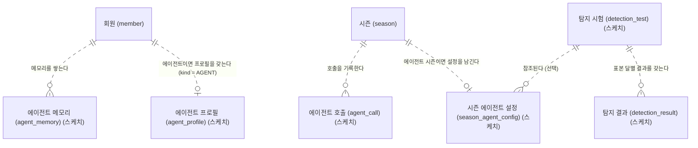

# my Fund Manager — 도메인 ERD (v2)

## 1. 머리말

[PLAN.md §5](PLAN.md#5-도메인과-회계-규칙)의 테이블을 컬럼·타입·키·관계·제약까지 그린 논리/물리 설계이다. 이 문서는 PostgreSQL 17 기준 v2이며, v1(MVP 8테이블, MySQL)은 커밋 `ecb10d9`에 있다. DDL(`db/` 아래 SQL)과 검증 쿼리가 이 문서의 표를 그대로 옮겨 쓴다.

이 문서에서 v1·v2는 erd 문서의 판이며 릴리스([PLAN §1.2](PLAN.md#12-릴리스--v1모의-투자과-v2실제-투자))가 아니다. 단계 이름은 PLAN v3.1에서 바뀌었다(V2 → EXT, V3 → APP, V4 → AI, V5 → OPS, 첫 규칙 집합 V1 → MVP).

**진행 상태:** 이 문서는 한 번에 쓰지 않고 두 번에 나눠 제자리에서 다시 썼다. 두 번 모두 끝났다.

| 기능 | 이 문서에서 하는 일 | 상태 |
|---|---|---|
| P0-03 | 공통 규칙, 전체 관계도, 설계 질문 답, **역사 데이터와 종목 풀** 8개 테이블의 확정 정의서 | 완료 |
| P0-04 | **회원·시즌·피드·대사** 9개(6절)와 **시즌 계좌** 5개(7절) 정의서, 대사 규칙의 v2 이전, v1 계좌 정의를 v2로 바꾸고 부록 삭제 | 완료 |

**정본 규칙:** 타입·키·제약 이름·구분값은 이 문서가 정본이다. [PLAN.md](PLAN.md)나 [SPRING_JPA.md](SPRING_JPA.md)와 어긋나면 이 문서를 따르고, 어긋난 문서를 같은 PR에서 고친다(PLAN §12).

**표기(D10):** 소유자의 ERDCloud 노트 형식을 따른다. 약어: PK(Primary Key, 기본 키), FK(Foreign Key, 외래 키), UK(Unique Key, 유일 키), NN(NOT NULL, 빈 값 불가). 엔티티는 `논리명 (물리명)`, 컬럼은 `타입 물리명 키 "논리명 | NN | 기본값"`. 선에 붙은 기호는 최소(`o` 선택, `|` 필수), 엔티티 쪽 기호는 최대(`|` 1, `{` N)이고, `--`은 식별 관계, `..`은 비식별 관계이다. Mermaid는 선 모양이 키 구성과 맞는지 검사하지 않으므로 표로 따로 확인한다.

**문서 구성:** 2 공통 규칙 → 3 전체 관계도 → 4 설계 질문 답 → 5 역사 데이터와 종목 풀 → 6 회원·시즌·피드·대사 → 7 시즌 계좌 → 8 설계 결정 → 9 하류 기능 약속. 부록은 없다 — v1 계좌 정의는 7절로 옮겨 v2로 바꿨고 v1과의 대응은 7.6에 있다.

## 2. 공통 규칙 (PostgreSQL 17)

이 절의 규칙은 22개 확정 테이블 모두에 적용된다. 6절·7절의 14개 정의서도 같은 규칙을 쓴다.

- **DB:** PostgreSQL 17, 스키마는 `public` 하나(D21). DB는 `ENCODING 'UTF8'`로 만든다(구체 명령은 DDL 기능의 `db/README.md`).
- **키:** 모든 테이블은 대리 키 `id BIGINT GENERATED ALWAYS AS IDENTITY`를 쓰고 PK 이름은 `pk_{테이블}`이다. 자연 키(적재에 쓰는 코드)는 `UNIQUE`로만 둔다. 예외는 `cash_account`(7.3, PK = `season_id`, 식별 1:1)이다(D12, v1 D6).
- **금액:** `NUMERIC(19,4)`(가격·현금·대금·평가액·원장·환율 수준). 원 단위 정수 CHECK(`col = ROUND(col, 0)`, v1 D1)는 **원화 금액**에만 건다(6절·7절의 테이블, 단 `holding.avg_price`·`execution.realized_pnl`은 소수 4자리를 저장하므로 제외). 5절의 8개 테이블에서 금액은 `asset_position.base_price`(현지 통화라 원 단위 CHECK 없음)와 `base_fx_rate` 둘이다.
- **비율:** 수익률·환율 변화·변동성·최대 낙폭·참여율·z-score·강도처럼 **금액이 아닌 비율은 모두 `NUMERIC(12,8)`** 하나다(D20). 확률만 `NUMERIC(5,4)`, 포메이션 비중은 `SMALLINT`(6.3 `season`)이다. 엔진 메모리에서 비율을 `float64`로 다루는 것은 PLAN §5.2의 "금지의 범위"에 따르며, 저장값은 이 타입이다. 정수 4자리를 넘는 값은 22003으로 거부된다 — 분모가 0에 가까운 계산은 계산 기능이 처리 규칙을 정한다(임의 0 대입·무통보 절단 금지).
- **금지 타입:** `DOUBLE PRECISION`, `REAL`, `FLOAT`를 컬럼 타입으로 쓰지 않는다(금액은 PLAN §5.2, 비율은 저장값을 정확한 소수로 두기 위해).
- **정수:** 작은 수(순위·개월 수·연속 수·강도 단계)는 `SMALLINT`, 수량은 `INTEGER`(7.3), 키는 `BIGINT`.
- **문자열:** 모두 `VARCHAR(n)`. 고정 길이 `CHAR` 타입은 쓰지 않는다 — PostgreSQL의 `CHAR`는 뒤 공백을 채우고 비교에서 무시한다(PostgreSQL 17.11에서 확인). Hibernate `validate`가 `bpchar`를 `varchar`와 다른 타입으로 보고 시작을 거부한다는 부분만 **실행 확인 필요** — MVP. 비교는 DB 기본(결정적) 콜레이션이라 대소문자·뒤 공백을 구분하므로 별도 콜레이션을 지정하지 않는다.
- **대소문자 무시 유일성:** 필요한 곳만 `lower(col)` 표현식 UNIQUE 인덱스를 쓴다(`uq_` 접두. 제약이 아니라 인덱스로 존재하므로 `pg_constraint`가 아니라 `pg_indexes`(뷰, 기반 카탈로그 `pg_index`)에 있다). 6.3의 `member.email`에 적용해 v1 동작("`a@x.com` = `A@X.COM`")을 유지한다. 코드값은 대문자 CHECK(`col = UPPER(col)` 또는 목록 CHECK)로 막는다.
- **구분값:** `VARCHAR(n)` + `CHECK (col IN (...))`. PostgreSQL `ENUM` 타입과 코드 테이블은 쓰지 않는다(D8). 값은 대문자 영문과 `_`, 폭은 가장 긴 값. JPA `@Enumerated(EnumType.STRING)`의 enum 상수와 CHECK 목록은 글자 단위로 같아야 한다.
- **날짜·시각:** 달·기준일·상장일 같은 날짜는 `DATE`. 시각(`created_at` 등)은 `TIMESTAMPTZ`(기본값 `now()`, Java `Instant`)이다(D11). DB `timezone = 'Asia/Seoul'`은 표시와 `::date` 변환용이다.
- **감사 컬럼:** 모든 테이블에 `created_at TIMESTAMPTZ NOT NULL DEFAULT now()`. `updated_at`은 가변 엔티티(`member`, `season`, `lineup`, `cash_account`, `holding`)에만.
- **외래 키:** 모두 `ON DELETE RESTRICT ON UPDATE RESTRICT`를 DDL에 명시한다. 이유: ① 추가 전용·이력 데이터의 부모가 지워지거나 바뀌며 자식이 따라 사라지면 안 된다. ② `DEFERRABLE`로 선언해도 `RESTRICT`는 즉시 검사한다(`NO ACTION`만 커밋까지 지연된다) — 의도를 정확히 드러낸다. `ON DELETE CASCADE`는 ①의 이유로 쓰지 않는다.
- **FK 인덱스:** PostgreSQL은 FK 컬럼에 인덱스를 자동으로 만들지 않는다. 다른 인덱스·UNIQUE의 **앞 컬럼이 아닌** FK에는 `idx_` 인덱스를 만든다.
- **CHECK:** 모두 컬럼 목록 뒤에 `CONSTRAINT ck_… CHECK (…)` 테이블 제약으로 쓰고 이름을 붙인다(컬럼 CHECK와 위치를 통일). CHECK 식의 결과가 NULL이면 **통과**한다(3값 논리) — NULL을 막는 것은 `NOT NULL`의 일이다.
- **포함 관계 CHECK:** 다른 CHECK에 논리적으로 포함되는 CHECK도 일부러 둔다. 도메인 규칙이 이름 붙은 제약으로 독립해 읽히고, 포함하는 CHECK를 고칠 때 함께 풀리는 실수를 막는 보호막이 된다. 한 행이 CHECK를 여러 개 어기면 PostgreSQL은 NOT NULL 다음에 CHECK를 이름의 알파벳 순으로 검사해 **첫 위반 하나만** 보고한다(PostgreSQL 17.11에서 확인). 검사는 생성 순서가 아니라 제약 이름의 알파벳 순이며 NOT NULL(23502)이 CHECK보다 먼저이다 — 보고된 이름이 원인의 전부라고 가정하지 않는다. 이 문서의 예: `ck_asset_market_currency` ⊇ `ck_asset_market`·`ck_asset_currency`.
- **이름:** 소문자 `snake_case`, 따옴표 없음. 제약·인덱스 이름은 `pk_{t}`, `uq_{t}_{cols}`, `fk_{t}_{부모 또는 컬럼}`, `ck_{t}_{규칙}`, `idx_{t}_{cols}`이며 **63바이트 이하**다(PostgreSQL은 넘는 이름을 NOTICE만 내고 잘라 쓰므로 잘린 이름끼리 충돌할 수 있다). 예약어·함수 이름과 겹치는 컬럼 이름은 피한다(`window` → `window_start`/`window_end`, `position` → `system_position`). `orders`는 `ORDER`가 예약어라 복수형을 유지한다(7.3).
- **숫자 대입:** `NUMERIC(p,s)`에 소수 자리가 더 많은 값을 넣으면 경고 없이 s자리로 반올림되고, 정수 자리가 넘치면 SQLSTATE 22003으로 거부된다(PostgreSQL 17.11에서 확인: 0.5는 0에서 먼 쪽으로 반올림 — 0.123456785 → 0.12345679, −0.123456785 → −0.12345679). 그래서 입력 원본의 소수 거부는 DB에 넣기 전에 코드가 맡는다.
- **노출 구분:** 정의서 코멘트 앞머리에 `[노출]`(시즌 중 화면·피드에 값이 나갈 수 있음), `[복기 전용]`(시즌 종료 전에는 어디에도 나가지 않음 — 날짜·실제 이름·출처·사후 평가), `[내부]`(사용자에게 나가지 않는 키·관리 컬럼)를 붙인다(PLAN §2 안티목표, §4.2·§4.11, SPRING_JPA §4.6).

### v1에서 바뀐 점

이 표와 7.6의 v1 열만 v1(MySQL) 토큰을 적는다.

| 항목 | v1 (`ecb10d9`) | v2 |
|---|---|---|
| 엔진·문자셋 | MySQL 8.4, InnoDB, `utf8mb4` | PostgreSQL 17, `UTF8` |
| 테이블 옵션 | `ENGINE=InnoDB` | 없음 |
| 금액 타입 | `DECIMAL(19,4)` | `NUMERIC(19,4)` |
| 키 생성 | `BIGINT … AUTO_INCREMENT` | `BIGINT GENERATED ALWAYS AS IDENTITY` |
| 시각 | `DATETIME(6)`에 KST 저장 + 서버 `time_zone` 전제 | `TIMESTAMPTZ`(순간을 저장, 시간대 규칙 불필요) |
| 작은 정수 | `TINYINT` | `SMALLINT` |
| 콜레이션 | `utf8mb4_0900_ai_ci`/`utf8mb4_0900_bin` 지정(P0-02 수정안) | 지정 없음 — 기본 비교가 대소문자·뒤 공백을 구분 |
| CHECK 위반·참조 오류 | ERROR 3819, 3813(컬럼 CHECK의 타 컬럼 참조 거부), 3823(CHECK 컬럼의 FK 동작 제한) | SQLSTATE 23514(check_violation), 23503(foreign_key_violation), 23505(unique_violation). 3813·3823 근거는 삭제 |
| 소수 초과 대입 | 경고 Note 1265 후 반올림 | 경고 없이 반올림, 정수 자리 초과는 22003 |
| FK 인덱스 | 자동 생성 | 자동이 아님 — `idx_`를 직접 만든다 |
| CHECK 다중 위반 | 이름 순 첫 하나 보고 | 알파벳 순 첫 하나 보고(PostgreSQL 17.11에서 확인) |

## 3. 전체 관계도

확정 22개와 MVP 스케치 3개는 3.1에, EXT 이후 스케치 16개와 에이전트 스케치(PLAN v3) 6개는 3.2에 따로 그린다. 한 그림이 25개 이하라 읽히고, 확정과 스케치가 그림 단위로 구분된다. 같은 엔티티 이름이 여러 그림에 나오는 것은 앵커이다.

### 3.1 확정 22개 + MVP 스케치 3개

컬럼 없이 이름과 관계선만 그린다(컬럼은 5절·6절·7절). R1–R8은 5절에서, R9–R22는 6절에서, R23–R32는 7절에서 확정한 관계이다. 바뀌면 이 그림과 4절 표를 같은 PR에서 고친다. MVP 스케치는 라벨에 "(스케치)"를 붙이며 MVP에서 컬럼을 확정한다.

```mermaid
erDiagram
    ASSET_GROUP["종목 그룹 (asset_group)"]
    ASSET["종목 (asset)"]
    ASSET_POSITION["종목 기준일 (asset_position)"]
    MONTH_BLOCK["월 블록 (month_block)"]
    ASSET_MONTH_RETURN["종목 달 수익률 (asset_month_return)"]
    FX_MONTH["달 환율 변화 (fx_month)"]
    MONTH_EVENT["달 사건 태그 (month_event)"]
    ASSET_MONTH_ATTENTION["종목 달 관심 지수 (asset_month_attention)"]
    MEMBER["회원 (member)"]
    SEASON["시즌 (season)"]
    SEASON_PATH["시즌 경로 (season_path)"]
    TURN["턴 (turn)"]
    TURN_PRICE["턴 가격 (turn_price)"]
    LINEUP["라인업 (lineup)"]
    FORMATION_CHANGE["포메이션 변경 (formation_change)"]
    TURN_FEED["턴 피드 (turn_feed)"]
    RECONCILIATION_LOG["대사 기록 (reconciliation_log)"]
    CASH_ACCOUNT["현금 계좌 (cash_account)"]
    ORDERS["주문 (orders)"]
    EXECUTION["체결 (execution)"]
    HOLDING["보유 (holding)"]
    CASH_LEDGER["현금 원장 (cash_ledger)"]
    SEASON_SCORE["시즌 점수 (season_score) (스케치)"]
    PROJECTION["예상 분포 (projection) (스케치)"]
    RATING_HISTORY["레이팅 이력 (rating_history) (스케치)"]
    ASSET_GROUP ||..o{ ASSET : "R1 분류한다"
    ASSET ||..o{ ASSET_POSITION : "R2 기준일마다 판정된다"
    ASSET ||..o{ ASSET_MONTH_RETURN : "R3 달마다 수익률을 갖는다"
    MONTH_BLOCK ||..o{ ASSET_MONTH_RETURN : "R4 달의 수익률이다"
    MONTH_BLOCK ||..o{ FX_MONTH : "R5 달의 환율 변화이다"
    MONTH_BLOCK ||..o{ MONTH_EVENT : "R6 달의 사건이다"
    ASSET ||..o{ ASSET_MONTH_ATTENTION : "R7 달마다 관심을 받는다"
    MONTH_BLOCK ||..o{ ASSET_MONTH_ATTENTION : "R8 달의 관심 지수이다"
    MEMBER ||..o{ SEASON : "R9 시즌을 연다"
    SEASON ||..|{ SEASON_PATH : "R10 경로를 갖는다"
    MONTH_BLOCK ||..o{ SEASON_PATH : "R11 턴에 배정된다"
    SEASON ||..o{ TURN : "R12 턴이 쌓인다"
    SEASON ||..o{ TURN_PRICE : "R13 가격이 기록된다"
    ASSET ||..o{ TURN_PRICE : "R14 턴마다 가격을 갖는다"
    SEASON ||..o{ LINEUP : "R15 라인업을 갖는다"
    ASSET ||..o{ LINEUP : "R16 포지션이 선언된다"
    SEASON ||..o{ FORMATION_CHANGE : "R17 전술을 바꾼다"
    SEASON ||..o{ TURN_FEED : "R18 피드를 본다"
    MONTH_EVENT |o..o{ TURN_FEED : "R19 사건 피드가 된다"
    ASSET |o..o{ TURN_FEED : "R20 종목 피드이다"
    ASSET_GROUP |o..o{ TURN_FEED : "R21 그룹 피드이다"
    SEASON ||..o{ RECONCILIATION_LOG : "R22 대사된다"
    SEASON ||--|| CASH_ACCOUNT : "R23 계좌를 가진다"
    SEASON ||..o{ ORDERS : "R24 주문한다"
    ASSET ||..o{ ORDERS : "R25 주문 대상이다"
    FORMATION_CHANGE |o..o{ ORDERS : "R26 변경에 묶인다"
    TURN_FEED |o..o{ ORDERS : "R27 피드에서 출발한다"
    ORDERS ||..o{ EXECUTION : "R28 체결된다"
    SEASON ||..o{ HOLDING : "R29 보유한다"
    ASSET ||..o{ HOLDING : "R30 보유된다"
    CASH_ACCOUNT ||..|{ CASH_LEDGER : "R31 원장에 기록된다"
    ORDERS |o..o{ CASH_LEDGER : "R32 원장을 만든다"
    SEASON ||..o| SEASON_SCORE : "스케치 점수를 받는다"
    SEASON ||..o{ PROJECTION : "스케치 예상을 남긴다"
    MEMBER ||..o{ RATING_HISTORY : "스케치 레이팅을 갖는다"
    SEASON ||..o| RATING_HISTORY : "스케치 레이팅을 만든다"
```



R9–R22의 관계 요약은 6.2에, R23–R32는 7.2에 있다. MVP 스케치 3개의 관계는 위 그림의 "스케치" 선이며 MVP에서 컬럼과 함께 확정한다.

### 3.2 EXT 이후 스케치 관계도

이름과 관계선만 있고 정의서는 없다(PLAN §5.1). 앵커(`member`, `season`, `asset`, `lineup`, `turn_feed`)는 이름만 다시 쓴다. **초안 — 확정 단계에 해당 기능이 컬럼을 정한다.**

```mermaid
erDiagram
    MEMBER["회원 (member)"]
    SEASON["시즌 (season)"]
    ASSET["종목 (asset)"]
    LINEUP["라인업 (lineup)"]
    TURN_FEED["턴 피드 (turn_feed)"]
    FEED_MARK["신호 소음 표시 (feed_mark) (스케치)"]
    MEMBER_WALLET["게임 머니 (member_wallet) (스케치)"]
    CASE_STUDY["케이스 (case_study) (스케치)"]
    CASE_CANDIDATE["케이스 후보 (case_candidate) (스케치)"]
    CASE_CANDIDATE_YEAR["후보 연도 (case_candidate_year) (스케치)"]
    CASE_PLAY["케이스 플레이 (case_play) (스케치)"]
    MASTER["대가 (master) (스케치)"]
    MASTER_RULE["대가 원칙 (master_rule) (스케치)"]
    ASSET_FUNDAMENTAL["종목 재무 (asset_fundamental) (스케치)"]
    LINEUP_CHECK["라인업 점검 (lineup_check) (스케치)"]
    LEAGUE["리그 (league) (스케치)"]
    LEAGUE_ENTRY["리그 참가 (league_entry) (스케치)"]
    THESIS["논제 (thesis) (스케치)"]
    THESIS_VERDICT["논제 판정 (thesis_verdict) (스케치)"]
    MEMBER_ATTRIBUTE["속성 프로필 (member_attribute) (스케치)"]
    HALL_OF_FAME["명예의 전당 (hall_of_fame) (스케치)"]
    TURN_FEED ||..o{ FEED_MARK : "표시된다"
    MEMBER ||..o| MEMBER_WALLET : "게임 머니를 갖는다"
    CASE_STUDY ||..o{ CASE_CANDIDATE : "후보를 갖는다"
    CASE_CANDIDATE ||..o{ CASE_CANDIDATE_YEAR : "연도별 숫자를 갖는다"
    MEMBER ||..o{ CASE_PLAY : "플레이한다"
    CASE_STUDY ||..o{ CASE_PLAY : "플레이된다"
    MASTER ||..o{ MASTER_RULE : "원칙을 갖는다"
    ASSET ||..o{ ASSET_FUNDAMENTAL : "기준일 재무를 갖는다"
    LINEUP ||..o{ LINEUP_CHECK : "점검된다"
    MASTER_RULE ||..o{ LINEUP_CHECK : "기준이 된다"
    LEAGUE ||..o{ LEAGUE_ENTRY : "참가를 받는다"
    SEASON ||..o{ LEAGUE_ENTRY : "참가한다"
    SEASON ||..o{ THESIS : "논제를 남긴다"
    ASSET ||..o{ THESIS : "논제 대상이다"
    THESIS ||..o{ THESIS_VERDICT : "판정된다"
    MEMBER ||..o{ MEMBER_ATTRIBUTE : "속성을 쌓는다"
    MEMBER ||..o{ HALL_OF_FAME : "등재된다"
```



| 이름 | 키(초안) | 관계(초안) | 확정 단계 |
|---|---|---|---|
| `feed_mark` | `id`, UNIQUE (`turn_feed_id`) | `turn_feed` 1 : 0..1 — 사용자의 신호/소음 표시 | EXT |
| `member_wallet` | `id`, UNIQUE (`member_id`) | `member` 1 : 0..1 — 게임 머니(시즌 자금과 별개, PLAN §6.6) | EXT |
| `case_study` | `id`, UNIQUE (코드) | `case_candidate`·`case_play`의 부모 — 전환기, 기간, 턴 수 | EXT 데이터, APP 화면 |
| `case_candidate` | `id`, UNIQUE (`case_study_id`, 후보 코드) | `case_study` 1 : 0..N — 가린 이름, 실제 이름, 승자 여부 | EXT 데이터, APP 화면 |
| `case_candidate_year` | `id`, UNIQUE (`case_candidate_id`, 연도) | `case_candidate` 1 : 0..N — 재무·서사·수익률, 출처 | EXT 데이터, APP 화면 |
| `case_play` | `id` | `member` 1 : 0..N, `case_study` 1 : 0..N — 턴별 배분, 선별 점수 | EXT 데이터, APP 화면 |
| `master` | `id`, UNIQUE (코드) | `master_rule`의 부모 — 대가, 요약, 출처 | EXT |
| `master_rule` | `id`, UNIQUE (`master_id`, 규칙 키) | `master` 1 : 0..N — 측정식 또는 질문, 선호 포메이션, 행동 규칙 | EXT |
| `asset_fundamental` | `id`, UNIQUE (`asset_id`, 기준일) | `asset` 1 : 0..N — 종목 × 기준일 재무 | EXT |
| `lineup_check` | `id`, UNIQUE (`lineup_id`, `master_rule_id`) | `lineup` 1 : 0..N, `master_rule` 1 : 0..N — 체크 결과 | EXT |
| `league` | `id` | `league_entry`의 부모 | APP |
| `league_entry` | `id`, UNIQUE (`league_id`, `season_id`) | `league` 1 : 0..N, `season` 1 : 0..N | APP |
| `thesis` | `id` | `season` 1 : 0..N, `asset` 1 : 0..N — 주장·수치·기한·기록 시각, 수정 불가 | M4 |
| `thesis_verdict` | `id` | `thesis` 1 : 0..N — 판정, 근거, 판정자, 이의 | M4 |
| `member_attribute` | `id`, UNIQUE (`member_id`, 속성 코드) | `member` 1 : 0..N — 속성 × 누적 점수·표본 수 | M4 |
| `hall_of_fame` | `id` | `member` 1 : 0..N — 기둥 또는 종합, 기수, 등재 시점 스냅샷, 공개 동의 | M4 (API), APP (화면) |
| `agent_profile` | `member_id` PK·FK(에이전트 회원만 — FK만으로는 강제되지 않으므로 강제 방식은 AG-02, 예: `orders`의 복합 FK 패턴 D29) | `member` 1 : 0..1 — 소유자, 페르소나 키, 모델 경로·id, 상태 (PLAN §4.16) | AG-02 |
| `season_agent_config` | `season_id` PK·FK | `season` 1 : 0..1 — 시즌 시작 때 한 번 남기는 불변 설정(페르소나 버전·해시, 모델, 온도, 시드, 프롬프트·러너 버전, 메모리 버전) | AG-02 |
| `agent_call` | `id`, UNIQUE (`season_id`, 턴 번호, 시도 번호, 호출 종류) | `season` 1 : 0..N — 요청·응답 원문, 파싱 결과, 거부 목록, 실제 모델, 토큰, 비용(`NUMERIC`), 지연. 불변·추가 전용(기록 재생의 재료) | AG-02 |
| `agent_memory` | `id`, UNIQUE (`member_id`, 층, 버전) | `member` 1 : 0..N — 시즌 반성·운용 노트의 불변 버전, 출처 시즌 | AG-05 |
| `detection_test`·`detection_result` | `id` | 시험 묶음(모델 × 입력 조건) 1 : 0..N 표본 달 결과(정답 여부·추정값). 보고 전용, AG-01은 파일 출력으로 시작 | AG-01 |

에이전트 펀드 매니저(PLAN v3, §4.16)의 스케치는 따로 그린다. 앵커는 `member`와 `season` 둘이다. **초안 — AG-02 이후 확정 단계에 해당 기능이 컬럼을 정한다.**



위 표의 에이전트 6개 행(`agent_profile` ~ `detection_test`·`detection_result`)이 이 그림의 정의다. 종목 가명 매핑 테이블은 두지 않는다 — 에이전트도 감독 모드에서 사람과 같은 실명을 본다(PLAN §4.16).

테이블이 아닌 컬럼 스케치 셋: `season.mode`(감독/전망, M4), `season.style_master_id`(선택, FK → `master.id`, EXT), `member.kind`(`HUMAN`/`AGENT`, AG-02 — 에이전트 펀드 매니저도 `member`의 한 종류라 `season.member_id` 이하 하류 테이블이 그대로다; 사람만 `email`·`password`를 가지므로 두 컬럼이 NULL 허용으로 바뀌고 CHECK 둘이 붙는다: `kind IN ('HUMAN','AGENT')`, `(kind = 'HUMAN' AND email IS NOT NULL AND password IS NOT NULL) OR (kind = 'AGENT' AND email IS NULL AND password IS NULL)`. 이름은 AG-02에서 6.4 규칙(`ck_member_…`)으로 정한다. PLAN v3). 셋 다 `season`·`member`의 정의서(6.3)에는 넣지 않고 해당 단계가 `ALTER TABLE`로 더한다. `orders.source`에 `AGENT`를 넣지 않는다 — 주문의 출발점과 주체는 다른 축이다(8절 "MVP에서 다시 볼 것").

## 4. 설계 질문 답

PLAN §5.3의 질문 1–7과 Phase 0 기능 표의 질문 Q8–Q13에 대한 답이다. "반영 위치"는 답이 구체화되는 곳이다.

| # | 답 | 반영 위치 | 바뀐 점 |
|---|---|---|---|
| 1 | `cash_account`의 PK = `season_id`(식별 1:1). `member` 1 : `season` 0..N. "진행 중 최대 3개"는 행 집합 규칙이라 MVP 서비스 검증이 맡는다 | 7.3 `cash_account`, 6.3 `season`, 6.5 서비스 규칙 | — |
| 2 | `season_path`는 시즌 시작 때 전부 저장하고 `UNIQUE (season_id, turn_no)`. 시즌에 시드·엔진 버전·데이터 스냅샷 날짜(PLAN §4.2)와 **기준일**(어느 `asset_position` 스냅샷을 쓰는지)을 둔다 | 6.3 `season`·`season_path`, 검증 규칙 S1·S2 | 기준일 컬럼 추가(D14에서 생김). `base_date`는 FK 대상이 없어 검증 규칙 S2가 본다 |
| 3 | 원화 단일 계좌, 체결 시 환산. 수익률은 현지 통화(`asset_month_return`), 환율 변화는 `fx_month`, 원화 가격은 `turn_price`를 만들 때 결합한다 | 5.3 `asset_month_return`·`fx_month`, 6.3 `turn_price` | — |
| 4 | `projection`은 시즌 시작·종료 시점 것만 저장한다. Phase 0은 스케치, MVP에서 확정 | 3.1 스케치 | — |
| 5 | 축 4개의 방향·강도와 국면 확률 4개는 `month_block` 컬럼(NULL 허용), 지표 14개 변환값은 MVP 데이터 준비 때 컬럼 vs JSONB를 정한다(PLAN §5.3 질문 5 현재 문구와 같음) | 5.3 `month_block` | — |
| 6 | `lineup`(보유 구간마다 한 행, 끝 턴 NULL = 보유 중). **같은 종목의 열린 구간 1개는 부분 유일 인덱스**(`CREATE UNIQUE INDEX … ON lineup (season_id, asset_id) WHERE end_turn IS NULL`)로 DDL이 막고, 나머지 겹침(열린 구간과 닫힌 구간, 닫힌 구간끼리)은 검증 쿼리가 본다 | 6.3 `lineup`, 대사 규칙 17·18 | 대사 → **DDL 강제**로 바뀜(문법 제한이 없어지고 PostgreSQL 부분 인덱스를 쓸 수 있게 됨). 구간은 반열림이고, 부분 인덱스는 FK 인덱스를 겸하지 못해 전체 인덱스 `idx_lineup_season_asset`를 따로 둔다(D26). 규칙 18이 열린 구간을 포함하도록 넓어짐 |
| 7 | `season`에 시작 4개 + 현재 4개(`SMALLINT`), 합 100·범위 0–100·골키퍼 ≥ 1 CHECK를 시작·현재 각각, `formation_change` 이력. 현재 = 마지막 변경의 이후 값은 대사 항목 | 6.3 `season`·`formation_change`, 대사 규칙 15 | 비중 타입이 `SMALLINT`로 정해짐(v1에서 바뀐 점 참고). 범위 CHECK 2개 추가 — 합 100만으로는 −10·110을 못 막는다 |
| Q8 | 기준일 가격(현지 통화)·기준일 환율은 `asset_position`에 둔다. 0턴 원화 가격 = round(`base_price` × `base_fx_rate`), t턴 가격 = round(0턴 원화 가격 × Π(1+r현지)(1+r환율)) — PLAN §5.2 문자 그대로(누적 곱은 정확한 소수로 두고 가격마다 반올림은 한 번) | 5.3 `asset_position`, 6.3 `turn_price`, 대사 규칙 12 | 위치 확정, 공식은 PLAN §5.2 |
| Q9 | `CHECK (path_length > 0)`, 60/120은 MVP 서비스 규칙 | 6.3 `season` | — |
| Q10 | `turn_feed`에 템플릿 id + 변수 값 + 렌더된 문장을 저장한다. 템플릿은 `feed/` 파일이고 id는 바꾸지 않는다 | 6.3 `turn_feed` | 변수 값은 JSONB(D27) |
| Q11 | `asset`이 그룹 하나를 FK로 가지고(`asset_group_id`), 시장은 `asset.market`. 다대다(테마)는 EXT 매핑 테이블 | 5.3 `asset_group`·`asset` | — |
| Q12 | 시가총액 **시장 내 순위**를 `asset_position.market_cap_rank`에 둔다(표본은 손으로 채움, ETF는 NULL) | 5.3 `asset_position` | `asset` → `asset_position`(기준일 값이므로) |
| Q13 | `orders`에 `turn_no` | 7.3 `orders` | — |

## 5. 역사 데이터와 종목 풀

PLAN §5.1의 "종목 풀"(`asset_group`, `asset`, `asset_position`)과 "역사 데이터"(`month_block`, `asset_month_return`, `fx_month`, `month_event`, `asset_month_attention`) 8개 테이블을 확정한다. 모두 **적재 전용**이다 — 게임(시즌)은 읽기만 한다. 적재 쪽 쓰기는 INSERT와 `asset_position` 판정을 채우는 한 번의 UPDATE(P0-10)뿐이다. 시즌이 참조한 뒤의 정정 정책은 MVP 데이터 준비에서 정한다 — 지난 시즌의 금액·피드는 `turn_price`·`turn_feed` 스냅샷이 정본이라 역사 행 정정에 바뀌지 않는다. 6절의 시즌 영역 테이블이 이 8개를 FK로 가리킨다.

### 5.1 관계도

```mermaid
erDiagram
    ASSET_GROUP["종목 그룹 (asset_group)"] {
        BIGINT id PK "그룹번호 | NN | IDENTITY"
        VARCHAR(30) code UK "그룹코드 | NN"
        VARCHAR(50) name "그룹명 | NN"
        VARCHAR(11) kind "그룹 구분 | NN"
        TIMESTAMPTZ created_at "생성일시 | NN | now()"
    }
    ASSET["종목 (asset)"] {
        BIGINT id PK "종목번호 | NN | IDENTITY"
        VARCHAR(2) market UK "시장 | NN"
        VARCHAR(12) ticker UK "종목코드 | NN"
        VARCHAR(100) name "종목명 | NN"
        VARCHAR(5) asset_type "종목 유형 | NN"
        VARCHAR(3) currency "거래 통화 | NN"
        BIGINT asset_group_id FK "그룹번호 | NN"
        DATE listed_on "상장일 | NN"
        VARCHAR(5) return_basis "수익률 기준 | NN"
        VARCHAR(100) proxy_index_name "대체 지수명 | NULL"
        TIMESTAMPTZ created_at "생성일시 | NN | now()"
    }
    ASSET_POSITION["종목 기준일 (asset_position)"] {
        BIGINT id PK "기준일 종목번호 | NN | IDENTITY"
        BIGINT asset_id FK "종목번호 | NN"
        DATE base_date "기준일 | NN"
        NUMERIC(19,4) base_price "기준일 가격 (현지 통화) | NN"
        NUMERIC(19,4) base_fx_rate "기준일 환율 | NN"
        SMALLINT market_cap_rank "시가총액 순위 (시장 내) | NULL"
        DATE window_start "판정 창 첫 달 | NULL"
        DATE window_end "판정 창 마지막 달 | NULL"
        SMALLINT months_used "사용한 달 수 | NULL"
        NUMERIC(12,8) up_participation "상승장 참여율 | NULL"
        NUMERIC(12,8) down_participation "하락장 참여율 | NULL"
        NUMERIC(12,8) volatility "변동성 | NULL"
        NUMERIC(12,8) max_drawdown "최대 낙폭 | NULL"
        VARCHAR(17) system_position "시스템 판정 포지션 | NULL"
        TIMESTAMPTZ created_at "생성일시 | NN | now()"
    }
    MONTH_BLOCK["월 블록 (month_block)"] {
        BIGINT id PK "월 블록번호 | NN | IDENTITY"
        DATE month_start UK "월 시작일 | NN"
        VARCHAR(7) rate_dir "금리 방향 | NULL"
        VARCHAR(7) growth_dir "성장 방향 | NULL"
        VARCHAR(7) fx_dir "환율 방향 | NULL"
        VARCHAR(7) sentiment_dir "심리 방향 | NULL"
        NUMERIC(12,8) rate_strength "금리 강도 | NULL"
        NUMERIC(12,8) growth_strength "성장 강도 | NULL"
        NUMERIC(12,8) fx_strength "환율 강도 | NULL"
        NUMERIC(12,8) sentiment_strength "심리 강도 | NULL"
        NUMERIC(5,4) prob_p1 "침체 확률 | NULL"
        NUMERIC(5,4) prob_p2 "골디락스 확률 | NULL"
        NUMERIC(5,4) prob_p3 "리플레이션 확률 | NULL"
        NUMERIC(5,4) prob_p4 "스태그플레이션 확률 | NULL"
        VARCHAR(200) event_summary "사건 요약 | NULL"
        BOOLEAN events_reviewed "사건 태그 편집 완료 | NN | FALSE"
        TIMESTAMPTZ created_at "생성일시 | NN | now()"
    }
    ASSET_MONTH_RETURN["종목 달 수익률 (asset_month_return)"] {
        BIGINT id PK "수익률번호 | NN | IDENTITY"
        BIGINT asset_id FK "종목번호 | NN"
        BIGINT month_block_id FK "월 블록번호 | NN"
        NUMERIC(12,8) local_return "현지 통화 월 수익률 | NN"
        VARCHAR(11) return_kind "수익률 종류 | NN | ACTUAL"
        TIMESTAMPTZ created_at "생성일시 | NN | now()"
    }
    FX_MONTH["달 환율 변화 (fx_month)"] {
        BIGINT id PK "환율번호 | NN | IDENTITY"
        BIGINT month_block_id FK "월 블록번호 | NN"
        VARCHAR(3) currency "통화 | NN"
        NUMERIC(12,8) fx_change "환율 변화율 | NN"
        TIMESTAMPTZ created_at "생성일시 | NN | now()"
    }
    MONTH_EVENT["달 사건 태그 (month_event)"] {
        BIGINT id PK "사건번호 | NN | IDENTITY"
        VARCHAR(40) event_key UK "사건 키 | NN"
        BIGINT month_block_id FK "월 블록번호 | NN"
        VARCHAR(12) category "범주 | NN"
        VARCHAR(30) event_type "사건 유형 | NN"
        VARCHAR(7) phase "단계 | NN"
        VARCHAR(20) outcome "결과 | NULL"
        VARCHAR(4) direction "방향 | NULL"
        SMALLINT strength "강도 단계 | NN"
        NUMERIC(12,8) reaction_change "반응 변화율 | NULL"
        VARCHAR(100) title "실제 이름 | NN"
        VARCHAR(500) source "출처 | NN"
        VARCHAR(300) hindsight "사후 평가 | NULL"
        TIMESTAMPTZ created_at "생성일시 | NN | now()"
    }
    ASSET_MONTH_ATTENTION["종목 달 관심 지수 (asset_month_attention)"] {
        BIGINT id PK "관심번호 | NN | IDENTITY"
        BIGINT asset_id FK "종목번호 | NN"
        BIGINT month_block_id FK "월 블록번호 | NN"
        SMALLINT window_months "z-score 창 달 수 | NN"
        NUMERIC(12,8) attention_z "수익률 크기 z-score | NULL"
        SMALLINT streak "연속 방향 달 수 | NN"
        NUMERIC(12,8) attention_index "관심 지수 | NULL"
        TIMESTAMPTZ created_at "생성일시 | NN | now()"
    }
    ASSET_GROUP ||..o{ ASSET : "R1 분류한다"
    ASSET ||..o{ ASSET_POSITION : "R2 기준일마다 판정된다"
    ASSET ||..o{ ASSET_MONTH_RETURN : "R3 달마다 수익률을 갖는다"
    MONTH_BLOCK ||..o{ ASSET_MONTH_RETURN : "R4 달의 수익률이다"
    MONTH_BLOCK ||..o{ FX_MONTH : "R5 달의 환율 변화이다"
    MONTH_BLOCK ||..o{ MONTH_EVENT : "R6 달의 사건이다"
    ASSET ||..o{ ASSET_MONTH_ATTENTION : "R7 달마다 관심을 받는다"
    MONTH_BLOCK ||..o{ ASSET_MONTH_ATTENTION : "R8 달의 관심 지수이다"
```

### 5.2 관계 요약

모두 비식별 `..`이다 — 자식의 PK가 대리 키 `id`라서 부모 키를 PK에 넣지 않는다(v1 D6의 방침). 자식의 UNIQUE가 (부모, 부모) 쌍의 중복을 막는다.

| # | 부모 → 자식 | 카디널리티 | 선 | 근거 |
|---|---|---|---|---|
| R1 | `asset_group` → `asset` | 1 : 0..N | 비식별 `..` | 종목은 그룹 하나에 속한다(Q11). 그룹은 시장을 가로지른다 |
| R2 | `asset` → `asset_position` | 1 : 0..N | 비식별 `..` | 종목 × 기준일. 한 종목이 여러 기준일의 풀에 들 수 있다 |
| R3 | `asset` → `asset_month_return` | 1 : 0..N | 비식별 `..` | 종목 × 달 |
| R4 | `month_block` → `asset_month_return` | 1 : 0..N | 비식별 `..` | "빈 칸 0"은 검증 규칙 H3 |
| R5 | `month_block` → `fx_month` | 1 : 0..N | 비식별 `..` | 달마다 USD 1행은 검증 규칙 H4 |
| R6 | `month_block` → `month_event` | 1 : 0..N | 비식별 `..` | 0건 = 사건 없음(`events_reviewed`가 `TRUE`일 때) |
| R7 | `asset` → `asset_month_attention` | 1 : 0..N | 비식별 `..` | 종목 × 달 |
| R8 | `month_block` → `asset_month_attention` | 1 : 0..N | 비식별 `..` | |

### 5.3 엔티티 정의서

노출 구분(`[노출]`/`[복기 전용]`/`[내부]`)은 코멘트 앞머리에 붙는다. 같은 컬럼이 값에 따라 노출되는 경우(예: 가격이 0턴 가격으로 나감)는 `[노출]` 뒤에 쓰임을 적는다. 시각 `created_at`은 8개 모두 `TIMESTAMPTZ`, NN, 기본값 `now()`, `[내부]`이다.

#### 종목 그룹 (asset_group)

| 키 | 논리명 | 물리명 | 타입 | NULL | 기본값 | 코멘트 |
| --- | --- | --- | --- | --- | --- | --- |
| PK | 그룹번호 | id | BIGINT | NN | IDENTITY | `[내부]` `pk_asset_group` |
| UK | 그룹코드 | code | VARCHAR(30) | NN | | `[내부]` `uq_asset_group_code`. 적재 자연 키(예: `SEMICONDUCTOR`, `BOND_LONG`, `GOLD`, `USD`, `EQUITY_INDEX`). `ck_asset_group_code_format`: `code ~ '^[A-Z][A-Z0-9_]*$'` |
| | 그룹명 | name | VARCHAR(50) | NN | | `[노출]` 표시 이름("반도체"). "확대" 피드 문장에 들어간다(PLAN §4.13) — 연도·날짜·풀 밖 고유명사 금지(P0-13 검사 대상) |
| | 그룹 구분 | kind | VARCHAR(11) | NN | | `[노출]` `ck_asset_group_kind`: `kind IN ('SECTOR','ASSET_CLASS')` — 업종 vs 자산군(주식 지수·채권·금·달러·현금성) |
| | 생성일시 | created_at | TIMESTAMPTZ | NN | now() | `[내부]` |

- 시장(국내·미국)은 그룹이 아니라 `asset.market`이다(Q11). 그룹은 시장을 가로지른다(국내 반도체 + 미국 반도체 = `SEMICONDUCTOR`). 시장별 그룹 관심 지수가 필요하면 조회에서 `market`으로 나눈다.
- 다대다(테마)는 EXT 매핑 테이블로 푼다. 이번 스케치에는 넣지 않는다(PLAN §5.1에 없음).

#### 종목 (asset)

| 키 | 논리명 | 물리명 | 타입 | NULL | 기본값 | 코멘트 |
| --- | --- | --- | --- | --- | --- | --- |
| PK | 종목번호 | id | BIGINT | NN | IDENTITY | `[내부]` `pk_asset` |
| UK | 시장 | market | VARCHAR(2) | NN | | `[노출]` `uq_asset_market_ticker (market, ticker)`의 앞 컬럼. `ck_asset_market`: `market IN ('KR','US')`. 국가 시장 — 거래소 구분은 MVP에 필요 없다(수수료·세금·통화가 국가 단위, PLAN §4.6·§9) |
| UK | 종목코드 | ticker | VARCHAR(12) | NN | | `[노출]` 적재 자연 키(`market`과 함께 UNIQUE). `ck_asset_ticker_upper`: `ticker = UPPER(ticker)` — 대소문자만 다른 중복을 막는다(PostgreSQL 비교는 대소문자를 구분). 예 `005930`, `069500`, `AAPL`, `BRK.B`. 숫자 전용 CHECK는 없다(영문이 섞인 코드가 있음) |
| | 종목명 | name | VARCHAR(100) | NN | | `[노출]` 종목 풀의 이름은 피드에 나와도 된다(PLAN §4.13이 금지하는 것은 "종목 풀의 이름 외의 고유명사") |
| | 종목 유형 | asset_type | VARCHAR(5) | NN | | `[노출]` `ck_asset_asset_type`: `asset_type IN ('STOCK','ETF')` — 국내 주식·국내 ETF·미국 주식·미국 ETF를 `market` × `asset_type`으로 구분 |
| | 거래 통화 | currency | VARCHAR(3) | NN | | `[내부]` `ck_asset_currency`: `currency IN ('KRW','USD')`. `ck_asset_market_currency`: `market`과 `currency`의 짝(KR-KRW, US-USD). **의도적 중복** — `market`에서 `currency`가 정해지는 함수 종속(3NF 위반)을 CHECK로 묶어 두고, `fx_month.currency`와 바로 조인한다 |
| FK | 그룹번호 | asset_group_id | BIGINT | NN | | `[노출]` (그룹 이름으로) → asset_group.id (R1). `fk_asset_asset_group`, `idx_asset_asset_group` |
| | 상장일 | listed_on | DATE | NN | | `[복기 전용]` 실제 날짜라 시즌 중에는 나가지 않는다. 쓰임: 풀 선정(MVP 개별 주식은 2007-01 이전 상장만 — PLAN §4.7, DDL로 강제하지 않는다)과 검증 규칙 H7의 상장월 경계 |
| | 수익률 기준 | return_basis | VARCHAR(5) | NN | | `[노출]` `ck_asset_return_basis`: `return_basis IN ('PRICE','TOTAL')` — MVP 국내는 가격 수익률, 미국은 총수익률(PLAN §4.6). 성적표의 "국내 종목은 배당 제외" 공개 문구의 근거. `market`과의 짝(KR → `PRICE`, US → `TOTAL`)은 **의도적 중복**이며 국내 총수익률 도입(M1 배당 파이프라인) 때 풀리므로 CHECK가 아니라 검증 규칙 H7이 본다 |
| | 대체 지수명 | proxy_index_name | VARCHAR(100) | NULL | | `[노출]` 상장 전 구간에 쓰는 추종 지수 이름(PLAN §4.7, ETF). `ck_asset_proxy_etf`: `proxy_index_name IS NULL OR asset_type = 'ETF'` — MVP 규칙이며 EXT 대체 수익률을 도입할 때 바꾼다 |
| | 생성일시 | created_at | TIMESTAMPTZ | NN | now() | `[내부]` |

- **기준일은 `asset`에 두지 않는다.** 풀은 연 1회 갱신되고(PLAN §7) 같은 종목이 여러 기준일의 풀에 들 수 있으므로, 기준일은 "종목 × 기준일" 행(`asset_position`)의 키이다. 기준일 시점의 풀 구성 = 그 기준일의 `asset_position` 행 집합(D14).
- PLAN §5.1 종목 풀 행의 "상장일·통화·대체 지수는 `asset`, 기준일 속성은 `asset_position`"과 일치한다.

#### 종목 기준일 (asset_position)

| 키 | 논리명 | 물리명 | 타입 | NULL | 기본값 | 코멘트 |
| --- | --- | --- | --- | --- | --- | --- |
| PK | 기준일 종목번호 | id | BIGINT | NN | IDENTITY | `[내부]` `pk_asset_position` |
| FK | 종목번호 | asset_id | BIGINT | NN | | `[내부]` → asset.id (R2). `fk_asset_position_asset`. `uq_asset_position_asset_base_date (asset_id, base_date)`의 앞 컬럼이라 FK 인덱스를 겸한다 |
| | 기준일 | base_date | DATE | NN | | `[내부]` 매년 1월 첫 거래일(PLAN §7). `idx_asset_position_base_date (base_date)` — 기준일의 풀 전체 조회 |
| | 기준일 가격 | base_price | NUMERIC(19,4) | NN | | `[노출]` (0턴 가격으로) 기준일 실제 종가, **현지 통화**(Q8). `ck_asset_position_base_price`: `base_price > 0`. 원 단위 CHECK는 없다(달러 가격은 센트 단위) |
| | 기준일 환율 | base_fx_rate | NUMERIC(19,4) | NN | | `[내부]` 기준일 환율(현지 통화 1단위당 원). KRW 종목은 1. `ck_asset_position_base_fx_rate`: `base_fx_rate > 0`. 같은 기준일·통화의 행끼리 같아야 한다는 규칙은 DDL로 못 막는다 → 검증 규칙 H1 |
| | 시가총액 순위 | market_cap_rank | SMALLINT | NULL | | `[내부]` 기준일 시가총액의 **시장 내** 순위(Q12, 타겟형 판정 PLAN §4.10). ETF는 NULL. `ck_asset_position_market_cap_rank`: `market_cap_rank IS NULL OR market_cap_rank > 0`. "상위"의 경계는 P0-10(PLAN §14) |
| | 판정 창 첫 달 | window_start | DATE | NULL | | `[내부]` 판정에 쓴 창의 첫 달(달의 1일) |
| | 판정 창 마지막 달 | window_end | DATE | NULL | | `[내부]` 판정 창의 마지막 달(달의 1일). `ck_asset_position_window`: `window_start <= window_end AND window_end < date_trunc('month', base_date::timestamp)::date` — 마지막 달이 기준일이 속한 달보다 앞이어야 한다(기준일 달의 수익률은 기준일 이후 정보를 포함하므로 사후 정보 배제, PLAN §4.5). `::timestamp` 캐스트는 시간대에 따라 결과가 달라지는 `timestamptz` 오버로드 대신 IMMUTABLE 오버로드를 고르게 한다. 기준일 바로 전 달인지는 CHECK가 아니라 검증 규칙 H2가 본다. `ck_asset_position_window_month_start`: 두 값 모두 달의 1일 |
| | 사용한 달 수 | months_used | SMALLINT | NULL | | `[내부]` 창 안에서 실제로 쓴 달 수(초안 36, PLAN §4.10·§14). `ck_asset_position_months_used`: `months_used > 0` |
| | 상승장 참여율 | up_participation | NUMERIC(12,8) | NULL | | `[노출]` 시장이 오른 달의 종목 평균 수익률 ÷ 시장 평균 수익률. **원화 기준** — 미국 종목은 (1+r현지)(1+r환율) − 1로 계산한다(PLAN §4.10 "시장 지수, 원화") |
| | 하락장 참여율 | down_participation | NUMERIC(12,8) | NULL | | `[노출]` 같은 방식. "시장이 빠진 달"의 기준은 P0-10 |
| | 변동성 | volatility | NUMERIC(12,8) | NULL | | `[노출]` 월 수익률의 표본 표준편차(원화 기준, 연율화하지 않음 — 바꾸면 P0-10이 이 문장을 고친다). `ck_asset_position_volatility`: `volatility >= 0` |
| | 최대 낙폭 | max_drawdown | NUMERIC(12,8) | NULL | | `[노출]` 창 안 최대 낙폭, **0 이하 소수**(−0.35 = −35%). `ck_asset_position_max_drawdown`: `max_drawdown BETWEEN -1 AND 0` |
| | 시스템 판정 포지션 | system_position | VARCHAR(17) | NULL | | `[노출]` `ck_asset_position_system_position`: `IN ('GOALKEEPER','DEFENDER','MIDFIELDER','FORWARD_TARGET','FORWARD_BREAKOUT','FORWARD_DEFENSIVE')`. **6.3 `lineup` 선언 포지션과 글자 단위로 같은 목록**(SPRING_JPA §4.1). 포메이션 4분류는 `FORWARD_*`를 공격으로 묶는다 |
| | 생성일시 | created_at | TIMESTAMPTZ | NN | now() | `[내부]` |

- `ck_asset_position_judgment_all_or_none`: 판정 8컬럼(`window_start`, `window_end`, `months_used`, `up_participation`, `down_participation`, `volatility`, `max_drawdown`, `system_position`)은 **모두 NULL이거나 모두 NOT NULL**이다. 행은 P0-08이 기준일 가격과 함께 만들고, 판정은 P0-10이 계산해 채운다(적재 순서). 시즌 시작(P0-14) 전에 판정이 모두 채워졌는지는 검증 규칙 H2가 본다.
- 0턴 원화 가격 = `round(base_price × base_fx_rate, 0)`이다(P0-14, Q8).
- "변동성 상위 20%"(돌파형)는 같은 기준일 풀 안의 상대 순위라 저장하지 않고 P0-10이 조회로 계산한다(판정 결과만 저장).

#### 월 블록 (month_block)

| 키 | 논리명 | 물리명 | 타입 | NULL | 기본값 | 코멘트 |
| --- | --- | --- | --- | --- | --- | --- |
| PK | 월 블록번호 | id | BIGINT | NN | IDENTITY | `[내부]` `pk_month_block` |
| UK | 월 시작일 | month_start | DATE | NN | | `[복기 전용]` 그 달의 1일. `uq_month_block_month_start`(적재 자연 키). `ck_month_block_month_start`: `EXTRACT(DAY FROM month_start) = 1` |
| | 금리 방향 | rate_dir | VARCHAR(7) | NULL | | `[노출]` 축(금리·성장·환율·심리, PLAN §4.4)의 방향. `ck_month_block_rate_dir`: `rate_dir IN ('UP','DOWN','NEUTRAL')` |
| | 성장 방향 | growth_dir | VARCHAR(7) | NULL | | `[노출]` `ck_month_block_growth_dir`: 같은 목록 |
| | 환율 방향 | fx_dir | VARCHAR(7) | NULL | | `[노출]` `ck_month_block_fx_dir`: 같은 목록 |
| | 심리 방향 | sentiment_dir | VARCHAR(7) | NULL | | `[노출]` `ck_month_block_sentiment_dir`: 같은 목록 |
| | 금리 강도 | rate_strength | NUMERIC(12,8) | NULL | | `[노출]` 이동 z-score의 절댓값(PLAN §4.4 "변환값만"). `ck_month_block_rate_pair`: 방향과 강도는 함께 NULL이거나 함께 값이 있고 강도 ≥ 0 |
| | 성장 강도 | growth_strength | NUMERIC(12,8) | NULL | | `[노출]` `ck_month_block_growth_pair`: 같은 규칙 |
| | 환율 강도 | fx_strength | NUMERIC(12,8) | NULL | | `[노출]` `ck_month_block_fx_pair`: 같은 규칙 |
| | 심리 강도 | sentiment_strength | NUMERIC(12,8) | NULL | | `[노출]` `ck_month_block_sentiment_pair`: 같은 규칙 |
| | 침체 확률 | prob_p1 | NUMERIC(5,4) | NULL | | `[노출]` 국면 P1 침체의 확률(MACRO_ETF §2.1). **M2부터 채운다**(PLAN §4.4, §11 MVP "국면 확률은 없음") |
| | 골디락스 확률 | prob_p2 | NUMERIC(5,4) | NULL | | `[노출]` P2 골디락스 |
| | 리플레이션 확률 | prob_p3 | NUMERIC(5,4) | NULL | | `[노출]` P3 리플레이션 |
| | 스태그플레이션 확률 | prob_p4 | NUMERIC(5,4) | NULL | | `[노출]` P4 스태그플레이션. 확률 4개의 제약: `ck_month_block_prob_range`(각각 0 이상 1 이하), `ck_month_block_prob_all_or_none`(넷 모두 NULL이거나 모두 값), `ck_month_block_prob_sum`(합과 1의 차이 ≤ 0.0002 — 소수 4자리 반올림 오차 4 × 0.00005) |
| | 사건 요약 | event_summary | VARCHAR(200) | NULL | | `[복기 전용]` 한 줄 요약("리먼 파산, 신용 경색", PLAN §4.4). 실제 이름이 들어간다 |
| | 사건 태그 편집 완료 | events_reviewed | BOOLEAN | NN | FALSE | `[내부]` 사건 태그 편집 완료(PLAN §4.11). `FALSE` = 아직 안 봄, `TRUE` + 태그 0건 = 사건 없음 |
| | 생성일시 | created_at | TIMESTAMPTZ | NN | now() | `[내부]` |

- 축 방향·강도는 Phase 0 표본에서 **NULL**이다(지표를 적재하지 않음). MVP 데이터 준비 때 Java가 이동 z-score로 채운다(PLAN §4.4). 방향과 강도는 따로 저장한다. 방향은 히스테리시스(데드밴드·연속 조건, MACRO_ETF §2.4) 때문에 z의 부호와 다를 수 있는 **별개 사실**이라 강도에서 유도되지 않고, 짝 CHECK가 둘의 NULL 상태를 묶는다.
  남는 위험은 `NEUTRAL`인데 강도가 큰 행 같은 의미 불일치이며, 경계값이 MVP 결정이라 지금은 막을 수 없다.
- 지표 14개 변환값은 **스케치**이다. MVP 데이터 준비 때 컬럼 vs JSONB vs 긴 테이블을 정한다(PLAN §5.3 질문 5).
- 국면 라벨(PLAN §3 "월 블록 … 국면 라벨")은 확률의 최댓값에서 나오는 파생값이라 저장하지 않는다. M2에서 필요하면 다시 본다.
- 재생 표본 범위(2007-01 – 기준일 전년 말, PLAN §4.2·§4.7)는 컬럼이 아니라 조회 조건이다. 준비 구간(2002–2006, PLAN §7)도 `month_block` 행이 되며(수익률 FK 때문) 재생 대상에서는 조건으로 뺀다.
- 연속성: 표본이 2012-04와 2023-01 사이에서 끊긴다. "직전 달" = `month_start - INTERVAL '1 month'`인 행이 **있을 때만** 연속으로 본다(P0-11·P0-14가 따른다).

#### 종목 달 수익률 (asset_month_return)

| 키 | 논리명 | 물리명 | 타입 | NULL | 기본값 | 코멘트 |
| --- | --- | --- | --- | --- | --- | --- |
| PK | 수익률번호 | id | BIGINT | NN | IDENTITY | `[내부]` `pk_asset_month_return` |
| FK | 종목번호 | asset_id | BIGINT | NN | | `[내부]` → asset.id (R3). `fk_asset_month_return_asset`. `uq_asset_month_return_asset_month (asset_id, month_block_id)`의 앞 컬럼이라 FK 인덱스를 겸한다(종목별 달 순서 조회) |
| FK | 월 블록번호 | month_block_id | BIGINT | NN | | `[내부]` → month_block.id (R4). `fk_asset_month_return_month_block`, `idx_asset_month_return_month_block (month_block_id)` — 턴 진행: 한 달의 풀 전체 |
| | 현지 통화 월 수익률 | local_return | NUMERIC(12,8) | NN | | `[노출]` (턴 결과로) **현지 통화** 월 수익률(Q3). 기준은 `asset.return_basis`. `ck_asset_month_return_local_return`: `local_return >= -1` |
| | 수익률 종류 | return_kind | VARCHAR(11) | NN | 'ACTUAL' | `[노출]` (이력 비율로) **턴별로 노출하지 않는다 — 종목 전체의 `ACTUAL` 비율만 나간다**(상장 전 달임이 곧 날짜 단서: ETF 상장일은 공개 정보라 "이번 달은 대체 지수"가 보이면 연도의 상한이 샌다). `ck_asset_month_return_return_kind`: `return_kind IN ('ACTUAL','PROXY_INDEX')`. `PROXY_INDEX` = 상장 전 달의 추종 지수 수익률에서 보수/12를 뺀 값(PLAN §4.6·§4.7). EXT에 합성 대체 수익률 값을 더한다. "이력 62%" 표시(PLAN §4.7)의 근거 |
| | 생성일시 | created_at | TIMESTAMPTZ | NN | now() | `[내부]` |

- 원화 수익률은 저장하지 않는다. (1 + `local_return`)(1 + `fx_month.fx_change`) − 1을 조회에서 결합한다(Q3·Q8). 결합은 `asset.currency`로 `fx_month`에 LEFT JOIN하며, KRW는 `fx_change = 0`, USD는 그 달 행이 없으면 오류로 본다(H4) — 일괄 `COALESCE(…, 0)`은 USD 누락을 0%로 숨기므로 쓰지 않는다.

#### 달 환율 변화 (fx_month)

| 키 | 논리명 | 물리명 | 타입 | NULL | 기본값 | 코멘트 |
| --- | --- | --- | --- | --- | --- | --- |
| PK | 환율번호 | id | BIGINT | NN | IDENTITY | `[내부]` `pk_fx_month` |
| FK | 월 블록번호 | month_block_id | BIGINT | NN | | `[내부]` → month_block.id (R5). `fk_fx_month_month_block`. `uq_fx_month_month_block_currency (month_block_id, currency)`의 앞 컬럼이라 FK 인덱스를 겸한다 |
| | 통화 | currency | VARCHAR(3) | NN | | `[내부]` `ck_fx_month_currency`: `currency IN ('USD')` — MVP는 달러뿐이며 통화가 늘면 목록만 바꾼다. `asset.currency`와 같은 코드 |
| | 환율 변화율 | fx_change | NUMERIC(12,8) | NN | | `[노출]` (환율 축·통계 보드) 그 통화 1단위의 원화 가격 월말 대비 변화율(FRED `DEXKOUS` 월말 관측치, PLAN §7). `ck_fx_month_fx_change`: `fx_change > -1` |
| | 생성일시 | created_at | TIMESTAMPTZ | NN | now() | `[내부]` |

- 환율 **수준**은 저장하지 않는다(저장소에는 파생 변화율만 둔다). 예외는 기준일 환율 하나(`asset_position.base_fx_rate`)이다.

#### 달 사건 태그 (month_event)

| 키 | 논리명 | 물리명 | 타입 | NULL | 기본값 | 코멘트 |
| --- | --- | --- | --- | --- | --- | --- |
| PK | 사건번호 | id | BIGINT | NN | IDENTITY | `[내부]` `pk_month_event`. 6.3 `turn_feed.month_event_id`의 FK 대상 |
| UK | 사건 키 | event_key | VARCHAR(40) | NN | | `[내부]` `events/` 파일의 태그 id, **바꾸지 않는다**(P0-13 템플릿 id와 같은 규칙). `uq_month_event_event_key`(적재 자연 키 — 다시 적재해도(`event_key` 기준 갱신) 피드 참조가 유지된다. FK `RESTRICT`라 참조된 태그는 지울 수 없다) |
| FK | 월 블록번호 | month_block_id | BIGINT | NN | | `[내부]` → month_block.id (R6). `fk_month_event_month_block`, `idx_month_event_month_block (month_block_id)` |
| | 범주 | category | VARCHAR(12) | NN | | `[노출]` (유형 표본 수 3 이상일 때만) 대분류(PLAN §4.11의 7개). `ck_month_event_category`: `IN ('GEOPOLITICS','TRADE','POLITICS','SUPPLY_SHOCK','FINANCIAL','POLICY','HEALTH')` |
| | 사건 유형 | event_type | VARCHAR(30) | NN | | `[노출]` (유형 표본 수 3 이상일 때만) 세부 유형 코드(예: `US_PRESIDENTIAL_ELECTION`, `US_MIDTERM`, `ARMED_CONFLICT`, `TARIFF`, `OIL_SHOCK`, `BANK_FAILURE`, `PANDEMIC`). `ck_month_event_event_type_format`: `event_type ~ '^[A-Z][A-Z0-9_]*$'`. 목록은 `events/README.md`(P0-09). **"고유 사건 예외"(n < 3 → 범주를 말하지 않는 카드, PLAN §4.11)와 통계 보드 사건 조건의 단위**이다(D18) |
| | 단계 | phase | VARCHAR(7) | NN | | `[노출]` (유형 표본 수 3 이상일 때만) 시작·지속·종료(당시 인식 기준, PLAN §4.11). `ck_month_event_phase`: `phase IN ('START','ONGOING','END')` |
| | 결과 | outcome | VARCHAR(20) | NULL | | `[노출]` (유형 표본 수 3 이상일 때만) 결과 코드(정권 교체 `CHANGE`/유지 `KEEP`, 과반 상실 `MAJORITY_LOST`/유지 `MAJORITY_KEPT`, 관세 `IMPOSED`/`RETALIATED`/`AGREED`, 분쟁 `ESCALATED`/`CEASEFIRE` …). `ck_month_event_outcome_format`: `outcome IS NULL OR outcome ~ '^[A-Z][A-Z_]*$'`. 유형별 허용 값은 `events/README.md` |
| | 방향 | direction | VARCHAR(4) | NULL | | `[노출]` (유형 표본 수 3 이상일 때만) 대상의 방향(유가 +/−). `ck_month_event_direction`: `direction IN ('UP','DOWN')`(NULL 통과) |
| | 강도 단계 | strength | SMALLINT | NN | | `[노출]` 1–3단계(그 달의 시장 반응 변화율 기준, 경계값은 P0-09). `ck_month_event_strength`: `strength BETWEEN 1 AND 3` |
| | 반응 변화율 | reaction_change | NUMERIC(12,8) | NULL | | `[노출]` 카드에 보이는 변화율("이 달 유가 +28%" → 0.28, PLAN §4.11 "변화율은 보여 준다"). `ck_month_event_reaction_change`: `reaction_change IS NULL OR reaction_change >= -1` |
| | 실제 이름 | title | VARCHAR(100) | NN | | `[복기 전용]` 실제 이름("리먼 브러더스 파산") |
| | 출처 | source | VARCHAR(500) | NN | | `[복기 전용]` URL 또는 서지 |
| | 사후 평가 | hindsight | VARCHAR(300) | NULL | | `[복기 전용]` 나중에 붙은 이름·사후 평가("대침체", PLAN §4.11) |
| | 생성일시 | created_at | TIMESTAMPTZ | NN | now() | `[내부]` |

- 노출 컬럼(`category`~`reaction_change`)에는 연도·날짜·고유명사가 들어갈 수 없다. 코드값 CHECK가 대부분 막고, 남는 것은 P0-09의 검사 쿼리이다(검증 규칙 H5).
- **희소 사건 규칙:** 유형(`event_type`) 표본 수가 3 미만이면 카드에는 `strength`·`reaction_change`만 나가고 `category`·`event_type`·`phase`·`outcome`·`direction`은 복기 전까지 나가지 않는다. PLAN §4.11의 '범주'(고유 사건 예외)는 이 문서의 `event_type` 단위이다.
- 유형별 표본 수 = `event_type`별 `phase = 'START'` 태그 수이다(한 사건이 여러 달 이어져도 1회). 정의는 P0-09가 확정하고 이 문장을 고칠 수 있다.

#### 종목 달 관심 지수 (asset_month_attention)

| 키 | 논리명 | 물리명 | 타입 | NULL | 기본값 | 코멘트 |
| --- | --- | --- | --- | --- | --- | --- |
| PK | 관심번호 | id | BIGINT | NN | IDENTITY | `[내부]` `pk_asset_month_attention` |
| FK | 종목번호 | asset_id | BIGINT | NN | | `[내부]` → asset.id (R7). `fk_asset_month_attention_asset`. `uq_asset_month_attention_asset_month (asset_id, month_block_id)`의 앞 컬럼이라 FK 인덱스를 겸한다 |
| FK | 월 블록번호 | month_block_id | BIGINT | NN | | `[내부]` → month_block.id (R8). `fk_asset_month_attention_month_block`. `idx_asset_month_attention_month_block (month_block_id)` — 한 달의 풀 전체 조회(랭킹 보드·피드의 입력) |
| | z-score 창 달 수 | window_months | SMALLINT | NN | | `[내부]` z-score에 쓴 직전 달 수(0–12, 표본이 끊긴 곳에서는 연속된 달만). `ck_asset_month_attention_window_months`: `window_months BETWEEN 0 AND 12` |
| | 수익률 크기 z-score | attention_z | NUMERIC(12,8) | NULL | | `[내부]` 그 달 수익률 절댓값의 이동 z-score(직전 12개월, 그 달 제외, 현지 통화 — PLAN §4.13). **창이 부족하면 NULL**. 창 2는 수학적 하한(표본 표준편차가 정의되는 값)일 뿐 안전하지 않다 — 실측 z = 35,354.63 → 22003, 직전 수익률이 모두 같은 값인 창 → division by zero. 최소 창(6 이상 권장), 표준편차 하한 미만 → NULL, ±3 절단(MACRO_ETF §2.4) 여부를 P0-11이 정해 이 칸에 적는다. `ck_asset_month_attention_z_window`: `attention_z IS NULL OR window_months >= 2` |
| | 연속 방향 달 수 | streak | SMALLINT | NN | | `[노출]` 같은 방향이 이어진 달 수, 부호 있음(+3 = 3개월 연속 상승, −2 = 2개월 연속 하락, 수익률 0이면 0). 표본이 끊긴 뒤 첫 달은 ±1 |
| | 관심 지수 | attention_index | NUMERIC(12,8) | NULL | | `[노출]` (상대값으로) 관심 지수 = f(`attention_z`, `streak`)(공식은 P0-11, PLAN §14). `ck_asset_month_attention_index_needs_z`: `attention_z IS NOT NULL OR attention_index IS NULL` |
| | 생성일시 | created_at | TIMESTAMPTZ | NN | now() | `[내부]` |

- `attention_z`·`streak`·`attention_index`는 **종목 자신의 수익률만으로 계산한다(풀 구성과 무관)**. 순위는 저장하지 않는다 — 풀은 기준일마다 바뀌므로 순위는 풀 상대값이다("변동성 상위 20%"와 같은 원칙). 시즌 기준일의 `asset_position` 풀로 걸러 `RANK() OVER (PARTITION BY month_block_id ORDER BY attention_index DESC)`로 조회하고 동률 규칙은 P0-11이 정한다.
- 사후 정보 배제(PLAN §4.5): 모든 값은 그 달까지의 수익률로만 계산한다(P0-11 테스트, 검증 규칙 H8). 그룹 관심 지수는 저장하지 않고 소속 종목 평균으로 조회한다(PLAN §4.13, §5.1 "통계 보드 테이블 없음"과 같은 방침). 거래량 z-score는 EXT 컬럼이다.

### 5.4 제약과 인덱스

한 행이 제약 하나이다. 이름은 DDL의 `CONSTRAINT`/`CREATE INDEX` 이름과 글자 단위로 같아야 하며, DDL 검증 쿼리가 `pg_constraint`·`pg_indexes`와 자동 대조한다. FK는 모두 `ON DELETE RESTRICT ON UPDATE RESTRICT`이다. 종류 `UQ`는 UNIQUE, `IDX`는 FK 인덱스나 조회 인덱스이다.

| 이름 | 종류 | 테이블 | 정의 |
|---|---|---|---|
| pk_asset_group | PK | asset_group | (id) |
| uq_asset_group_code | UQ | asset_group | (code) |
| ck_asset_group_code_format | CK | asset_group | code ~ '^[A-Z][A-Z0-9_]*$' |
| ck_asset_group_kind | CK | asset_group | kind IN ('SECTOR','ASSET_CLASS') |
| pk_asset | PK | asset | (id) |
| uq_asset_market_ticker | UQ | asset | (market, ticker) |
| fk_asset_asset_group | FK | asset | (asset_group_id) → asset_group.id (R1) |
| ck_asset_market | CK | asset | market IN ('KR','US') |
| ck_asset_ticker_upper | CK | asset | ticker = UPPER(ticker) |
| ck_asset_asset_type | CK | asset | asset_type IN ('STOCK','ETF') |
| ck_asset_currency | CK | asset | currency IN ('KRW','USD') |
| ck_asset_market_currency | CK | asset | (market = 'KR' AND currency = 'KRW') OR (market = 'US' AND currency = 'USD') |
| ck_asset_return_basis | CK | asset | return_basis IN ('PRICE','TOTAL') |
| ck_asset_proxy_etf | CK | asset | proxy_index_name IS NULL OR asset_type = 'ETF' |
| idx_asset_asset_group | IDX | asset | (asset_group_id) |
| pk_asset_position | PK | asset_position | (id) |
| uq_asset_position_asset_base_date | UQ | asset_position | (asset_id, base_date) |
| fk_asset_position_asset | FK | asset_position | (asset_id) → asset.id (R2) |
| ck_asset_position_base_price | CK | asset_position | base_price > 0 |
| ck_asset_position_base_fx_rate | CK | asset_position | base_fx_rate > 0 |
| ck_asset_position_market_cap_rank | CK | asset_position | market_cap_rank IS NULL OR market_cap_rank > 0 |
| ck_asset_position_window | CK | asset_position | window_start <= window_end AND window_end < date_trunc('month', base_date::timestamp)::date |
| ck_asset_position_window_month_start | CK | asset_position | EXTRACT(DAY FROM window_start) = 1 AND EXTRACT(DAY FROM window_end) = 1 |
| ck_asset_position_months_used | CK | asset_position | months_used > 0 |
| ck_asset_position_volatility | CK | asset_position | volatility >= 0 |
| ck_asset_position_max_drawdown | CK | asset_position | max_drawdown BETWEEN -1 AND 0 |
| ck_asset_position_system_position | CK | asset_position | system_position IN ('GOALKEEPER','DEFENDER','MIDFIELDER','FORWARD_TARGET','FORWARD_BREAKOUT','FORWARD_DEFENSIVE') |
| ck_asset_position_judgment_all_or_none | CK | asset_position | num_nulls(window_start, window_end, months_used, up_participation, down_participation, volatility, max_drawdown, system_position) IN (0, 8) |
| idx_asset_position_base_date | IDX | asset_position | (base_date) |
| pk_month_block | PK | month_block | (id) |
| uq_month_block_month_start | UQ | month_block | (month_start) |
| ck_month_block_month_start | CK | month_block | EXTRACT(DAY FROM month_start) = 1 |
| ck_month_block_rate_dir | CK | month_block | rate_dir IN ('UP','DOWN','NEUTRAL') |
| ck_month_block_growth_dir | CK | month_block | growth_dir IN ('UP','DOWN','NEUTRAL') |
| ck_month_block_fx_dir | CK | month_block | fx_dir IN ('UP','DOWN','NEUTRAL') |
| ck_month_block_sentiment_dir | CK | month_block | sentiment_dir IN ('UP','DOWN','NEUTRAL') |
| ck_month_block_rate_pair | CK | month_block | (rate_dir IS NULL) = (rate_strength IS NULL) AND (rate_strength IS NULL OR rate_strength >= 0) |
| ck_month_block_growth_pair | CK | month_block | (growth_dir IS NULL) = (growth_strength IS NULL) AND (growth_strength IS NULL OR growth_strength >= 0) |
| ck_month_block_fx_pair | CK | month_block | (fx_dir IS NULL) = (fx_strength IS NULL) AND (fx_strength IS NULL OR fx_strength >= 0) |
| ck_month_block_sentiment_pair | CK | month_block | (sentiment_dir IS NULL) = (sentiment_strength IS NULL) AND (sentiment_strength IS NULL OR sentiment_strength >= 0) |
| ck_month_block_prob_range | CK | month_block | prob_p1 BETWEEN 0 AND 1 AND prob_p2 BETWEEN 0 AND 1 AND prob_p3 BETWEEN 0 AND 1 AND prob_p4 BETWEEN 0 AND 1 |
| ck_month_block_prob_all_or_none | CK | month_block | num_nulls(prob_p1, prob_p2, prob_p3, prob_p4) IN (0, 4) |
| ck_month_block_prob_sum | CK | month_block | prob_p1 IS NULL OR ABS(prob_p1 + prob_p2 + prob_p3 + prob_p4 - 1) <= 0.0002 |
| pk_asset_month_return | PK | asset_month_return | (id) |
| uq_asset_month_return_asset_month | UQ | asset_month_return | (asset_id, month_block_id) |
| fk_asset_month_return_asset | FK | asset_month_return | (asset_id) → asset.id (R3) |
| fk_asset_month_return_month_block | FK | asset_month_return | (month_block_id) → month_block.id (R4) |
| ck_asset_month_return_local_return | CK | asset_month_return | local_return >= -1 |
| ck_asset_month_return_return_kind | CK | asset_month_return | return_kind IN ('ACTUAL','PROXY_INDEX') |
| idx_asset_month_return_month_block | IDX | asset_month_return | (month_block_id) |
| pk_fx_month | PK | fx_month | (id) |
| uq_fx_month_month_block_currency | UQ | fx_month | (month_block_id, currency) |
| fk_fx_month_month_block | FK | fx_month | (month_block_id) → month_block.id (R5) |
| ck_fx_month_currency | CK | fx_month | currency IN ('USD') |
| ck_fx_month_fx_change | CK | fx_month | fx_change > -1 |
| pk_month_event | PK | month_event | (id) |
| uq_month_event_event_key | UQ | month_event | (event_key) |
| fk_month_event_month_block | FK | month_event | (month_block_id) → month_block.id (R6) |
| ck_month_event_category | CK | month_event | category IN ('GEOPOLITICS','TRADE','POLITICS','SUPPLY_SHOCK','FINANCIAL','POLICY','HEALTH') |
| ck_month_event_event_type_format | CK | month_event | event_type ~ '^[A-Z][A-Z0-9_]*$' |
| ck_month_event_phase | CK | month_event | phase IN ('START','ONGOING','END') |
| ck_month_event_outcome_format | CK | month_event | outcome IS NULL OR outcome ~ '^[A-Z][A-Z_]*$' |
| ck_month_event_direction | CK | month_event | direction IN ('UP','DOWN') |
| ck_month_event_strength | CK | month_event | strength BETWEEN 1 AND 3 |
| ck_month_event_reaction_change | CK | month_event | reaction_change IS NULL OR reaction_change >= -1 |
| idx_month_event_month_block | IDX | month_event | (month_block_id) |
| pk_asset_month_attention | PK | asset_month_attention | (id) |
| uq_asset_month_attention_asset_month | UQ | asset_month_attention | (asset_id, month_block_id) |
| fk_asset_month_attention_asset | FK | asset_month_attention | (asset_id) → asset.id (R7) |
| fk_asset_month_attention_month_block | FK | asset_month_attention | (month_block_id) → month_block.id (R8) |
| ck_asset_month_attention_window_months | CK | asset_month_attention | window_months BETWEEN 0 AND 12 |
| ck_asset_month_attention_z_window | CK | asset_month_attention | attention_z IS NULL OR window_months >= 2 |
| ck_asset_month_attention_index_needs_z | CK | asset_month_attention | attention_z IS NOT NULL OR attention_index IS NULL |
| idx_asset_month_attention_month_block | IDX | asset_month_attention | (month_block_id) |

정의 칸은 DDL에 그대로 들어가는 SQL 식이다. `num_nulls(…) IN (0, n)`은 n개 컬럼이 모두 NULL이거나 모두 NOT NULL이라는 뜻이고(카탈로그 표기는 `= ANY (ARRAY[0, n])`), `ck_month_block_prob_range`는 NULL이면 통과한다(3값 논리, 2절 CHECK). 카탈로그(`pg_get_constraintdef`)는 괄호·캐스트·`IN`·`BETWEEN`을 바꿔 적으므로 DDL 검증 쿼리는 이 칸의 식을 PostgreSQL에 다시 파싱시켜 비교한다(`db/01_schema_history_check.sql`).

**개수 (DDL 검증 쿼리의 `pg_catalog` 대조 숫자):**

| 테이블 | PK | UNIQUE | FK | CHECK | INDEX(`idx_`) |
|---|---|---|---|---|---|
| asset_group | 1 | 1 | 0 | 2 | 0 |
| asset | 1 | 1 | 1 | 7 | 1 |
| asset_position | 1 | 1 | 1 | 10 | 1 |
| month_block | 1 | 1 | 0 | 12 | 0 |
| asset_month_return | 1 | 1 | 2 | 2 | 1 |
| fx_month | 1 | 1 | 1 | 2 | 0 |
| month_event | 1 | 1 | 1 | 7 | 1 |
| asset_month_attention | 1 | 1 | 2 | 3 | 1 |
| **합** | **8** | **8** | **8** | **45** | **5** |

FK 8개 = 5.2의 관계 R1–R8 = 5.1 관계선 8개이다. FK 컬럼 중 UNIQUE의 앞 컬럼이라 인덱스를 이미 갖는 것(`asset_position.asset_id`, `asset_month_return.asset_id`, `fx_month.month_block_id`, `asset_month_attention.asset_id`)에는 `idx_`를 만들지 않는다. `idx_` 5개는 FK 인덱스 4개(`asset.asset_group_id`, `asset_month_return.month_block_id`, `month_event.month_block_id`, `asset_month_attention.month_block_id`)와 조회 인덱스 1개(`asset_position.base_date`)이다.

### 5.5 DDL로 막지 못해 검증 쿼리가 검사할 규칙

`CHECK`는 한 행 안의 컬럼만 볼 수 있고 다른 행이나 다른 테이블은 보지 못한다. 아래는 DDL로 강제할 수 없어 검증 쿼리가 잡아야 하는 규칙이다.

| # | 규칙 | 검사하는 기능 |
|---|---|---|
| H1 | 같은 `base_date`의 USD 종목 행은 `base_fx_rate`가 모두 같고, KRW 종목은 1이다 | P0-05 검증 SQL 예시, P0-08 |
| H2 | 시즌이 쓰는 기준일의 `asset_position` 행은 판정 8컬럼이 모두 채워져 있고, `window_end` = 기준일 전달 1일이다(CHECK는 "기준일 달보다 앞"만 보장하므로 "바로 전 달"은 이 쿼리가 계속 검사) | P0-10, P0-14 전제 |
| H3 | 재생 표본의 모든 (풀 종목, 달)에 `asset_month_return` 행이 있다(빈 칸 0) | P0-08 |
| H4 | 표본 달마다 `fx_month`의 USD 행이 1개 있다 | P0-08 |
| H5 | `month_event`의 노출 컬럼에 연도·날짜·풀 밖 고유명사가 없다 | P0-09 |
| H6 | `event_type`·`outcome` 값이 `events/README.md` 목록 안에 있다 | P0-09 |
| H7 | ETF의 상장월 이전 달은 `PROXY_INDEX`, 이후는 `ACTUAL`이다(상장월 자체는 `PROXY_INDEX`, 다음 달부터 `ACTUAL` — P0-08에서 확정: 상장월에는 직전 월말 ETF 가격이 없어 한 달 전체의 실제 수익률을 만들 수 없기 때문이다. 검증 SQL은 `month_start <= date_trunc('month', listed_on)` ⇔ `PROXY_INDEX`로 본다). MVP 개별 주식은 전부 `ACTUAL`이다. MVP: `market = 'KR'` → `return_basis = 'PRICE'`, `'US'` → `'TOTAL'` | P0-08 |
| H8 | `attention_index`(와 `attention_z`·`streak`)는 그 달까지의 종목 자신의 수익률로만 계산된다(뒤 달을 바꿔도 불변) | P0-11 |

## 6. 회원·시즌·피드·대사

PLAN §5.1의 "사용자"(`member`)와 "시즌" 영역 9개 테이블을 확정한다. `season`이 중심이고 나머지 7개가 시즌에 매달린다(`member`는 시즌의 부모). 이 절의 테이블은 **게임 쪽 쓰기**가 있다 — 역사 데이터(5절)는 읽기만 하고 이 9개가 시즌 상태를 쌓는다. 시즌 안의 돈은 7절(`cash_account` 이하 5개)이 맡는다. 턴 번호의 뜻은 D23이다: `season.current_turn_no` = 마지막으로 적용된 턴(0 = 시즌 시작·팀 구성), 매매·전술 변경·포지션 지정 행의 `turn_no` = 그때의 `current_turn_no`, `turn`·`turn_feed` 행은 턴 1부터, `turn_price`는 0턴(기준일 가격)부터 있다.

### 6.1 관계도

관계선은 자식 테이블이 속한 절의 그림에 그린다. 앵커(`asset`, `month_block`, `month_event`, `asset_group`)는 다른 절의 부모라 컬럼 없이 이름만 그린다.

```mermaid
erDiagram
    MEMBER["회원 (member)"] {
        BIGINT id PK "회원번호 | NN | IDENTITY"
        VARCHAR(255) email UK "이메일 | NN"
        VARCHAR(50) name "이름 | NN"
        VARCHAR(255) password "비밀번호 해시 | NN"
        TIMESTAMPTZ created_at "가입일시 | NN | now()"
        TIMESTAMPTZ updated_at "수정일시 | NN | now()"
    }
    SEASON["시즌 (season)"] {
        BIGINT id PK "시즌번호 | NN | IDENTITY"
        BIGINT member_id FK "회원번호 | NN"
        VARCHAR(11) status "시즌 상태 | NN | IN_PROGRESS"
        SMALLINT path_length "경로 길이 | NN"
        SMALLINT current_turn_no "현재 턴 | NN | 0"
        SMALLINT abandoned_turn_no "포기 턴 | NULL"
        BIGINT seed "시드 | NN"
        VARCHAR(20) engine_version "엔진 버전 | NN"
        DATE data_snapshot_date "데이터 스냅샷 날짜 | NN"
        DATE base_date "기준일 | NN"
        NUMERIC(19,4) initial_cash "초기 자금 | NN"
        NUMERIC(12,8) fee_rate_kr "국내 수수료율 | NN"
        NUMERIC(12,8) fee_rate_us "미국 수수료율 | NN"
        NUMERIC(12,8) fx_spread_rate "환전 비용률 | NN"
        NUMERIC(12,8) risk_limit "위험 선언 | NN"
        SMALLINT start_goalkeeper "시작 골키퍼 비중 | NN"
        SMALLINT start_defender "시작 수비수 비중 | NN"
        SMALLINT start_midfielder "시작 미드필더 비중 | NN"
        SMALLINT start_forward "시작 공격수 비중 | NN"
        SMALLINT current_goalkeeper "현재 골키퍼 비중 | NN"
        SMALLINT current_defender "현재 수비수 비중 | NN"
        SMALLINT current_midfielder "현재 미드필더 비중 | NN"
        SMALLINT current_forward "현재 공격수 비중 | NN"
        BIGINT version "낙관적 락 버전 | NN | 0"
        TIMESTAMPTZ created_at "생성일시 | NN | now()"
        TIMESTAMPTZ updated_at "수정일시 | NN | now()"
    }
    SEASON_PATH["시즌 경로 (season_path)"] {
        BIGINT id PK "경로번호 | NN | IDENTITY"
        BIGINT season_id FK "시즌번호 | NN"
        SMALLINT turn_no "턴 번호 | NN"
        BIGINT month_block_id FK "월 블록번호 | NN"
        TIMESTAMPTZ created_at "생성일시 | NN | now()"
    }
    TURN["턴 스냅샷 (turn)"] {
        BIGINT id PK "턴 스냅샷번호 | NN | IDENTITY"
        BIGINT season_id FK "시즌번호 | NN"
        SMALLINT turn_no "턴 번호 | NN"
        NUMERIC(19,4) cash_balance "현금 잔액 | NN"
        NUMERIC(19,4) holdings_value "보유 평가액 | NN"
        NUMERIC(19,4) total_value "총 평가액 | NN"
        NUMERIC(19,4) goalkeeper_value "골키퍼 평가액 | NN"
        NUMERIC(19,4) defender_value "수비수 평가액 | NN"
        NUMERIC(19,4) midfielder_value "미드필더 평가액 | NN"
        NUMERIC(19,4) forward_value "공격수 평가액 | NN"
        NUMERIC(12,8) drawdown "누적 낙폭 | NN"
        TIMESTAMPTZ created_at "생성일시 | NN | now()"
    }
    TURN_PRICE["턴 가격 (turn_price)"] {
        BIGINT id PK "가격번호 | NN | IDENTITY"
        BIGINT season_id FK "시즌번호 | NN"
        SMALLINT turn_no "턴 번호 | NN"
        BIGINT asset_id FK "종목번호 | NN"
        NUMERIC(19,4) price "가격 | NN"
        TIMESTAMPTZ created_at "생성일시 | NN | now()"
    }
    LINEUP["라인업 (lineup)"] {
        BIGINT id PK "라인업번호 | NN | IDENTITY"
        BIGINT season_id FK "시즌번호 | NN"
        BIGINT asset_id FK "종목번호 | NN"
        VARCHAR(17) declared_position "선언 포지션 | NN"
        SMALLINT start_turn "시작 턴 | NN"
        SMALLINT end_turn "끝 턴 | NULL"
        TIMESTAMPTZ created_at "생성일시 | NN | now()"
        TIMESTAMPTZ updated_at "수정일시 | NN | now()"
    }
    FORMATION_CHANGE["포메이션 변경 (formation_change)"] {
        BIGINT id PK "변경번호 | NN | IDENTITY"
        BIGINT season_id FK "시즌번호 | NN"
        SMALLINT turn_no "턴 번호 | NN"
        SMALLINT before_goalkeeper "이전 골키퍼 비중 | NN"
        SMALLINT before_defender "이전 수비수 비중 | NN"
        SMALLINT before_midfielder "이전 미드필더 비중 | NN"
        SMALLINT before_forward "이전 공격수 비중 | NN"
        SMALLINT after_goalkeeper "이후 골키퍼 비중 | NN"
        SMALLINT after_defender "이후 수비수 비중 | NN"
        SMALLINT after_midfielder "이후 미드필더 비중 | NN"
        SMALLINT after_forward "이후 공격수 비중 | NN"
        VARCHAR(200) reason "사유 | NULL"
        TIMESTAMPTZ created_at "생성일시 | NN | now()"
    }
    TURN_FEED["턴 피드 (turn_feed)"] {
        BIGINT id PK "피드번호 | NN | IDENTITY"
        BIGINT season_id FK "시즌번호 | NN"
        SMALLINT turn_no "턴 번호 | NN"
        SMALLINT seq "표시 순서 | NN"
        VARCHAR(6) kind "종류 | NN"
        BIGINT asset_id FK "대상 종목번호 | NULL"
        BIGINT asset_group_id FK "대상 그룹번호 | NULL"
        BIGINT month_event_id FK "사건 태그번호 | NULL"
        BOOLEAN category_hidden "범주 비공개 여부 | NN | FALSE"
        VARCHAR(4) direction "방향 | NULL"
        SMALLINT strength "강도 | NULL"
        SMALLINT repeat_count "재생산 횟수 | NN | 0"
        VARCHAR(40) template_id "템플릿 id | NN"
        JSONB template_vars "템플릿 변수 | NN | 빈 객체"
        VARCHAR(300) body "문장 | NN"
        TIMESTAMPTZ created_at "생성일시 | NN | now()"
    }
    RECONCILIATION_LOG["대사 기록 (reconciliation_log)"] {
        BIGINT id PK "대사기록번호 | NN | IDENTITY"
        BIGINT season_id FK "시즌번호 | NN"
        SMALLINT turn_no "턴 번호 | NN"
        SMALLINT attempt_no "시도 번호 | NN"
        VARCHAR(20) check_code "검사 코드 | NN"
        VARCHAR(8) status "결과 | NN"
        NUMERIC(19,4) expected_value "기대값 | NULL"
        NUMERIC(19,4) actual_value "실제값 | NULL"
        NUMERIC(19,4) diff_value "차이 | NULL"
        INTEGER mismatch_count "불일치 수 | NN"
        VARCHAR(11) classification "분류 | NULL"
        JSONB detail "상세 | NULL"
        TIMESTAMPTZ created_at "생성일시 | NN | now()"
    }
    ASSET["종목 (asset)"]
    MONTH_BLOCK["월 블록 (month_block)"]
    MONTH_EVENT["달 사건 태그 (month_event)"]
    ASSET_GROUP["종목 그룹 (asset_group)"]
    MEMBER ||..o{ SEASON : "R9 시즌을 연다"
    SEASON ||..|{ SEASON_PATH : "R10 경로를 갖는다"
    MONTH_BLOCK ||..o{ SEASON_PATH : "R11 턴에 배정된다"
    SEASON ||..o{ TURN : "R12 턴이 쌓인다"
    SEASON ||..o{ TURN_PRICE : "R13 가격이 기록된다"
    ASSET ||..o{ TURN_PRICE : "R14 턴마다 가격을 갖는다"
    SEASON ||..o{ LINEUP : "R15 라인업을 갖는다"
    ASSET ||..o{ LINEUP : "R16 포지션이 선언된다"
    SEASON ||..o{ FORMATION_CHANGE : "R17 전술을 바꾼다"
    SEASON ||..o{ TURN_FEED : "R18 피드를 본다"
    MONTH_EVENT |o..o{ TURN_FEED : "R19 사건 피드가 된다"
    ASSET |o..o{ TURN_FEED : "R20 종목 피드이다"
    ASSET_GROUP |o..o{ TURN_FEED : "R21 그룹 피드이다"
    SEASON ||..o{ RECONCILIATION_LOG : "R22 대사된다"
```

### 6.2 관계 요약

R9–R22는 3.1의 같은 번호와 같다. 모두 비식별 `..`이다 — 자식의 PK가 대리 키 `id`라서 부모 키를 PK에 넣지 않는다. FK가 없는 연결은 이유가 있다: `season.base_date` ↛ `asset_position`(UNIQUE가 `(asset_id, base_date)`라 단독 참조 불가 → 검증 규칙 S2), `turn_price` ↛ `turn`(R13의 근거), `turn` ↛ `season_path`(턴 번호만 같다).

| # | 부모 → 자식 | 카디널리티 | 선 | 근거 |
|---|---|---|---|---|
| R9 | `member` → `season` | 1 : 0..N | 비식별 `..` | 질문 1. 진행 중 시즌 최대 3개는 서비스 규칙(6.5) |
| R10 | `season` → `season_path` | 1 : 1..N | 비식별 `..` | 최소 1·개수 = `path_length`는 검증 규칙 S1(DDL은 부모를 먼저 INSERT하므로 최소를 못 막는다) |
| R11 | `month_block` → `season_path` | 1 : 0..N | 비식별 `..` | 턴마다 실제 달 하나. 같은 달이 여러 턴·시즌에 배정될 수 있다 |
| R12 | `season` → `turn` | 1 : 0..N | 비식별 `..` | 턴마다 한 행(`uq_turn_season_turn`). 0턴 행은 없다 |
| R13 | `season` → `turn_price` | 1 : 0..N | 비식별 `..` | `turn`을 부모로 두지 않는다 — 0턴 가격에는 `turn` 행이 없고 같은 트랜잭션에서 가격을 먼저 넣는다 |
| R14 | `asset` → `turn_price` | 1 : 0..N | 비식별 `..` | 시즌 기준일 풀의 모든 종목이 턴마다 한 행(대사 규칙 12, 검증 규칙 S3) |
| R15 | `season` → `lineup` | 1 : 0..N | 비식별 `..` | 보유 구간마다 한 행(질문 6) |
| R16 | `asset` → `lineup` | 1 : 0..N | 비식별 `..` |  |
| R17 | `season` → `formation_change` | 1 : 0..N | 비식별 `..` | 변경 이력(질문 7) |
| R18 | `season` → `turn_feed` | 1 : 0..N | 비식별 `..` | 턴마다 0개 이상, 순서 `seq` |
| R19 | `month_event` → `turn_feed` | 0..1 : 0..N | 비식별 `..` | `ck_turn_feed_event`: `kind = 'EVENT'`일 때만 있다 |
| R20 | `asset` → `turn_feed` | 0..1 : 0..N | 비식별 `..` | `ck_turn_feed_target_kind`가 종류별 대상을 정한다 |
| R21 | `asset_group` → `turn_feed` | 0..1 : 0..N | 비식별 `..` | `SPREAD`(확대)가 그룹을 가리킨다 |
| R22 | `season` → `reconciliation_log` | 1 : 0..N | 비식별 `..` | (시도, 규칙)마다 한 행 |

### 6.3 엔티티 정의서

노출 구분(`[노출]`/`[복기 전용]`/`[내부]`)은 코멘트 앞머리에 붙는다. 금액 `₩`는 `NUMERIC(19,4)` + 원 단위 CHECK이다. 포메이션 비중은 `SMALLINT` 정수 %이다. 가변 엔티티(`member`, `season`, `lineup`)만 `updated_at`을 갖는다. 모든 FK는 `ON DELETE RESTRICT ON UPDATE RESTRICT`이다(2절).

#### 회원 (member)

| 키 | 논리명 | 물리명 | 타입 | NULL | 기본값 | 코멘트 |
| --- | --- | --- | --- | --- | --- | --- |
| PK | 회원번호 | id | BIGINT | NN | IDENTITY | `[내부]` `pk_member` |
| UK | 이메일 | email | VARCHAR(255) | NN |  | `[내부]` `uq_member_email`: `CREATE UNIQUE INDEX uq_member_email ON member (lower(email))` — 표현식 유일 인덱스라 제약이 아니라 `pg_indexes`에 있다(2절). 일반 UNIQUE는 두지 않는다(`lower()` 유일이 포함). v1 동작 `a@x.com` = `A@X.COM`을 유지한다. 형식 검사는 DB가 아니라 MVP `@Valid`가 맡는다 |
|  | 이름 | name | VARCHAR(50) | NN |  | `[노출]` 표시 이름 |
|  | 비밀번호 해시 | password | VARCHAR(255) | NN |  | `[내부]` 해시만 저장(BCrypt 60자 수용), 평문 금지. 이름은 PLAN 용어를 유지한다(v1) |
|  | 가입일시 | created_at | TIMESTAMPTZ | NN | now() | `[내부]` |
|  | 수정일시 | updated_at | TIMESTAMPTZ | NN | now() | `[내부]` 가변 엔티티(D6) |

#### 시즌 (season)

| 키 | 논리명 | 물리명 | 타입 | NULL | 기본값 | 코멘트 |
| --- | --- | --- | --- | --- | --- | --- |
| PK | 시즌번호 | id | BIGINT | NN | IDENTITY | `[내부]` `pk_season` |
| FK | 회원번호 | member_id | BIGINT | NN |  | `[내부]` → member.id (R9). `fk_season_member`, `idx_season_member`. "진행 중 시즌 최대 3개"는 행 집합 규칙이라 서비스가 검사한다(6.5의 서비스 규칙) |
|  | 시즌 상태 | status | VARCHAR(11) | NN | 'IN_PROGRESS' | `[노출]` `ck_season_status`: `status IN ('IN_PROGRESS','ABANDONING','FINISHED')`. `ABANDONING` = 포기한 뒤 남은 턴을 자동 진행하는 중(SPRING_JPA §5.3). 포기한 시즌도 끝나면 `FINISHED`(PLAN §4.1-7). 채점 단계 상태(`SCORING`)는 SPRING_JPA §12-1이 정해지면 목록에 더한다 |
|  | 경로 길이 | path_length | SMALLINT | NN |  | `[노출]` 총 턴 수. `ck_season_path_length`: `path_length > 0`(Q9 — 60/120은 MVP 서비스 규칙, Phase 0은 10) |
|  | 현재 턴 | current_turn_no | SMALLINT | NN | 0 | `[노출]` 마지막으로 적용된 턴(0 = 시즌 시작·팀 구성 단계, D23). `ck_season_current_turn_no`: `current_turn_no BETWEEN 0 AND path_length`. `ck_season_finished_turn`: `status <> 'FINISHED' OR current_turn_no = path_length` |
|  | 포기 턴 | abandoned_turn_no | SMALLINT | NULL |  | `[노출]` 포기한 턴. NULL = 포기하지 않음. `ck_season_abandoned_turn_no`: `abandoned_turn_no IS NULL OR abandoned_turn_no BETWEEN 0 AND current_turn_no`. `ck_season_abandoning`: `status <> 'ABANDONING' OR abandoned_turn_no IS NOT NULL`. `ck_season_abandoned_status`: `status <> 'IN_PROGRESS' OR abandoned_turn_no IS NULL` — 진행 중인 시즌에 포기 턴이 있는 상태를 막는다(`FINISHED`는 양쪽 허용). "3턴 안에 포기 = 미시작"(PLAN §4.1-7)은 이 값에서 조회한다 |
|  | 시드 | seed | BIGINT | NN |  | `[내부]` 경로·피드·예상 분포 난수의 원천(PLAN §4.2·§4.3·§4.13). 같은 시드 = 같은 경로라 시즌이 끝나기 전에는 어디에도 나가지 않는다 |
|  | 엔진 버전 | engine_version | VARCHAR(20) | NN |  | `[내부]` 재현성(PLAN §4.2). Phase 0 값 예: `p0-sql` |
|  | 데이터 스냅샷 날짜 | data_snapshot_date | DATE | NN |  | `[내부]` 역사 데이터를 고정한 날짜(PLAN §4.2) |
|  | 기준일 | base_date | DATE | NN |  | `[내부]` 이 시즌이 쓰는 `asset_position` 스냅샷의 기준일(Q2, D14). **FK 대상이 없다** — `asset_position`의 UNIQUE는 `(asset_id, base_date)`라 `base_date` 단독을 참조할 수 없다. 그 기준일의 풀이 있고 판정이 채워졌는지는 검증 규칙 S2가 본다 |
|  | 초기 자금 | initial_cash | NUMERIC(19,4) | NN |  | `[노출]` ₩. 초기 자금(기본 ₩30,000,000, PLAN §4.1-1). `ck_season_initial_cash_pos`: `initial_cash > 0`, `ck_season_initial_cash_won`: `initial_cash = ROUND(initial_cash, 0)`. DB 기본값을 두지 않는다 — 시즌을 만들 때 값을 박아 재현성을 지킨다(D30). 첫 `DEPOSIT`의 금액과 같다(대사 규칙 1) |
|  | 국내 수수료율 | fee_rate_kr | NUMERIC(12,8) | NN |  | `[노출]` 국내(`asset.market = 'KR'`) 종목의 체결 수수료율, 매수·매도 같음(PLAN §4.6). 초안 0.00015000(0.015%, 국내 증권사 공개 요율 중앙값). `ck_season_fee_rate_kr`: `fee_rate_kr >= 0 AND fee_rate_kr < 1`. 시즌에 박아 두어야 요율이 바뀐 뒤에도 지난 시즌을 검산(대사 규칙 14)·재현할 수 있다(D30) |
|  | 미국 수수료율 | fee_rate_us | NUMERIC(12,8) | NN |  | `[노출]` 미국(`asset.market = 'US'`) 종목의 위탁 수수료율, 매수·매도 같음(PLAN §4.6). 초안 0.00250000(0.25%). `ck_season_fee_rate_us`: `fee_rate_us >= 0 AND fee_rate_us < 1`. 미국 종목의 체결 요율은 이 값에 `fx_spread_rate`를 더한 값이다(대사 규칙 14). 시즌에 박는 이유는 `fee_rate_kr`과 같다(D30) |
|  | 환전 비용률 | fx_spread_rate | NUMERIC(12,8) | NN |  | `[노출]` 미국 종목을 사고팔 때마다 붙는 환전 비용률(PLAN §4.6). 초안 0.00100000(0.10%, 잠정 — 공식 요율 확인 뒤 확정). `ck_season_fx_spread_rate`: `fx_spread_rate >= 0 AND fx_spread_rate < 1`. 국내 종목에는 붙지 않는다. 별도 원장 유형 없이 체결 수수료 한 값에 합쳐 `FEE` 한 행으로 남는다(D4). 시즌에 박는 이유는 `fee_rate_kr`과 같다(D30) |
|  | 위험 선언 | risk_limit | NUMERIC(12,8) | NN |  | `[노출]` 감수할 최대 낙폭, **0 이하 소수**(−0.20 = −20%, `asset_position.max_drawdown`·`turn.drawdown`과 같은 부호). `ck_season_risk_limit`: `risk_limit IN (-0.10, -0.20, -0.30, -0.40)`(PLAN §4.1-1). 시즌 내내 고정(PLAN §4.10) |
|  | 시작 골키퍼 비중 | start_goalkeeper | SMALLINT | NN |  | `[노출]` 시작 포메이션의 골키퍼(현금) 비중, 정수 %(PLAN §4.10, 질문 7). `ck_season_start_formation_sum`: 네 값의 합 = 100. `ck_season_start_formation_range`: 네 값 모두 `BETWEEN 0 AND 100`(합 100만으로는 −10·110을 못 막는다). `ck_season_start_goalkeeper_min`: `start_goalkeeper >= 1` — 현금은 골키퍼이고 0%이면 팀이 아니다 |
|  | 시작 수비수 비중 | start_defender | SMALLINT | NN |  | `[노출]` 시작 포메이션의 수비수 비중(위 CHECK 3개가 함께 건다) |
|  | 시작 미드필더 비중 | start_midfielder | SMALLINT | NN |  | `[노출]` 시작 포메이션의 미드필더 비중 |
|  | 시작 공격수 비중 | start_forward | SMALLINT | NN |  | `[노출]` 시작 포메이션의 공격수 비중(`FORWARD_*` 3종을 묶은 값, PLAN §4.10) |
|  | 현재 골키퍼 비중 | current_goalkeeper | SMALLINT | NN |  | `[노출]` 현재 포메이션 — **의도적 중복**(PLAN §5.3-7). `ck_season_current_formation_sum`, `ck_season_current_formation_range`, `ck_season_current_goalkeeper_min`이 시작 값과 같은 규칙을 건다. 마지막 `formation_change`의 이후 값과 같은지는 대사 규칙 15 |
|  | 현재 수비수 비중 | current_defender | SMALLINT | NN |  | `[노출]` 현재 포메이션의 수비수 비중 |
|  | 현재 미드필더 비중 | current_midfielder | SMALLINT | NN |  | `[노출]` 현재 포메이션의 미드필더 비중 |
|  | 현재 공격수 비중 | current_forward | SMALLINT | NN |  | `[노출]` 현재 포메이션의 공격수 비중 |
|  | 낙관적 락 버전 | version | BIGINT | NN | 0 | `[내부]` `@Version`(SPRING_JPA §4.1·§5.3) |
|  | 생성일시 | created_at | TIMESTAMPTZ | NN | now() | `[내부]` |
|  | 수정일시 | updated_at | TIMESTAMPTZ | NN | now() | `[내부]` 가변 엔티티 |

- `season`의 상태·포메이션·위험 선언은 PLAN §4.1·§4.10의 값이다. `mode`(감독/전망, M4)와 `style_master_id`(EXT)는 3.2의 컬럼 스케치이며 해당 단계가 `ALTER TABLE`로 더하므로 이 정의서에 넣지 않는다. 월 적립금·소음 수준은 EXT다.
- 시작·현재 포메이션 8개와 `current_turn_no`·`status`는 이력과 겹치는 **의도적 중복**이다(현재 포메이션 ↔ `formation_change`는 대사 규칙 15). 위험 선언은 시즌 내내 바뀌지 않는다.
- CHECK 19개: 상태 1, 턴 4(`path_length`, `current_turn_no`, `finished_turn`, `abandoned_turn_no`), 포기 2(`abandoning`, `abandoned_status`), 금액 2, 요율 3(`fee_rate_kr`, `fee_rate_us`, `fx_spread_rate`), 위험 1, 포메이션 6. 포함 관계 CHECK(`range` ⊇ `goalkeeper_min`의 일부)는 2절 규칙대로 일부러 둔다.

#### 시즌 경로 (season_path)

| 키 | 논리명 | 물리명 | 타입 | NULL | 기본값 | 코멘트 |
| --- | --- | --- | --- | --- | --- | --- |
| PK | 경로번호 | id | BIGINT | NN | IDENTITY | `[내부]` `pk_season_path` |
| FK | 시즌번호 | season_id | BIGINT | NN |  | `[내부]` → season.id (R10). `fk_season_path_season`. `uq_season_path_season_turn (season_id, turn_no)`의 앞 컬럼이라 FK 인덱스를 겸한다 |
|  | 턴 번호 | turn_no | SMALLINT | NN |  | `[노출]` `ck_season_path_turn_no`: `turn_no >= 1`(0턴은 기준일 — 블록이 없다). 상한과 빈틈 없음은 검증 규칙 S1 |
| FK | 월 블록번호 | month_block_id | BIGINT | NN |  | `[복기 전용]` 이 턴에 배정된 실제 달 → month_block.id (R11). `fk_season_path_month_block`, `idx_season_path_month_block` — 최근 시즌과 같은 블록의 반복을 피하는 조회(PLAN §4.2). 시즌 종료 전에는 어디에도 나가지 않는다 |
|  | 생성일시 | created_at | TIMESTAMPTZ | NN | now() | `[내부]` |

불변(SPRING_JPA §4.4). 시즌 시작 트랜잭션에서 전부 저장한다(SPRING_JPA §5.3). 시즌 종료 전에는 `month_block_id`가 어디에도 나가지 않는다 — 날짜와 사건이 곧 이 값이다.

#### 턴 스냅샷 (turn)

| 키 | 논리명 | 물리명 | 타입 | NULL | 기본값 | 코멘트 |
| --- | --- | --- | --- | --- | --- | --- |
| PK | 턴 스냅샷번호 | id | BIGINT | NN | IDENTITY | `[내부]` `pk_turn` |
| FK | 시즌번호 | season_id | BIGINT | NN |  | `[내부]` → season.id (R12). `fk_turn_season`. `uq_turn_season_turn (season_id, turn_no)`의 앞 컬럼 — "같은 턴 두 번"의 마지막 안전망(SPRING_JPA §5.3) |
|  | 턴 번호 | turn_no | SMALLINT | NN |  | `[노출]` `ck_turn_turn_no`: `turn_no >= 1`(0턴 행은 없다 — 0턴 값은 `turn_price`와 `cash_ledger`에 있다) |
|  | 현금 잔액 | cash_balance | NUMERIC(19,4) | NN |  | `[노출]` ₩. 스냅샷 시점의 `cash_account.balance` |
|  | 보유 평가액 | holdings_value | NUMERIC(19,4) | NN |  | `[노출]` ₩. Σ 보유 수량 × `turn_price(t)`(PLAN §5.2 평가액, 대사 규칙 11) |
|  | 총 평가액 | total_value | NUMERIC(19,4) | NN |  | `[노출]` ₩. `ck_turn_total_value`: `total_value = holdings_value + cash_balance`. SPRING_JPA §6이 이 이름을 쓴다 |
|  | 골키퍼 평가액 | goalkeeper_value | NUMERIC(19,4) | NN |  | `[노출]` ₩. 선언 포지션(`lineup`) 기준 포지션별 평가액, **현금은 골키퍼**에 들어간다(PLAN §4.10). `ck_turn_position_sum`: 네 값의 합 = `total_value`. `ck_turn_goalkeeper_cash`: `goalkeeper_value >= cash_balance`. 비중 = 값 ÷ `total_value`는 조회가 계산한다(D24) |
|  | 수비수 평가액 | defender_value | NUMERIC(19,4) | NN |  | `[노출]` ₩. `DEFENDER` 평가액 |
|  | 미드필더 평가액 | midfielder_value | NUMERIC(19,4) | NN |  | `[노출]` ₩. `MIDFIELDER` 평가액 |
|  | 공격수 평가액 | forward_value | NUMERIC(19,4) | NN |  | `[노출]` ₩. `FORWARD_TARGET`·`FORWARD_BREAKOUT`·`FORWARD_DEFENSIVE` 3종을 공격으로 묶은 평가액. 금액 7개(`cash_balance`~`forward_value`)에 `ck_turn_amounts_nonneg`(모두 `>= 0`)와 `ck_turn_amounts_won`(모두 원 단위)이 건다 |
|  | 누적 낙폭 | drawdown | NUMERIC(12,8) | NN |  | `[노출]` 0 이하. `total_value ÷ max(initial_cash, 1..t턴의 total_value) − 1` — 시작 고점에 초기 자금을 넣어 팀 구성 수수료도 손실로 보인다(PLAN §4.6 "비용은 반드시 결과에"). `ck_turn_drawdown`: `drawdown BETWEEN -1 AND 0`. 8자리 반올림은 대입 반올림이다(2절 "숫자 대입") |
|  | 생성일시 | created_at | TIMESTAMPTZ | NN | now() | `[내부]` |

- 공통 CHECK 2개: `ck_turn_amounts_nonneg`(금액 7개 모두 `>= 0`), `ck_turn_amounts_won`(7개 모두 원 단위). CHECK는 모두 7개다.
- **스냅샷 시점:** 턴 t를 적용하는 트랜잭션에서 `turn_price(t)` INSERT 뒤, 그 순간의 보유·현금·열린 `lineup`으로 만든다(SPRING_JPA §5.3 5 → 7단계). 불변이다. 기준 포트폴리오 4개의 턴별 값은 이 테이블에 두지 않는다(MVP에서 다시 볼 것, 8절).

#### 턴 가격 (turn_price)

| 키 | 논리명 | 물리명 | 타입 | NULL | 기본값 | 코멘트 |
| --- | --- | --- | --- | --- | --- | --- |
| PK | 가격번호 | id | BIGINT | NN | IDENTITY | `[내부]` `pk_turn_price` |
| FK | 시즌번호 | season_id | BIGINT | NN |  | `[내부]` → season.id (R13). `fk_turn_price_season`. `uq_turn_price_season_turn_asset (season_id, turn_no, asset_id)`의 앞 컬럼이라 FK 인덱스를 겸한다 |
|  | 턴 번호 | turn_no | SMALLINT | NN |  | `[노출]` `ck_turn_price_turn_no`: `turn_no >= 0`(0턴 = 기준일 가격) |
| FK | 종목번호 | asset_id | BIGINT | NN |  | `[내부]` → asset.id (R14). `fk_turn_price_asset`, `idx_turn_price_asset` |
|  | 가격 | price | NUMERIC(19,4) | NN |  | `[노출]` ₩, **원화 환산 포함**. `ck_turn_price_price_pos`: `price > 0`, `ck_turn_price_price_won`: `price = ROUND(price, 0)`. 0턴 = `round(base_price × base_fx_rate, 0)`, t턴 = `round(0턴 가격 × Π(1+r현지)(1+r환율), 0)` — PLAN §5.2 문자 그대로(D16). 체결·평가의 **유일한** 가격이다(대사 규칙 13) |
|  | 생성일시 | created_at | TIMESTAMPTZ | NN | now() | `[내부]` |

- **행 집합:** 턴마다 **시즌 기준일 풀 전체**(`asset_position.base_date = season.base_date`의 종목) — SPRING_JPA §12-6의 초안. 완전성은 대사 규칙 12와 검증 규칙 S3가 본다.
- **누적 곱은 저장하지 않는다**(D25). `NUMERIC(12,8)`로 저장하면 그 순간 반올림돼 PLAN §5.2의 "정확한 소수 유지"가 깨지고, 정밀도 무제한 `NUMERIC`은 2절 타입 규칙 밖이다. 매 턴 `season_path`와 수익률에서 다시 곱한다(60턴 × 약 180종목, 무시할 비용).
- **시즌 중 종목 정보**로 나가는 것은 종목명·시장·유형·그룹·`turn_price`·시스템 판정·이력 비율이다. 나가지 않는 것은 `asset.listed_on`(복기 전용)과 턴별 `return_kind`다. 이력 비율(`ACTUAL` 비율)은 **재생 표본 전체**에서 계산하고 시즌 경로로 계산하지 않는다 — 경로 기준이면 턴이 지날수록 값이 바뀌어 단서가 된다.
- 지난 시즌의 금액은 이 스냅샷이 정본이라 역사 행(5절)을 정정해도 바뀌지 않는다.

#### 라인업 (lineup)

| 키 | 논리명 | 물리명 | 타입 | NULL | 기본값 | 코멘트 |
| --- | --- | --- | --- | --- | --- | --- |
| PK | 라인업번호 | id | BIGINT | NN | IDENTITY | `[내부]` `pk_lineup` |
| FK | 시즌번호 | season_id | BIGINT | NN |  | `[내부]` → season.id (R15). `fk_lineup_season`. `idx_lineup_season_asset (season_id, asset_id)`는 FK 인덱스를 겸하는 전체 인덱스이다 — `uq_lineup_open`은 열린 행만 담는 부분 인덱스라 FK 인덱스를 대신하지 못한다 |
| FK | 종목번호 | asset_id | BIGINT | NN |  | `[내부]` → asset.id (R16). `fk_lineup_asset`, `idx_lineup_asset` |
|  | 선언 포지션 | declared_position | VARCHAR(17) | NN |  | `[노출]` `ck_lineup_declared_position`: `declared_position IN ('GOALKEEPER','DEFENDER','MIDFIELDER','FORWARD_TARGET','FORWARD_BREAKOUT','FORWARD_DEFENSIVE')` — `ck_asset_position_system_position`과 글자 단위로 같은 목록(SPRING_JPA §4.1) |
|  | 시작 턴 | start_turn | SMALLINT | NN |  | `[노출]` 구간 시작(그 매수·지정의 `turn_no`) |
|  | 끝 턴 | end_turn | SMALLINT | NULL |  | `[노출]` 구간 끝. NULL = 보유 중. `ck_lineup_turns`: `start_turn >= 0 AND (end_turn IS NULL OR end_turn >= start_turn)` |
|  | 생성일시 | created_at | TIMESTAMPTZ | NN | now() | `[내부]` |
|  | 수정일시 | updated_at | TIMESTAMPTZ | NN | now() | `[내부]` 구간을 닫을 때 `end_turn`을 UPDATE하므로 가변 엔티티이다 |

- `uq_lineup_open`: `CREATE UNIQUE INDEX uq_lineup_open ON lineup (season_id, asset_id) WHERE end_turn IS NULL` — 같은 종목의 열린 구간 1개를 DDL이 강제한다(질문 6).
- 구간은 **반열림 [start_turn, end_turn)** 이다(D26). 턴 t에서 포지션을 바꾸면 이전 행의 `end_turn = t`, 새 행의 `start_turn = t`로 맞닿고 겹치지 않는다. `end_turn = start_turn`은 턴을 한 번도 겪지 않은 구간(같은 매매 구간 안에서 사고판 경우)으로 허용한다. 같은 종목의 모든 구간 쌍(열린 구간은 `end_turn` = +∞로 본다)이 겹치지 않음(`s1 < e2 AND s2 < e1`이면 겹침)은 대사 규칙 18이 본다.

#### 포메이션 변경 (formation_change)

| 키 | 논리명 | 물리명 | 타입 | NULL | 기본값 | 코멘트 |
| --- | --- | --- | --- | --- | --- | --- |
| PK | 변경번호 | id | BIGINT | NN | IDENTITY | `[내부]` `pk_formation_change`. 같은 턴의 여러 변경은 id 순(SPRING_JPA §5.4 "둘 다 기록") |
| FK | 시즌번호 | season_id | BIGINT | NN |  | `[내부]` → season.id (R17). `fk_formation_change_season`, `idx_formation_change_season_turn (season_id, turn_no)` |
|  | 턴 번호 | turn_no | SMALLINT | NN |  | `[노출]` 변경한 턴(그때의 `current_turn_no`). `ck_formation_change_turn_no`: `turn_no >= 0` |
|  | 이전 골키퍼 비중 | before_goalkeeper | SMALLINT | NN |  | `[노출]` 이전 포메이션 — 의도적 중복(직전 변경의 이후 값 또는 시작 값, 대사 규칙 15). `ck_formation_change_before_sum`: 합 = 100, `ck_formation_change_before_range`: 넷 모두 `BETWEEN 0 AND 100`, `ck_formation_change_before_goalkeeper_min`: `before_goalkeeper >= 1` |
|  | 이전 수비수 비중 | before_defender | SMALLINT | NN |  | `[노출]` 이전 수비수 비중 |
|  | 이전 미드필더 비중 | before_midfielder | SMALLINT | NN |  | `[노출]` 이전 미드필더 비중 |
|  | 이전 공격수 비중 | before_forward | SMALLINT | NN |  | `[노출]` 이전 공격수 비중 |
|  | 이후 골키퍼 비중 | after_goalkeeper | SMALLINT | NN |  | `[노출]` 이후 포메이션. `ck_formation_change_after_sum`, `ck_formation_change_after_range`, `ck_formation_change_after_goalkeeper_min`이 이전 값과 같은 규칙을 건다 |
|  | 이후 수비수 비중 | after_defender | SMALLINT | NN |  | `[노출]` 이후 수비수 비중 |
|  | 이후 미드필더 비중 | after_midfielder | SMALLINT | NN |  | `[노출]` 이후 미드필더 비중 |
|  | 이후 공격수 비중 | after_forward | SMALLINT | NN |  | `[노출]` 이후 공격수 비중 |
|  | 사유 | reason | VARCHAR(200) | NULL |  | `[노출]` 선택 한 줄 사유(PLAN §4.10). 복기에서 실제 사건 옆에 놓인다 |
|  | 생성일시 | created_at | TIMESTAMPTZ | NN | now() | `[내부]` |

- `ck_formation_change_changed`: 이전 4개와 이후 4개를 행 비교(`<>`)해 아무것도 바꾸지 않은 변경을 막는다(여덟 컬럼이 모두 NN이라 NULL 문제가 없다). CHECK는 8개다.
- `uq_formation_change_id_season_turn (id, season_id, turn_no)`은 `orders`의 복합 FK 대상이다(D29).
- **변경 비용은 저장하지 않는다**(D31): `formation_change_id`로 묶인 주문의 수수료·세금 합을 조회한다(PLAN §5.1 시즌 계좌 비고). 불변 엔티티라 나중에 비용을 채울 수 없다. 불변(SPRING_JPA §4.4).

#### 턴 피드 (turn_feed)

| 키 | 논리명 | 물리명 | 타입 | NULL | 기본값 | 코멘트 |
| --- | --- | --- | --- | --- | --- | --- |
| PK | 피드번호 | id | BIGINT | NN | IDENTITY | `[내부]` `pk_turn_feed`. `uq_turn_feed_id_season (id, season_id)` — `orders` 복합 FK의 대상(D29) |
| FK | 시즌번호 | season_id | BIGINT | NN |  | `[내부]` → season.id (R18). `fk_turn_feed_season`. `uq_turn_feed_season_turn_seq (season_id, turn_no, seq)`의 앞 컬럼이라 FK 인덱스를 겸한다 |
|  | 턴 번호 | turn_no | SMALLINT | NN |  | `[노출]` `ck_turn_feed_turn_no`: `turn_no >= 1` |
|  | 표시 순서 | seq | SMALLINT | NN |  | `[노출]` 그 턴 안의 표시 순서("보인 그대로"의 일부). `ck_turn_feed_seq`: `seq >= 1` |
|  | 종류 | kind | VARCHAR(6) | NN |  | `[복기 전용]` `ck_turn_feed_kind`: `kind IN ('RISE','FALL','ECHO','SPREAD','FADE','EVENT','NUDGE')` — 상승·하락·재생산·확대·소모·사건 카드·독려 알림(PLAN §4.13·§5.1). **시즌 중 DTO에 나가지 않는다**: `EVENT`가 보이면 "어느 항목이 신호였나"(복기에서 공개, PLAN §4.13)가 샌다. 화면 배치에 필요한 것은 `NUDGE` → 알림, 나머지 → 피드의 2분류뿐이며 DTO에서 파생한다. `kind`를 빼는 것만으로는 부족하다 — 피드 안에서 대상이 없는 항목은 `EVENT`뿐이므로(`ck_turn_feed_target_kind`) 시즌 중 DTO와 화면은 대상 유무·`template_id`·주문 동선으로 사건 카드를 가를 수 없게 만든다(MVP) |
| FK | 대상 종목번호 | asset_id | BIGINT | NULL |  | `[노출]` 대상 종목 → asset.id (R20). `fk_turn_feed_asset`, `idx_turn_feed_asset`. 피드에서 주문으로 가는 동선의 출발점(`orders.source = 'FEED'`) |
| FK | 대상 그룹번호 | asset_group_id | BIGINT | NULL |  | `[노출]` 대상 그룹 → asset_group.id (R21). `fk_turn_feed_asset_group`, `idx_turn_feed_asset_group` |
| FK | 사건 태그번호 | month_event_id | BIGINT | NULL |  | `[복기 전용]` 사건 카드의 태그 → month_event.id (R19). `fk_turn_feed_month_event`, `idx_turn_feed_month_event`. 범주·유형은 **복사하지 않고** 이 id로만 가리킨다(D27) |
|  | 범주 비공개 여부 | category_hidden | BOOLEAN | NN | FALSE | `[내부]` 그 턴에 범주를 말하지 않는 카드(PLAN §4.11 고유 사건 예외 — 화면 문장은 소음과 같은 중립 문체, "범주 비공개" 글자는 내지 않는다)였는지(5.3 `month_event`의 희소 사건 규칙). 표본 수는 태그를 더 편집하면 바뀌므로 판정 결과를 저장해야 "보인 그대로"이다. `ck_turn_feed_category_hidden`: `NOT category_hidden OR kind = 'EVENT'` |
|  | 방향 | direction | VARCHAR(4) | NULL |  | `[내부]` `ck_turn_feed_direction`: `direction IN ('UP','DOWN')`(NULL 통과) — `month_event.direction`과 같은 코드. 문장에 반영된다 |
|  | 강도 | strength | SMALLINT | NULL |  | `[내부]` `ck_turn_feed_strength`: `strength BETWEEN 1 AND 3`(NULL 통과). 사건 카드는 `month_event.strength`, 소음은 관심 단계(P0-18) |
|  | 재생산 횟수 | repeat_count | SMALLINT | NN | 0 | `[내부]` `ck_turn_feed_repeat_count`: `repeat_count >= 0 AND (kind <> 'ECHO' OR repeat_count >= 1)` |
|  | 템플릿 id | template_id | VARCHAR(40) | NN |  | `[내부]` `feed/` 템플릿 id, **바꾸지 않는다** — 문장을 고치면 새 id(Q10) |
|  | 템플릿 변수 | template_vars | JSONB | NN | '{}' | `[내부]` 변수 값(종목명·그룹명·수익률·순위 …). `ck_turn_feed_template_vars`: `jsonb_typeof(template_vars) = 'object'`. 기본값은 빈 객체 |
|  | 문장 | body | VARCHAR(300) | NN |  | `[노출]` **렌더된 문장 — 사용자가 본 그대로**(Q10). 연도·날짜·풀 밖 고유명사·절대 수치 금지(P0-13 템플릿 검사, P0-18 생성 검사) |
|  | 생성일시 | created_at | TIMESTAMPTZ | NN | now() | `[내부]` |

- `ck_turn_feed_target_one`: `num_nonnulls(asset_id, asset_group_id) <= 1` — 종목과 그룹을 함께 가리키지 못한다.
- `ck_turn_feed_target_kind`: `(kind IN ('RISE','FALL','ECHO','FADE') AND num_nonnulls(asset_id, asset_group_id) = 1) OR (kind = 'SPREAD' AND asset_group_id IS NOT NULL) OR (kind = 'EVENT' AND asset_id IS NULL AND asset_group_id IS NULL) OR kind = 'NUDGE'` — 종류별로 대상이 정해진다(`NUDGE`는 대상 없음 가능).
- `ck_turn_feed_event`: `(kind = 'EVENT') = (month_event_id IS NOT NULL)`. CHECK는 11개다.
- 불변(SPRING_JPA §4.4). 사건 카드의 태그는 **그 턴 블록의 태그**여야 한다 → 검증 규칙 S5(다음 블록 참조 금지, PLAN §4.13). 지난 시즌의 피드는 이 스냅샷이 정본이라 사건 태그 정정에 바뀌지 않는다.

#### 대사 기록 (reconciliation_log)

| 키 | 논리명 | 물리명 | 타입 | NULL | 기본값 | 코멘트 |
| --- | --- | --- | --- | --- | --- | --- |
| PK | 대사기록번호 | id | BIGINT | NN | IDENTITY | `[내부]` `pk_reconciliation_log` |
| FK | 시즌번호 | season_id | BIGINT | NN |  | `[내부]` → season.id (R22). `fk_reconciliation_log_season`. `uq_reconciliation_log_season_turn_attempt_code (season_id, turn_no, attempt_no, check_code)`의 앞 컬럼이라 FK 인덱스를 겸한다 |
|  | 턴 번호 | turn_no | SMALLINT | NN |  | `[내부]` 검사한 턴. 턴 전환이면 **넘어가려던 턴**(t+1 — 롤백되면 `current_turn_no`보다 1 크다), 수동 검사(P0-16)면 현재 턴. `ck_reconciliation_log_turn_no`: `turn_no >= 0` |
|  | 시도 번호 | attempt_no | SMALLINT | NN |  | `[내부]` 같은 턴의 몇 번째 시도인지(롤백 뒤 재시도, 할당 규칙은 9절 P0-17). `ck_reconciliation_log_attempt_no`: `attempt_no >= 1` |
|  | 검사 코드 | check_code | VARCHAR(20) | NN |  | `[내부]` 대사 규칙 코드(7.5의 `check_code` 열과 1:1). `ck_reconciliation_log_check_code`: 17개 코드의 목록 CHECK(6.4 표) |
|  | 결과 | status | VARCHAR(8) | NN |  | `[내부]` `ck_reconciliation_log_status`: `status IN ('MATCH','MISMATCH')` |
|  | 기대값 | expected_value | NUMERIC(19,4) | NULL |  | `[내부]` 스칼라로 표현되는 항등식(현금 합, 평가액 …)의 기대값. 연속성처럼 스칼라가 아닌 규칙은 NULL. 수량 합도 담을 수 있어 원 단위 CHECK는 걸지 않는다. `ck_reconciliation_log_values`: `num_nulls(expected_value, actual_value, diff_value) IN (0, 3) AND (diff_value IS NULL OR diff_value = actual_value - expected_value)` |
|  | 실제값 | actual_value | NUMERIC(19,4) | NULL |  | `[내부]` 실제 값(기대값과 같은 규칙 — 수량 합도 담아 원 단위 CHECK 없음) |
|  | 차이 | diff_value | NUMERIC(19,4) | NULL |  | `[내부]` 실제 − 기대(기대값과 같은 규칙 — 수량 합도 담아 원 단위 CHECK 없음). `ck_reconciliation_log_match_diff`: `status <> 'MATCH' OR diff_value IS NULL OR diff_value = 0` — 차이가 있는 일치를 막는다(역방향은 강제하지 않는다 — 항목별 상쇄) |
|  | 불일치 수 | mismatch_count | INTEGER | NN |  | `[내부]` 불일치 항목 수. `ck_reconciliation_log_mismatch`: `mismatch_count >= 0 AND (status = 'MATCH') = (mismatch_count = 0)` |
|  | 분류 | classification | VARCHAR(11) | NULL |  | `[내부]` 시차·조정·조사(PLAN §5.2 — MVP는 전부 `INVESTIGATE`). `ck_reconciliation_log_classification`: `classification IN ('TIMING','ADJUSTMENT','INVESTIGATE')`(NULL 통과). `ck_reconciliation_log_status_classification`: `(status = 'MATCH') = (classification IS NULL)` |
|  | 상세 | detail | JSONB | NULL |  | `[내부]` 불일치 항목 목록(주문 id·종목 id·행 id 등). 일치하면 NULL |
|  | 생성일시 | created_at | TIMESTAMPTZ | NN | now() | `[내부]` |

- `uq_reconciliation_log_season_turn_attempt_code`가 한 (시도, 규칙)당 한 행을 지킨다. CHECK는 9개다.
- **일치해도 기록한다**(PLAN §5.2). 성공한 턴은 턴 트랜잭션 안에서 함께 커밋되고, 실패한 턴은 롤백이 끝난 뒤 새 트랜잭션으로 기록된다(SPRING_JPA §6 `TurnFacade` — 락을 쥔 채 `REQUIRES_NEW`로 쓰면 FK 검사가 그 락을 기다린다). 불변(SPRING_JPA §4.4).

### 6.4 제약과 인덱스

한 행이 제약 하나다. 이름은 DDL의 `CONSTRAINT`/`CREATE INDEX` 이름과 글자 단위로 같아야 하며 DDL 검증 쿼리가 `pg_constraint`·`pg_indexes`와 자동 대조한다. 종류 `UQ`는 UNIQUE 제약, `UQI`는 UNIQUE **인덱스**(표현식·부분 — `pg_constraint`에 없고 `pg_indexes`에만 있다), `IDX`는 FK 인덱스나 조회 인덱스다. 표현식 유일 인덱스와 부분 유일 인덱스가 `pg_indexes`에 `uq_` 이름으로 나타나고 `pg_constraint`에는 없다(PostgreSQL 17.11에서 확인: `pg_indexes`의 정의는 `lower((email)::text)`와 `WHERE (end_turn IS NULL)`로 나온다). `jsonb_typeof`·`num_nonnulls`·`num_nulls`·`lower`·`ROUND(numeric, int)`는 모두 IMMUTABLE이라 CHECK·인덱스 식에 쓸 수 있고, 행 비교 `<>`도 CHECK에 쓸 수 있다. 행 비교에 NULL이 끼면 결과가 NULL이라 CHECK가 통과하므로 `ck_formation_change_changed`는 8개 컬럼이 모두 NN이어야 성립한다.

| 이름 | 종류 | 테이블 | 정의 |
|---|---|---|---|
| pk_member | PK | member | (id) |
| uq_member_email | UQI | member | (lower(email)) |
| pk_season | PK | season | (id) |
| fk_season_member | FK | season | (member_id) → member.id (R9) |
| ck_season_status | CK | season | status IN ('IN_PROGRESS','ABANDONING','FINISHED') |
| ck_season_path_length | CK | season | path_length > 0 |
| ck_season_current_turn_no | CK | season | current_turn_no BETWEEN 0 AND path_length |
| ck_season_finished_turn | CK | season | status <> 'FINISHED' OR current_turn_no = path_length |
| ck_season_abandoned_turn_no | CK | season | abandoned_turn_no IS NULL OR abandoned_turn_no BETWEEN 0 AND current_turn_no |
| ck_season_abandoning | CK | season | status <> 'ABANDONING' OR abandoned_turn_no IS NOT NULL |
| ck_season_abandoned_status | CK | season | status <> 'IN_PROGRESS' OR abandoned_turn_no IS NULL |
| ck_season_initial_cash_pos | CK | season | initial_cash > 0 |
| ck_season_initial_cash_won | CK | season | initial_cash = ROUND(initial_cash, 0) |
| ck_season_fee_rate_kr | CK | season | fee_rate_kr >= 0 AND fee_rate_kr < 1 |
| ck_season_fee_rate_us | CK | season | fee_rate_us >= 0 AND fee_rate_us < 1 |
| ck_season_fx_spread_rate | CK | season | fx_spread_rate >= 0 AND fx_spread_rate < 1 |
| ck_season_risk_limit | CK | season | risk_limit IN (-0.10, -0.20, -0.30, -0.40) |
| ck_season_start_formation_sum | CK | season | start_goalkeeper + start_defender + start_midfielder + start_forward = 100 |
| ck_season_start_formation_range | CK | season | start_goalkeeper BETWEEN 0 AND 100 AND start_defender BETWEEN 0 AND 100 AND start_midfielder BETWEEN 0 AND 100 AND start_forward BETWEEN 0 AND 100 |
| ck_season_start_goalkeeper_min | CK | season | start_goalkeeper >= 1 |
| ck_season_current_formation_sum | CK | season | current_goalkeeper + current_defender + current_midfielder + current_forward = 100 |
| ck_season_current_formation_range | CK | season | current_goalkeeper BETWEEN 0 AND 100 AND current_defender BETWEEN 0 AND 100 AND current_midfielder BETWEEN 0 AND 100 AND current_forward BETWEEN 0 AND 100 |
| ck_season_current_goalkeeper_min | CK | season | current_goalkeeper >= 1 |
| idx_season_member | IDX | season | (member_id) |
| pk_season_path | PK | season_path | (id) |
| uq_season_path_season_turn | UQ | season_path | (season_id, turn_no) |
| fk_season_path_season | FK | season_path | (season_id) → season.id (R10) |
| fk_season_path_month_block | FK | season_path | (month_block_id) → month_block.id (R11) |
| ck_season_path_turn_no | CK | season_path | turn_no >= 1 |
| idx_season_path_month_block | IDX | season_path | (month_block_id) |
| pk_turn | PK | turn | (id) |
| uq_turn_season_turn | UQ | turn | (season_id, turn_no) |
| fk_turn_season | FK | turn | (season_id) → season.id (R12) |
| ck_turn_turn_no | CK | turn | turn_no >= 1 |
| ck_turn_total_value | CK | turn | total_value = holdings_value + cash_balance |
| ck_turn_position_sum | CK | turn | goalkeeper_value + defender_value + midfielder_value + forward_value = total_value |
| ck_turn_goalkeeper_cash | CK | turn | goalkeeper_value >= cash_balance |
| ck_turn_drawdown | CK | turn | drawdown BETWEEN -1 AND 0 |
| ck_turn_amounts_nonneg | CK | turn | cash_balance >= 0 AND holdings_value >= 0 AND total_value >= 0 AND goalkeeper_value >= 0 AND defender_value >= 0 AND midfielder_value >= 0 AND forward_value >= 0 |
| ck_turn_amounts_won | CK | turn | cash_balance = ROUND(cash_balance, 0) AND holdings_value = ROUND(holdings_value, 0) AND total_value = ROUND(total_value, 0) AND goalkeeper_value = ROUND(goalkeeper_value, 0) AND defender_value = ROUND(defender_value, 0) AND midfielder_value = ROUND(midfielder_value, 0) AND forward_value = ROUND(forward_value, 0) |
| pk_turn_price | PK | turn_price | (id) |
| uq_turn_price_season_turn_asset | UQ | turn_price | (season_id, turn_no, asset_id) |
| fk_turn_price_season | FK | turn_price | (season_id) → season.id (R13) |
| fk_turn_price_asset | FK | turn_price | (asset_id) → asset.id (R14) |
| ck_turn_price_turn_no | CK | turn_price | turn_no >= 0 |
| ck_turn_price_price_pos | CK | turn_price | price > 0 |
| ck_turn_price_price_won | CK | turn_price | price = ROUND(price, 0) |
| idx_turn_price_asset | IDX | turn_price | (asset_id) |
| pk_lineup | PK | lineup | (id) |
| uq_lineup_open | UQI | lineup | (season_id, asset_id) WHERE end_turn IS NULL |
| fk_lineup_season | FK | lineup | (season_id) → season.id (R15) |
| fk_lineup_asset | FK | lineup | (asset_id) → asset.id (R16) |
| ck_lineup_declared_position | CK | lineup | declared_position IN ('GOALKEEPER','DEFENDER','MIDFIELDER','FORWARD_TARGET','FORWARD_BREAKOUT','FORWARD_DEFENSIVE') |
| ck_lineup_turns | CK | lineup | start_turn >= 0 AND (end_turn IS NULL OR end_turn >= start_turn) |
| idx_lineup_season_asset | IDX | lineup | (season_id, asset_id) |
| idx_lineup_asset | IDX | lineup | (asset_id) |
| pk_formation_change | PK | formation_change | (id) |
| uq_formation_change_id_season_turn | UQ | formation_change | (id, season_id, turn_no) |
| fk_formation_change_season | FK | formation_change | (season_id) → season.id (R17) |
| ck_formation_change_turn_no | CK | formation_change | turn_no >= 0 |
| ck_formation_change_before_sum | CK | formation_change | before_goalkeeper + before_defender + before_midfielder + before_forward = 100 |
| ck_formation_change_before_range | CK | formation_change | before_goalkeeper BETWEEN 0 AND 100 AND before_defender BETWEEN 0 AND 100 AND before_midfielder BETWEEN 0 AND 100 AND before_forward BETWEEN 0 AND 100 |
| ck_formation_change_before_goalkeeper_min | CK | formation_change | before_goalkeeper >= 1 |
| ck_formation_change_after_sum | CK | formation_change | after_goalkeeper + after_defender + after_midfielder + after_forward = 100 |
| ck_formation_change_after_range | CK | formation_change | after_goalkeeper BETWEEN 0 AND 100 AND after_defender BETWEEN 0 AND 100 AND after_midfielder BETWEEN 0 AND 100 AND after_forward BETWEEN 0 AND 100 |
| ck_formation_change_after_goalkeeper_min | CK | formation_change | after_goalkeeper >= 1 |
| ck_formation_change_changed | CK | formation_change | (before_goalkeeper, before_defender, before_midfielder, before_forward) <> (after_goalkeeper, after_defender, after_midfielder, after_forward) |
| idx_formation_change_season_turn | IDX | formation_change | (season_id, turn_no) |
| pk_turn_feed | PK | turn_feed | (id) |
| uq_turn_feed_season_turn_seq | UQ | turn_feed | (season_id, turn_no, seq) |
| uq_turn_feed_id_season | UQ | turn_feed | (id, season_id) |
| fk_turn_feed_season | FK | turn_feed | (season_id) → season.id (R18) |
| fk_turn_feed_month_event | FK | turn_feed | (month_event_id) → month_event.id (R19) |
| fk_turn_feed_asset | FK | turn_feed | (asset_id) → asset.id (R20) |
| fk_turn_feed_asset_group | FK | turn_feed | (asset_group_id) → asset_group.id (R21) |
| ck_turn_feed_turn_no | CK | turn_feed | turn_no >= 1 |
| ck_turn_feed_seq | CK | turn_feed | seq >= 1 |
| ck_turn_feed_kind | CK | turn_feed | kind IN ('RISE','FALL','ECHO','SPREAD','FADE','EVENT','NUDGE') |
| ck_turn_feed_category_hidden | CK | turn_feed | NOT category_hidden OR kind = 'EVENT' |
| ck_turn_feed_direction | CK | turn_feed | direction IN ('UP','DOWN') |
| ck_turn_feed_strength | CK | turn_feed | strength BETWEEN 1 AND 3 |
| ck_turn_feed_repeat_count | CK | turn_feed | repeat_count >= 0 AND (kind <> 'ECHO' OR repeat_count >= 1) |
| ck_turn_feed_template_vars | CK | turn_feed | jsonb_typeof(template_vars) = 'object' |
| ck_turn_feed_target_one | CK | turn_feed | num_nonnulls(asset_id, asset_group_id) <= 1 |
| ck_turn_feed_target_kind | CK | turn_feed | (kind IN ('RISE','FALL','ECHO','FADE') AND num_nonnulls(asset_id, asset_group_id) = 1) OR (kind = 'SPREAD' AND asset_group_id IS NOT NULL) OR (kind = 'EVENT' AND asset_id IS NULL AND asset_group_id IS NULL) OR kind = 'NUDGE' |
| ck_turn_feed_event | CK | turn_feed | (kind = 'EVENT') = (month_event_id IS NOT NULL) |
| idx_turn_feed_asset | IDX | turn_feed | (asset_id) |
| idx_turn_feed_asset_group | IDX | turn_feed | (asset_group_id) |
| idx_turn_feed_month_event | IDX | turn_feed | (month_event_id) |
| pk_reconciliation_log | PK | reconciliation_log | (id) |
| uq_reconciliation_log_season_turn_attempt_code | UQ | reconciliation_log | (season_id, turn_no, attempt_no, check_code) |
| fk_reconciliation_log_season | FK | reconciliation_log | (season_id) → season.id (R22) |
| ck_reconciliation_log_turn_no | CK | reconciliation_log | turn_no >= 0 |
| ck_reconciliation_log_attempt_no | CK | reconciliation_log | attempt_no >= 1 |
| ck_reconciliation_log_check_code | CK | reconciliation_log | check_code IN ('ACCOUNT_OPENING','CASH_SUM','LEDGER_CHAIN','ORDER_LEDGER','HOLDING_QTY','ORDER_FILL','EXEC_VALUES','RESERVED_ZERO','VALUATION','TURN_PRICE','FILL_PRICE','FEE_RULE','FORMATION','FORMATION_BIND','LINEUP_HOLDING','LINEUP_OVERLAP','POSITION_VALUE') |
| ck_reconciliation_log_status | CK | reconciliation_log | status IN ('MATCH','MISMATCH') |
| ck_reconciliation_log_values | CK | reconciliation_log | num_nulls(expected_value, actual_value, diff_value) IN (0, 3) AND (diff_value IS NULL OR diff_value = actual_value - expected_value) |
| ck_reconciliation_log_match_diff | CK | reconciliation_log | status <> 'MATCH' OR diff_value IS NULL OR diff_value = 0 |
| ck_reconciliation_log_mismatch | CK | reconciliation_log | mismatch_count >= 0 AND (status = 'MATCH') = (mismatch_count = 0) |
| ck_reconciliation_log_classification | CK | reconciliation_log | classification IN ('TIMING','ADJUSTMENT','INVESTIGATE') |
| ck_reconciliation_log_status_classification | CK | reconciliation_log | (status = 'MATCH') = (classification IS NULL) |

정의 칸은 DDL에 그대로 들어가는 SQL 식이다. `UQI` 두 행의 칸은 `CREATE UNIQUE INDEX {이름} ON {테이블}` 뒤에 오는 부분이다 — 표현식 유일 인덱스(`uq_member_email`)와 부분 유일 인덱스(`uq_lineup_open`)는 제약이 아니라 인덱스라 `pg_constraint`가 아니라 `pg_indexes`에 있다. `idx_lineup_season_asset`은 FK 인덱스를 겸하는 전체 인덱스이고, `uq_lineup_open`은 열린 행만 담는 부분 인덱스라 FK 인덱스를 대신하지 못한다. `uq_formation_change_id_season_turn`과 `uq_turn_feed_id_season`은 `orders` 복합 FK의 대상이다(D29). 카탈로그(`pg_get_constraintdef`·`pg_get_indexdef`)는 괄호·캐스트·`IN`·`BETWEEN`을 바꿔 적으므로(예: `lower((email)::text)`, `WHERE (end_turn IS NULL)`) DDL 검증 쿼리는 이 칸의 식을 PostgreSQL에 다시 파싱시켜 비교한다(`db/02_schema_season_check.sql`).

**개수 (DDL 검증 쿼리의 `pg_catalog` 대조 숫자):**

| 테이블 | PK | UNIQUE(제약) | UNIQUE 인덱스(`uq_`) | FK | CHECK | INDEX(`idx_`) |
|---|---|---|---|---|---|---|
| member | 1 | 0 | 1 | 0 | 0 | 0 |
| season | 1 | 0 | 0 | 1 | 19 | 1 |
| season_path | 1 | 1 | 0 | 2 | 1 | 1 |
| turn | 1 | 1 | 0 | 1 | 7 | 0 |
| turn_price | 1 | 1 | 0 | 2 | 3 | 1 |
| lineup | 1 | 0 | 1 | 2 | 2 | 2 |
| formation_change | 1 | 1 | 0 | 1 | 8 | 1 |
| turn_feed | 1 | 2 | 0 | 4 | 11 | 3 |
| reconciliation_log | 1 | 1 | 0 | 1 | 9 | 0 |
| **§6 소계** | **9** | **7** | **2** | **14** | **60** | **9** |

FK 14개 = 6.2의 R9–R22 = 6.1 관계선 14개다. FK 컬럼 중 UNIQUE의 앞 컬럼이라 인덱스를 이미 갖는 것(`season_path.season_id`, `turn.season_id`, `turn_price.season_id`, `turn_feed.season_id`, `reconciliation_log.season_id`)과 `idx_lineup_season_asset`·`idx_formation_change_season_turn`이 앞 컬럼으로 덮는 것(`lineup.season_id`, `formation_change.season_id`)에는 별도 `idx_`를 만들지 않는다. `idx_` 9개는 FK 인덱스 7개(`season.member_id`, `season_path.month_block_id`, `turn_price.asset_id`, `lineup.asset_id`, `turn_feed.asset_id`·`asset_group_id`·`month_event_id`)와 조회 인덱스 2개(`idx_lineup_season_asset`, `idx_formation_change_season_turn`)다.

### 6.5 DDL로 막지 못해 검증 쿼리가 검사할 규칙

`CHECK`는 한 행 안의 컬럼만 볼 수 있다. 아래는 DDL로 강제할 수 없어 시즌 시작·피드 생성·적재 뒤의 검증 쿼리가 잡아야 하는 규칙이다(5.5의 H1–H8과 같은 성격이며 `reconciliation_log`에는 기록하지 않는다. 턴마다 도는 규칙은 7.5의 대사 규칙이다).

| # | 규칙 | 검사하는 기능 |
|---|---|---|
| S1 | `season_path` 행 수 = `path_length`이고 `turn_no`가 1..`path_length`에 빈틈이 없고, 각 블록의 `month_start`가 재생 범위 안이다 — 재생 시작(2007-01) 이후이고 기준일이 속한 해의 1월 1일보다 앞(Phase 0은 날짜 조건, 준비 구간 표시 방법은 8절 첫 줄) | P0-14 |
| S2 | `season.base_date`의 `asset_position` 행이 있고 판정이 모두 채워져 있다(H2의 연장 — FK가 없으므로) | P0-14 전제 |
| S3 | `turn_price`는 0..`current_turn_no`의 모든 턴에 풀 전체 행이 있고, `turn`은 1..`current_turn_no`에 빈틈이 없다 | P0-17 |
| S4 | 달력 정렬: 턴 k의 블록 월 = `((k − 1) % 12) + 1`(1년차 1월 = 실제 1월, PLAN §4.11). 블록 안 연속은 5.3 `month_block`의 "직전 달 행이 있을 때만" 규칙. ±1개월·조건 해제 예외(PLAN §4.11)는 엔진 단계이고 Phase 0 손 경로는 엄격하게 본다 | P0-14 |
| S5 | `turn_feed.month_event_id`의 `month_block` = `season_path(season, turn_no)`의 블록(**다음 블록 참조 금지**, PLAN §4.13). `category_hidden` = 그 시점 `event_type` 표본 수 < 3 | P0-18 |
| S6 | `orders.source = 'ALERT'`이면 참조 `turn_feed.kind = 'NUDGE'`, `'FEED'`이면 `kind <> 'NUDGE'` | P0-19 |
| S7 | `orders.turn_no` ≤ `season.current_turn_no`이고 `turn_no` < `path_length`(종료 뒤 매매 없음), 포기한 시즌은 `turn_no` ≤ `abandoned_turn_no`(포기한 턴 안에서 포기 뒤에 넣은 주문은 포기 시각을 저장하지 않아 사후에 볼 수 없다 — 작성 시 검사가 막는다). 작성 시 검사(지난 턴·종료 뒤 주문 거부)는 SPRING_JPA §5.2 1단계(락 아래 `status = IN_PROGRESS`·`currentTurnNo == expectedTurnNo`)가 맡는다 | P0-15·P0-19 |

**서비스 규칙(쿼리 대상이 아니다 — MVP 서비스 검증):** 진행 중 시즌 최대 3개(PLAN §4.1-7, 질문 1), 시즌 길이 60/120(Q9), 포메이션 프리셋(PLAN §4.10), 단일 종목 비중 한도(PLAN §7 예시 30% — 정해지면 `season` 컬럼 추가 여부를 그때 결정).

## 7. 시즌 계좌

PLAN §5.1의 "시즌 계좌" 5개 테이블이다. v1의 거래 모델(회원·현금·주문·체결·보유·원장)이 **시즌 안의 계좌**로 그대로 살아남는다 — 키가 `member_id` → `season_id`로 바뀌고(D6), 주문에 턴 번호·출발점·변경·피드 참조가, 계좌·보유에 감사 컬럼(`created_at`·`updated_at`)이 더해지고 체결의 `executed_at`은 `created_at`이 대신한다(7.6). 정의·CHECK의 v1 대응도 7.6에 있다.

### 7.1 관계도

관계선 R23–R32를 그린다. 앵커(`season`, `asset`, `formation_change`, `turn_feed`)는 다른 절의 부모라 컬럼 없이 이름만 그린다.

```mermaid
erDiagram
    CASH_ACCOUNT["현금 계좌 (cash_account)"] {
        BIGINT season_id PK, FK "시즌번호 | NN"
        NUMERIC(19,4) balance "잔액 | NN | 0"
        NUMERIC(19,4) reserved "예약금 | NN | 0"
        BIGINT version "낙관적 락 버전 | NN | 0"
        TIMESTAMPTZ created_at "생성일시 | NN | now()"
        TIMESTAMPTZ updated_at "수정일시 | NN | now()"
    }
    ORDERS["주문 (orders)"] {
        BIGINT id PK "주문번호 | NN | IDENTITY"
        BIGINT season_id FK "시즌번호 | NN"
        BIGINT asset_id FK "종목번호 | NN"
        SMALLINT turn_no "턴 번호 | NN"
        VARCHAR(4) side "매수매도 구분 | NN"
        VARCHAR(6) type "주문 유형 | NN | MARKET"
        INTEGER quantity "수량 | NN"
        NUMERIC(19,4) limit_price "지정가 | NULL"
        VARCHAR(10) status "주문 상태 | NN | PENDING"
        VARCHAR(7) source "출발점 | NN"
        BIGINT formation_change_id FK "전술 변경번호 | NULL"
        BIGINT turn_feed_id FK "피드 항목번호 | NULL"
        TIMESTAMPTZ created_at "주문일시 | NN | now()"
    }
    EXECUTION["체결 (execution)"] {
        BIGINT id PK "체결번호 | NN | IDENTITY"
        BIGINT order_id FK "주문번호 | NN"
        NUMERIC(19,4) fill_price "체결가 | NN"
        INTEGER quantity "체결 수량 | NN"
        NUMERIC(19,4) fee "수수료 | NN | 0"
        NUMERIC(19,4) tax "세금 | NN | 0"
        NUMERIC(19,4) realized_pnl "실현 손익 | NULL"
        TIMESTAMPTZ created_at "체결일시 | NN | now()"
    }
    HOLDING["보유 (holding)"] {
        BIGINT id PK "보유번호 | NN | IDENTITY"
        BIGINT season_id FK "시즌번호 | NN"
        BIGINT asset_id FK "종목번호 | NN"
        INTEGER quantity "보유 수량 | NN"
        NUMERIC(19,4) avg_price "평균단가 | NN | 0"
        TIMESTAMPTZ created_at "생성일시 | NN | now()"
        TIMESTAMPTZ updated_at "수정일시 | NN | now()"
    }
    CASH_LEDGER["현금 원장 (cash_ledger)"] {
        BIGINT id PK "원장번호 | NN | IDENTITY"
        BIGINT season_id FK "시즌번호 | NN"
        VARCHAR(12) type "원장 유형 | NN"
        NUMERIC(19,4) amount "부호 있는 금액 | NN"
        NUMERIC(19,4) balance_after "거래 후 잔액 | NN"
        BIGINT ref_order_id FK "참조 주문번호 | NULL"
        TIMESTAMPTZ created_at "기록일시 | NN | now()"
    }
    SEASON["시즌 (season)"]
    ASSET["종목 (asset)"]
    FORMATION_CHANGE["포메이션 변경 (formation_change)"]
    TURN_FEED["턴 피드 (turn_feed)"]
    SEASON ||--|| CASH_ACCOUNT : "R23 계좌를 가진다"
    SEASON ||..o{ ORDERS : "R24 주문한다"
    ASSET ||..o{ ORDERS : "R25 주문 대상이다"
    FORMATION_CHANGE |o..o{ ORDERS : "R26 변경에 묶인다"
    TURN_FEED |o..o{ ORDERS : "R27 피드에서 출발한다"
    ORDERS ||..o{ EXECUTION : "R28 체결된다"
    SEASON ||..o{ HOLDING : "R29 보유한다"
    ASSET ||..o{ HOLDING : "R30 보유된다"
    CASH_ACCOUNT ||..|{ CASH_LEDGER : "R31 원장에 기록된다"
    ORDERS |o..o{ CASH_LEDGER : "R32 원장을 만든다"
```

### 7.2 관계 요약

R23–R32는 3.1의 같은 번호와 같다. `cash_account`만 식별 `--`이고 나머지는 비식별 `..`이다. 복합 FK 3개(R26·R27·R32)는 자식 컬럼이 여러 개이며 선은 하나로 그린다.

| # | 부모 → 자식 | 카디널리티 | 선 | 근거 |
|---|---|---|---|---|
| R23 | `season` → `cash_account` | 1 : 1 | 식별 `--` | PK = FK. 계좌 쪽 최소 1(시즌마다 계좌가 있음)은 대사 규칙 1 |
| R24 | `season` → `orders` | 1 : 0..N | 비식별 `..` |  |
| R25 | `asset` → `orders` | 1 : 0..N | 비식별 `..` | 풀의 모든 종목이 대상이 될 수 있다 |
| R26 | `formation_change` → `orders` | 0..1 : 0..N | 비식별 `..` | 복합 FK `(formation_change_id, season_id, turn_no)` — 시즌·턴이 같은 변경에만 묶인다(D29) |
| R27 | `turn_feed` → `orders` | 0..1 : 0..N | 비식별 `..` | 복합 FK `(turn_feed_id, season_id)`(D29) |
| R28 | `orders` → `execution` | 1 : 0..N | 비식별 `..` | D3 |
| R29 | `season` → `holding` | 1 : 0..N | 비식별 `..` | (시즌, 종목)마다 한 행(`uq_holding_season_asset`) |
| R30 | `asset` → `holding` | 1 : 0..N | 비식별 `..` |  |
| R31 | `cash_account` → `cash_ledger` | 1 : 1..N | 비식별 `..` | 최소 1(`DEPOSIT`)은 대사 규칙 1. 원장은 계좌의 원장(D6) |
| R32 | `orders` → `cash_ledger` | 0..1 : 0..N | 비식별 `..` | 복합 FK `(ref_order_id, season_id)`(D29) |

### 7.3 엔티티 정의서

표기는 6.3과 같다. 가변 엔티티(`cash_account`, `holding`)만 `updated_at`을 갖는다. `orders`·`execution`·`cash_ledger`는 넣은 뒤 바뀌지 않아 `updated_at`이 없다(SPRING_JPA §4.5).

#### 현금 계좌 (cash_account)

| 키 | 논리명 | 물리명 | 타입 | NULL | 기본값 | 코멘트 |
| --- | --- | --- | --- | --- | --- | --- |
| PK, FK | 시즌번호 | season_id | BIGINT | NN |  | `[내부]` → season.id (R23). PK = FK(식별 1:1, D6). `pk_cash_account`, `fk_cash_account_season`. v1의 `member_id`가 `season_id`로 바뀐 것이다 |
|  | 잔액 | balance | NUMERIC(19,4) | NN | 0 | `[노출]` ₩. 신용 없음: `ck_cash_account_balance_nonneg`: `balance >= 0`. 원 단위 정수만 저장: `ck_cash_account_balance_won`: `balance = ROUND(balance, 0)` |
|  | 예약금 | reserved | NUMERIC(19,4) | NN | 0 | `[내부]` ₩. `ck_cash_account_reserved_range`: `reserved >= 0 AND reserved <= balance`, `ck_cash_account_reserved_won`: `reserved = ROUND(reserved, 0)`. 주문 가능 금액 = balance − reserved. **v2는 지정가가 없어(PLAN §4.6) 항상 0**이다 → 대사 규칙 9. v1 구조를 그대로 둔다(D2) |
|  | 낙관적 락 버전 | version | BIGINT | NN | 0 | `[내부]` `@Version` |
|  | 생성일시 | created_at | TIMESTAMPTZ | NN | now() | `[내부]` v1에 없던 컬럼(2절 "모든 테이블") |
|  | 수정일시 | updated_at | TIMESTAMPTZ | NN | now() | `[내부]` 가변 엔티티. v1에 없던 컬럼 |

v1 CHECK 4개 그대로다. `reserved`와 그 CHECK 2개는 지정가가 없는 v2에서도 유지한다(D2).

#### 주문 (orders)

| 키 | 논리명 | 물리명 | 타입 | NULL | 기본값 | 코멘트 |
| --- | --- | --- | --- | --- | --- | --- |
| PK | 주문번호 | id | BIGINT | NN | IDENTITY | `[내부]` `pk_orders`. `uq_orders_id_season (id, season_id)` — `cash_ledger` 복합 FK의 대상(D29) |
| FK | 시즌번호 | season_id | BIGINT | NN |  | `[내부]` → season.id (R24). `fk_orders_season`, `idx_orders_season_turn (season_id, turn_no)` — 턴별 매매 조회·회전율·변경 비용(v1의 `(member_id, created_at)` 대체) |
| FK | 종목번호 | asset_id | BIGINT | NN |  | `[내부]` → asset.id (R25, v1 `stock_id`). `fk_orders_asset`, `idx_orders_asset` |
|  | 턴 번호 | turn_no | SMALLINT | NN |  | `[노출]` 주문한 턴(Q13) — 그때의 `current_turn_no`(D23). `ck_orders_turn_no`: `turn_no >= 0`. 체결가 = `turn_price(turn_no)`(대사 규칙 13) |
|  | 매수매도 구분 | side | VARCHAR(4) | NN |  | `[노출]` `ck_orders_side`: `side IN ('BUY','SELL')` |
|  | 주문 유형 | type | VARCHAR(6) | NN | 'MARKET' | `[내부]` `ck_orders_type`: `type IN ('MARKET','LIMIT')`. **v2는 `MARKET`만 쓴다**(PLAN §4.6 — 지정가 없음). `LIMIT`은 v1 구조를 남긴 값이다(D2). `type`은 PostgreSQL의 비예약 키워드라 따옴표 없이 컬럼 이름으로 쓸 수 있다(PostgreSQL 17.11에서 확인: `pg_get_keywords()`에서 `type`은 비예약(`U`)이고 `orders.type`·`cash_ledger.type`을 따옴표 없이 생성·조회·INSERT했다) |
|  | 수량 | quantity | INTEGER | NN |  | `[노출]` `ck_orders_quantity_pos`: `quantity > 0` — 1주 단위 정수 |
|  | 지정가 | limit_price | NUMERIC(19,4) | NULL |  | `[내부]` ₩. `ck_orders_limit_price`: `(type = 'MARKET' AND limit_price IS NULL) OR (type = 'LIMIT' AND limit_price IS NOT NULL AND limit_price > 0)`, `ck_orders_limit_price_won`: `limit_price = ROUND(limit_price, 0)`(NULL이면 통과). v2에서는 항상 NULL |
|  | 주문 상태 | status | VARCHAR(10) | NN | 'PENDING' | `[내부]` `ck_orders_status`: `status IN ('PENDING','FILLED','CANCELED','REJECTED')`. v2 주문은 접수와 체결이 한 번이라 `FILLED`로 넣는다(SPRING_JPA §5.2 5단계). 검증 실패는 예외·롤백이라 `REJECTED` 행도 생기지 않는다 → 대사 규칙 7 |
|  | 출발점 | source | VARCHAR(7) | NN |  | `[노출]` 주문의 출발점(PLAN §4.13). `ck_orders_source`: `source IN ('RANKING','FEED','ALERT','BENCH','DIRECT')` — 랭킹 보드·피드 항목·알림·벤치·검색/직접. DB 기본값이 없다 — 서버가 반드시 기록한다(자기 신고가 아님) |
| FK | 전술 변경번호 | formation_change_id | BIGINT | NULL |  | `[내부]` 전술 변경에 따른 매매 → formation_change.id (R26). `fk_orders_formation_change`, `idx_orders_formation_change`. **복합 FK** `(formation_change_id, season_id, turn_no)` → `formation_change (id, season_id, turn_no)`(D29) — 다른 시즌·다른 턴의 변경에는 묶이지 못한다(PLAN §5.1 "같은 턴 안"). 변경 뒤 같은 턴의 주문이 **빠짐없이** 묶이는지는 대사 규칙 16 |
| FK | 피드 항목번호 | turn_feed_id | BIGINT | NULL |  | `[내부]` 출발한 피드·알림 항목 → turn_feed.id (R27). `fk_orders_turn_feed`, `idx_orders_turn_feed`. **복합 FK** `(turn_feed_id, season_id)` → `turn_feed (id, season_id)`(D29). `ck_orders_source_feed`: `(source IN ('FEED','ALERT')) = (turn_feed_id IS NOT NULL)`. `ALERT` ↔ `kind = 'NUDGE'`는 검증 규칙 S6 |
|  | 주문일시 | created_at | TIMESTAMPTZ | NN | now() | `[내부]` |

- **v2는 `MARKET`·`FILLED`만 쓴다**(PLAN §4.6). `type`·`limit_price`·`status` 목록과 그 CHECK는 v1을 그대로 둔다(D2). CHECK는 9개: v1 6개 + 새 3개(`ck_orders_turn_no`, `ck_orders_source`, `ck_orders_source_feed`).
- **복합 FK(MATCH SIMPLE)**: 자식 컬럼 중 하나라도 NULL이면 검사하지 않는다 — `formation_change_id`·`turn_feed_id`가 NULL인 주문(전술 변경과 무관한 주문, 피드 밖에서 시작한 주문)은 통과한다. 참조 대상의 UNIQUE가 정확히 같은 컬럼 목록이어야 하고 없으면 `CREATE TABLE`이 SQLSTATE 42830으로 실패한다(PostgreSQL 17.11에서 확인, `confmatchtype = 's'`). 한 컬럼이라도 NULL이면 부모를 전혀 검사하지 않으므로(`formation_change_id`만 NULL이어도 통과) 복합 FK의 나머지 컬럼(`season_id`·`turn_no`)이 NOT NULL이어야 NULL 우회가 하나뿐이다 — 이 문서의 3개는 모두 그렇다.
- `uq_orders_id_season (id, season_id)`는 `cash_ledger` 복합 FK의 대상이다(D29).

#### 체결 (execution)

| 키 | 논리명 | 물리명 | 타입 | NULL | 기본값 | 코멘트 |
| --- | --- | --- | --- | --- | --- | --- |
| PK | 체결번호 | id | BIGINT | NN | IDENTITY | `[내부]` `pk_execution` |
| FK | 주문번호 | order_id | BIGINT | NN |  | `[내부]` → orders.id (R28). UNIQUE 아님(주문 1 : 체결 0..N, D3). `fk_execution_order`, `idx_execution_order` |
|  | 체결가 | fill_price | NUMERIC(19,4) | NN |  | `[노출]` ₩. `ck_execution_fill_price_pos`: `fill_price > 0`, `ck_execution_fill_price_won`: `fill_price = ROUND(fill_price, 0)`. = `turn_price(orders.turn_no)`(대사 규칙 13). 체결 대금 = `fill_price × quantity`도 정수가 되어 원장 `amount`와 오차 없이 맞는다(대사 규칙 4) |
|  | 체결 수량 | quantity | INTEGER | NN |  | `[노출]` `ck_execution_quantity_pos`: `quantity > 0` |
|  | 수수료 | fee | NUMERIC(19,4) | NN | 0 | `[노출]` ₩. `ck_execution_fee_nonneg`: `fee >= 0`, `ck_execution_fee_won`: `fee = ROUND(fee, 0)`. = `round(fill_price × quantity × rate(asset.market), 0)`. rate(`KR`) = `season.fee_rate_kr`, rate(`US`) = `season.fee_rate_us + season.fx_spread_rate`(대사 규칙 14, 반올림은 코드 한 곳 — PLAN §5.2). 환전 비용도 이 값 안에 들어 있어 `FEE` 한 행으로 남는다(D4) |
|  | 세금 | tax | NUMERIC(19,4) | NN | 0 | `[노출]` ₩. `ck_execution_tax_nonneg`: `tax >= 0`, `ck_execution_tax_won`: `tax = ROUND(tax, 0)`. MVP는 항상 0(세금은 EXT, PLAN §4.6). 매수 체결의 0은 대사 규칙 8이 검사한다 |
|  | 실현 손익 | realized_pnl | NUMERIC(19,4) | NULL |  | `[노출]` ₩. 매도 체결만 값, 매수는 NULL. 소수 4자리까지 저장하며 원 단위 CHECK가 없다(D1·D9). `round_half_up((체결가 − 체결 직전 avg_price) × 매도 수량, 4)`, 수수료·세금은 빼지 않는다(D9) |
|  | 체결일시 | created_at | TIMESTAMPTZ | NN | now() | `[내부]` 체결 시각. v1의 `executed_at`을 이 컬럼이 대신한다 — 같은 순간을 두 번 저장하지 않는다 |

CHECK 7개(v1 그대로). 불변(SPRING_JPA §4.4). 주문 1 : 체결 1이 보통이나 1 : N 구조를 유지한다(D3).

#### 보유 (holding)

| 키 | 논리명 | 물리명 | 타입 | NULL | 기본값 | 코멘트 |
| --- | --- | --- | --- | --- | --- | --- |
| PK | 보유번호 | id | BIGINT | NN | IDENTITY | `[내부]` `pk_holding` |
| FK | 시즌번호 | season_id | BIGINT | NN |  | `[내부]` → season.id (R29). `fk_holding_season`. `uq_holding_season_asset (season_id, asset_id)`의 앞 컬럼이라 FK 인덱스를 겸한다(v1 `uq_holding_member_stock`) |
| FK | 종목번호 | asset_id | BIGINT | NN |  | `[내부]` → asset.id (R30). `fk_holding_asset`, `idx_holding_asset` |
|  | 보유 수량 | quantity | INTEGER | NN |  | `[노출]` 전량 매도 뒤에도 행을 유지하고 0으로 둔다(D7). 0 이상 규칙은 `avg_price` 행의 CHECK가 강제한다 |
|  | 평균단가 | avg_price | NUMERIC(19,4) | NN | 0 | `[노출]` 원화, 소수 4자리까지 저장(원 단위 CHECK 없음, D1). `ck_holding_quantity_avg_price`: `(quantity = 0 AND avg_price = 0) OR (quantity > 0 AND avg_price > 0)`. 이동평균, 수수료 제외: 매수 때 `round_half_up((기존 수량 × 기존 평균 + 체결 수량 × 체결가) ÷ 새 수량, 4)`, 부분 매도는 평균 유지, 전량 매도 시 0(D9). 값 자체는 대사하지 않는다(체결 이력 재생이 필요) |
|  | 생성일시 | created_at | TIMESTAMPTZ | NN | now() | `[내부]` v1에 없던 컬럼 |
|  | 수정일시 | updated_at | TIMESTAMPTZ | NN | now() | `[내부]` 가변 엔티티. v1에 없던 컬럼 |

#### 현금 원장 (cash_ledger)

| 키 | 논리명 | 물리명 | 타입 | NULL | 기본값 | 코멘트 |
| --- | --- | --- | --- | --- | --- | --- |
| PK | 원장번호 | id | BIGINT | NN | IDENTITY | `[내부]` `pk_cash_ledger`. **잠금 전제:** 같은 시즌 안에서 기록 순서 = id 순서이려면, 원장 행을 넣는 모든 트랜잭션이 직전 `balance_after`를 읽기 **전에** 같은 트랜잭션에서 `season` → `cash_account` 순으로 `SELECT … FOR UPDATE`를 해야 한다(SPRING_JPA §5.2 락 순서). identity 값은 커밋 순서가 아니라 할당 순서이므로 이 직렬화가 있어야 성립한다. PostgreSQL 기본 격리 수준 READ COMMITTED는 문장마다 새 스냅샷을 쓰므로, 잠금을 얻은 **뒤의** 일반 `SELECT`는 앞 트랜잭션이 커밋한 원장 행을 본다(PostgreSQL 17.11 두 세션 실험으로 확인: T1이 일반 SELECT로 시작한 뒤 `season` `FOR UPDATE`에서 T2의 커밋까지 기다렸고, 잠근 뒤의 일반 SELECT가 T2의 새 `balance_after`를 봤다). v1(MySQL REPEATABLE READ)은 트랜잭션의 첫 읽기 시점 스냅샷을 써서 잠근 뒤에도 그 행을 못 볼 수 있어 잠금 읽기로 읽어야 했다. 격리 수준을 REPEATABLE READ 이상으로 올리면 잠근 행이 그 사이 바뀐 경우 직렬화 실패(SQLSTATE 40001, 확인: `season` 잠금은 통과하고 T2가 바꾼 `cash_account` 행을 `FOR UPDATE`로 잠그는 문장에서 'could not serialize access due to concurrent update')가 나 재시도가 필요하다. 잠금 없는 일반 SELECT는 트랜잭션 시작 스냅샷의 옛 값을 계속 본다. "최신 `balance_after`" = 그 시즌에서 id가 가장 큰 행 |
| FK | 시즌번호 | season_id | BIGINT | NN |  | `[내부]` → **cash_account.season_id** (R31, 원장은 계좌의 원장 — D6). `fk_cash_ledger_cash_account`, `idx_cash_ledger_season_id (season_id, id)` — 페이징·최신 `balance_after` 조회(v1 `idx_cash_ledger_member_id`) |
|  | 원장 유형 | type | VARCHAR(12) | NN |  | `[노출]` `ck_cash_ledger_type`: `type IN ('DEPOSIT','BUY','SELL','FEE','TAX','ADJUSTMENT')`. `TAX` 행은 세금이 들어오는 EXT부터 생긴다(PLAN §5.1) |
|  | 부호 있는 금액 | amount | NUMERIC(19,4) | NN |  | `[노출]` ₩. 입금 +, 출금 −. Σ amount = balance(대사 규칙 2). `ck_cash_ledger_amount_sign`: `(type IN ('DEPOSIT','SELL') AND amount > 0) OR (type IN ('BUY','FEE','TAX') AND amount < 0) OR (type = 'ADJUSTMENT' AND amount <> 0)`, `ck_cash_ledger_amount_won`: `amount = ROUND(amount, 0)` |
|  | 거래 후 잔액 | balance_after | NUMERIC(19,4) | NN |  | `[노출]` ₩. `ck_cash_ledger_balance_after_nonneg`: `balance_after >= 0`, `ck_cash_ledger_balance_after_won`: `balance_after = ROUND(balance_after, 0)`. 직전 행 기준 누적(대사 규칙 3) |
| FK | 참조 주문번호 | ref_order_id | BIGINT | NULL |  | `[내부]` → orders.id (R32). `fk_cash_ledger_order`, `idx_cash_ledger_ref_order`. `ck_cash_ledger_ref_order`: `(type IN ('BUY','SELL','FEE','TAX') AND ref_order_id IS NOT NULL) OR (type = 'DEPOSIT' AND ref_order_id IS NULL) OR type = 'ADJUSTMENT'`. **복합 FK** `(ref_order_id, season_id)` → `orders (id, season_id)`(D29) — 원장 행의 시즌이 참조 주문의 시즌과 같음을 DB가 막는다(v1 대사 규칙 5의 이동) |
|  | 기록일시 | created_at | TIMESTAMPTZ | NN | now() | `[내부]` |

CHECK 6개(v1 그대로). 수수료가 0원이면 `FEE` 행을 생략한다(D4). 정정은 반대 부호의 `ADJUSTMENT` 행으로 한다. 불변(SPRING_JPA §4.4).

### 7.4 제약과 인덱스

표기는 6.4와 같다. 복합 FK의 정의는 자식 컬럼 목록 → 부모 컬럼 목록이다. 복합 FK의 MATCH SIMPLE 동작과 대상 UNIQUE의 컬럼 목록 일치는 확인했다(PostgreSQL 17.11, 7.3 `orders` 아래 둘째 불릿).

| 이름 | 종류 | 테이블 | 정의 |
|---|---|---|---|
| pk_cash_account | PK | cash_account | (season_id) |
| fk_cash_account_season | FK | cash_account | (season_id) → season.id (R23) |
| ck_cash_account_balance_nonneg | CK | cash_account | balance >= 0 |
| ck_cash_account_reserved_range | CK | cash_account | reserved >= 0 AND reserved <= balance |
| ck_cash_account_balance_won | CK | cash_account | balance = ROUND(balance, 0) |
| ck_cash_account_reserved_won | CK | cash_account | reserved = ROUND(reserved, 0) |
| pk_orders | PK | orders | (id) |
| uq_orders_id_season | UQ | orders | (id, season_id) — `cash_ledger` 복합 FK의 대상 |
| fk_orders_season | FK | orders | (season_id) → season.id (R24) |
| fk_orders_asset | FK | orders | (asset_id) → asset.id (R25) |
| fk_orders_formation_change | FK | orders | (formation_change_id, season_id, turn_no) → formation_change (id, season_id, turn_no) (R26, 복합) |
| fk_orders_turn_feed | FK | orders | (turn_feed_id, season_id) → turn_feed (id, season_id) (R27, 복합) |
| ck_orders_side | CK | orders | side IN ('BUY','SELL') |
| ck_orders_type | CK | orders | type IN ('MARKET','LIMIT') |
| ck_orders_quantity_pos | CK | orders | quantity > 0 |
| ck_orders_limit_price | CK | orders | (type = 'MARKET' AND limit_price IS NULL) OR (type = 'LIMIT' AND limit_price IS NOT NULL AND limit_price > 0) |
| ck_orders_limit_price_won | CK | orders | limit_price = ROUND(limit_price, 0) |
| ck_orders_status | CK | orders | status IN ('PENDING','FILLED','CANCELED','REJECTED') |
| ck_orders_turn_no | CK | orders | turn_no >= 0 |
| ck_orders_source | CK | orders | source IN ('RANKING','FEED','ALERT','BENCH','DIRECT') |
| ck_orders_source_feed | CK | orders | (source IN ('FEED','ALERT')) = (turn_feed_id IS NOT NULL) |
| idx_orders_season_turn | IDX | orders | (season_id, turn_no) |
| idx_orders_asset | IDX | orders | (asset_id) |
| idx_orders_formation_change | IDX | orders | (formation_change_id) |
| idx_orders_turn_feed | IDX | orders | (turn_feed_id) |
| pk_execution | PK | execution | (id) |
| fk_execution_order | FK | execution | (order_id) → orders.id (R28) |
| ck_execution_fill_price_pos | CK | execution | fill_price > 0 |
| ck_execution_fill_price_won | CK | execution | fill_price = ROUND(fill_price, 0) |
| ck_execution_quantity_pos | CK | execution | quantity > 0 |
| ck_execution_fee_nonneg | CK | execution | fee >= 0 |
| ck_execution_tax_nonneg | CK | execution | tax >= 0 |
| ck_execution_fee_won | CK | execution | fee = ROUND(fee, 0) |
| ck_execution_tax_won | CK | execution | tax = ROUND(tax, 0) |
| idx_execution_order | IDX | execution | (order_id) |
| pk_holding | PK | holding | (id) |
| uq_holding_season_asset | UQ | holding | (season_id, asset_id) |
| fk_holding_season | FK | holding | (season_id) → season.id (R29) |
| fk_holding_asset | FK | holding | (asset_id) → asset.id (R30) |
| ck_holding_quantity_avg_price | CK | holding | (quantity = 0 AND avg_price = 0) OR (quantity > 0 AND avg_price > 0) |
| idx_holding_asset | IDX | holding | (asset_id) |
| pk_cash_ledger | PK | cash_ledger | (id) |
| fk_cash_ledger_cash_account | FK | cash_ledger | (season_id) → cash_account.season_id (R31) |
| fk_cash_ledger_order | FK | cash_ledger | (ref_order_id, season_id) → orders (id, season_id) (R32, 복합) |
| ck_cash_ledger_type | CK | cash_ledger | type IN ('DEPOSIT','BUY','SELL','FEE','TAX','ADJUSTMENT') |
| ck_cash_ledger_amount_sign | CK | cash_ledger | (type IN ('DEPOSIT','SELL') AND amount > 0) OR (type IN ('BUY','FEE','TAX') AND amount < 0) OR (type = 'ADJUSTMENT' AND amount <> 0) |
| ck_cash_ledger_balance_after_nonneg | CK | cash_ledger | balance_after >= 0 |
| ck_cash_ledger_amount_won | CK | cash_ledger | amount = ROUND(amount, 0) |
| ck_cash_ledger_balance_after_won | CK | cash_ledger | balance_after = ROUND(balance_after, 0) |
| ck_cash_ledger_ref_order | CK | cash_ledger | (type IN ('BUY','SELL','FEE','TAX') AND ref_order_id IS NOT NULL) OR (type = 'DEPOSIT' AND ref_order_id IS NULL) OR type = 'ADJUSTMENT' |
| idx_cash_ledger_season_id | IDX | cash_ledger | (season_id, id) |
| idx_cash_ledger_ref_order | IDX | cash_ledger | (ref_order_id) |

**개수:**

| 테이블 | PK | UNIQUE(제약) | UNIQUE 인덱스(`uq_`) | FK | CHECK | INDEX(`idx_`) |
|---|---|---|---|---|---|---|
| cash_account | 1 | 0 | 0 | 1 | 4 | 0 |
| orders | 1 | 1 | 0 | 4 | 9 | 4 |
| execution | 1 | 0 | 0 | 1 | 7 | 1 |
| holding | 1 | 1 | 0 | 2 | 1 | 1 |
| cash_ledger | 1 | 0 | 0 | 2 | 6 | 2 |
| **§7 소계** | **5** | **2** | **0** | **10** | **27** | **8** |

FK 10개 = 7.2의 R23–R32 = 7.1 관계선 10개다. `idx_` 8개는 FK 인덱스 6개(`orders.asset_id`, `orders.formation_change_id`, `orders.turn_feed_id`, `execution.order_id`, `holding.asset_id`, `cash_ledger.ref_order_id`)와 조회 인덱스 2개(`idx_orders_season_turn`, `idx_cash_ledger_season_id`)다. `idx_orders_season_turn`이 `orders.season_id`의 FK 인덱스를 겸하고, `uq_holding_season_asset`이 `holding.season_id`를, `idx_cash_ledger_season_id`가 `cash_ledger.season_id`를 겸한다. §6과 §7의 합계는 아래와 같다.

| 구분 | PK | UNIQUE(제약) | UNIQUE 인덱스 | FK | CHECK | INDEX(`idx_`) |
|---|---|---|---|---|---|---|
| §6 소계 | 9 | 7 | 2 | 14 | 60 | 9 |
| §7 소계 | 5 | 2 | 0 | 10 | 27 | 8 |
| **합** | **14** | **9** | **2** | **24** | **87** | **17** |

5.4와 합치면 확정 22개의 제약은 PK 22, UNIQUE 17, UNIQUE 인덱스 2, FK 32, CHECK 132, INDEX 22이다. **UNIQUE 인덱스 열**은 5.4의 개수 표에 없던 열이다 — 표현식·부분 유일 인덱스는 `pg_constraint`에 없고 `pg_indexes`에만 있어 DDL 검증이 다른 카탈로그를 봐야 하기 때문이다(2절 "대소문자 무시 유일성").

### 7.5 DDL로 막지 못해 대사가 검사할 규칙

턴 전환과 수동 검사에서 쿼리로 돌리되 **규칙 11·19는 턴 전환에서만** 돌리고(현재 턴의 매매가 `turn` 스냅샷 뒤에 있으므로), 결과를 `reconciliation_log`에 기록하며 불일치면 롤백한다(PLAN §5.2, SPRING_JPA §6). **규칙 번호 1–10은 v1 그대로이고 새 규칙은 11부터다.** `check_code`는 `ck_reconciliation_log_check_code`의 목록과 같다(17개).

| # | 규칙 | `check_code` | v1 | 비고 |
|---|---|---|---|---|
| 1 | 시즌마다 `cash_account` 1행이 있고, 계좌마다 원장 1행 이상이며 **첫 행(최소 id)이 `DEPOSIT`이고 금액 = `season.initial_cash`** | ACCOUNT_OPENING | 1 + 확장 | P0-14 |
| 2 | Σ `cash_ledger.amount` = `cash_account.balance`(시즌별) | CASH_SUM | 2 | PLAN §5.2 항등식 ① |
| 3 | 잔액 연속성: 최신(최대 id) 행의 `balance_after` = `balance`이고, 시즌 원장을 id 순으로 볼 때 각 행 `balance_after` = 직전 행 + `amount`(`LAG()`, 첫 행은 `amount`). 중간 행이 깨지면 어느 행인지 보고한다 | LEDGER_CHAIN | 3 | |
| 4 | 주문별 원장 합(`ref_order_id`가 그 주문인 `BUY`·`SELL`·`FEE`·`TAX`·`ADJUSTMENT` 모두) = (매수면 −, 매도면 +) Σ (`fill_price × quantity`) − Σ `fee` − Σ `tax`. 원장 `BUY`/`SELL` 행의 `type` = 참조 주문의 `side`. **진단 출력:** 유형별 비교(`BUY`/`SELL` ↔ 대금, `FEE` ↔ −fee, `TAX` ↔ −tax)로 "총액 불일치"와 "분류 오류"를 나눠 보고한다 — 수수료 > 0인 v2에서 `FEE`를 `BUY`에 합친 행이 총액 검사를 통과할 수 있다 | ORDER_LEDGER | 4 | |
| 5 | 원장 행의 시즌 = 참조 주문의 시즌 | — | 5 | **DDL로 이동** — 복합 FK `fk_cash_ledger_order`(D29). 쿼리 대상이 아니다 |
| 6 | `holding.quantity` = Σ 매수 체결 수량 − Σ 매도 체결 수량, 양방향(`FULL OUTER JOIN` — v1의 `LEFT JOIN` 두 개 `UNION`을 대체). `avg_price`는 대사하지 않는다(체결 이력 재생이 필요, D9) | HOLDING_QTY | 6 | PLAN §5.2 항등식 ② |
| 7 | 주문 상태 ↔ 체결: `FILLED`면 Σ 체결 수량 = 주문 수량이고 그 밖의 상태 행은 0건(v2는 `FILLED`만 쓴다). 주문은 `type = 'MARKET'`이고 `limit_price`가 NULL이다 | ORDER_FILL | 7 | |
| 8 | 체결 값: 매수는 `realized_pnl` NULL이고 `tax` = 0, 매도는 `realized_pnl` NOT NULL. MVP는 매도 체결도 `tax` = 0(세금은 EXT) | EXEC_VALUES | 8 | |
| 9 | `cash_account.reserved` = 0(지정가가 없다, PLAN §4.6) | RESERVED_ZERO | 9 | v1은 "P0-07에서 정의" → 정의 완료(D2) |
| 10 | 원장 UPDATE/DELETE 금지 — 추가 전용은 규칙과 권한(`@Immutable`, MVP의 `GRANT`/`REVOKE`)으로 지킨다. 정정은 `ADJUSTMENT` 행 추가 | — | 10 | 쿼리 대상 아님 |
| 11 | 평가액: 새 `turn` 행의 `holdings_value` = Σ `holding.quantity` × `turn_price(t)`, `cash_balance` = `cash_account.balance`, `drawdown` = `round(total_value ÷ max(initial_cash, 1..t턴의 total_value) − 1, 8)`(예: 초기 100, 총액 120 → 90이면 −0.25000000) | VALUATION | 새 | PLAN §5.2 항등식 ③, SPRING_JPA §6. **턴 전환 전용** — 수동 검사에서는 돌리지 않고 기록하지 않는다(현재 턴의 매매가 스냅샷 뒤에 있다) |
| 12 | 턴 가격: `turn_price` = PLAN §5.2 공식(0턴·t턴), 그리고 턴마다 행 수 = 기준일 풀 크기. PostgreSQL 17.11 `ROUND(numeric, n)`은 0에서 먼 쪽으로 반올림해 양수·음수 모두 Java `RoundingMode.HALF_UP`과 같다(0.5·1.5·2.5·−0.5·−1.5·−2.5와 소수 4·8자리 경계 18개 값을 Java 21 `BigDecimal.setScale`과 대조해 전부 일치). `double precision`의 `round()`는 짝수 쪽(0.5 → 0, 2.5 → 2)이라 금액에 쓰지 않는다(2절) | TURN_PRICE | 새 | Phase 0(P0-17)은 전 행, MVP는 표본(SPRING_JPA §6) |
| 13 | 체결가 = `turn_price(season, orders.turn_no, asset)` | FILL_PRICE | 새 | PLAN §5.2 "체결·평가는 그 값만" |
| 14 | 수수료 = `round(fill_price × quantity × rate(asset.market), 0)`. rate(`KR`) = `season.fee_rate_kr`, rate(`US`) = `season.fee_rate_us + season.fx_spread_rate`. 종목의 시장은 `execution` → `orders` → `asset`으로 찾는다 | FEE_RULE | 새 | PLAN §4.6 |
| 15 | 현재 포메이션 = 마지막 `formation_change`의 after(없으면 시작값), 각 변경의 before = 직전 변경의 after(첫 변경은 시작값) | FORMATION | 새 | 질문 7, SPRING_JPA §6 |
| 16 | 변경 묶기: 같은 시즌·턴에서 `formation_change` 뒤에 들어온 주문은 모두 마지막 변경에 묶이고 앞선 주문은 묶이지 않는다(순서 = `created_at`) | FORMATION_BIND | 새 | PLAN §5.1 "자동으로 묶는다(초안)". **전제:** `formation_change`·`orders`는 `season` 락을 얻은 **뒤의** 시각으로 넣는다 — Phase 0 SQL은 `created_at`에 `clock_timestamp()`를 명시하고 MVP는 Auditing(`Clock`)이 넣는다(기본값 `now()`는 트랜잭션 시작 시각이라 한 트랜잭션의 행이 모두 같은 값을 갖는다). 같은 시각이면 순서를 정할 수 없으므로 불일치로 보고한다. id는 같은 테이블 안에서만 순서다. "같은 시즌·턴"은 복합 FK(DDL)가 보장하고 **빠짐없음**만 쿼리가 본다 |
| 17 | 라인업 ↔ 보유: 열린 `lineup` 행이 있다 ⇔ `holding.quantity > 0`(시즌·종목별 양방향) | LINEUP_HOLDING | 새 | PLAN §4.10 |
| 18 | 라인업 구간: 같은 시즌·종목의 **모든 구간 쌍**(열린 구간은 `end_turn` = +∞로 본다)이 겹치지 않고(반열림, `s1 < e2 AND s2 < e1`이면 겹침) `start_turn` ≤ 현재 턴, 닫힌 구간의 `end_turn` ≤ 현재 턴 | LINEUP_OVERLAP | 새 | 질문 6 |
| 19 | 포지션별 평가액: 새 `turn` 행의 네 값 = 열린 `lineup`의 선언 포지션으로 묶은 Σ 수량 × 가격(+ 골키퍼에 현금) | POSITION_VALUE | 새 | PLAN §4.10, D24. **턴 전환 전용** — 수동 검사에서는 돌리지 않고 기록하지 않는다(규칙 11과 같은 이유) |

규칙 5·10을 뺀 17개 규칙이 `check_code`를 갖는다. 이름이 가장 긴 코드는 15자(`ACCOUNT_OPENING`)라 `VARCHAR(20)`이다. 규칙을 나누거나 합치면 `ck_reconciliation_log_check_code` 목록도 같은 PR에서 고친다.

### 7.6 v1에서 옮긴 것

이 절의 v1 열만 v1(MySQL) 글자 그대로의 조건과 타입을 적는다. v1 커밋은 `ecb10d9`이다. `stock`·`stock_price`는 옮기지 않는다 — `asset`·`asset_month_return`·`turn_price`로 대체된다(D5).

**CHECK 대조 (v1 24개 → v2 24개):**

| # | 테이블 | v1 조건 | v2 이름 | 처리 |
|---|---|---|---|---|
| 1 | cash_account | `balance >= 0` | ck_cash_account_balance_nonneg | 옮김 |
| 2 | cash_account | `reserved >= 0 AND reserved <= balance` | ck_cash_account_reserved_range | 옮김 — 컬럼 유지(D2), 대사 규칙 9 |
| 3 | cash_account | `balance = ROUND(balance, 0)` | ck_cash_account_balance_won | 옮김 |
| 4 | cash_account | `reserved = ROUND(reserved, 0)` | ck_cash_account_reserved_won | 옮김 |
| 5 | orders | `side IN ('BUY','SELL')` | ck_orders_side | 옮김 |
| 6 | orders | `type IN ('MARKET','LIMIT')` | ck_orders_type | 옮김 — v2는 `MARKET`만 쓴다 |
| 7 | orders | `quantity > 0` | ck_orders_quantity_pos | 옮김 |
| 8 | orders | `(type = 'MARKET' AND limit_price IS NULL) OR (type = 'LIMIT' AND limit_price IS NOT NULL AND limit_price > 0)` | ck_orders_limit_price | 옮김 — 항상 NULL |
| 9 | orders | `limit_price = ROUND(limit_price, 0)` | ck_orders_limit_price_won | 옮김 |
| 10 | orders | `status IN ('PENDING','FILLED','CANCELED','REJECTED')` | ck_orders_status | 옮김 — v2는 `FILLED`만 쓴다(대사 규칙 7) |
| 11 | execution | `fill_price > 0` | ck_execution_fill_price_pos | 옮김 |
| 12 | execution | `fill_price = ROUND(fill_price, 0)` | ck_execution_fill_price_won | 옮김 |
| 13 | execution | `quantity > 0` | ck_execution_quantity_pos | 옮김 |
| 14 | execution | `fee >= 0` | ck_execution_fee_nonneg | 옮김 |
| 15 | execution | `tax >= 0` | ck_execution_tax_nonneg | 옮김 |
| 16 | execution | `fee = ROUND(fee, 0)` | ck_execution_fee_won | 옮김 |
| 17 | execution | `tax = ROUND(tax, 0)` | ck_execution_tax_won | 옮김 |
| 18 | holding | `(quantity = 0 AND avg_price = 0) OR (quantity > 0 AND avg_price > 0)` | ck_holding_quantity_avg_price | 옮김 |
| 19 | cash_ledger | `type IN ('DEPOSIT','BUY','SELL','FEE','TAX','ADJUSTMENT')` | ck_cash_ledger_type | 옮김 |
| 20 | cash_ledger | `(type IN ('DEPOSIT','SELL') AND amount > 0) OR (type IN ('BUY','FEE','TAX') AND amount < 0) OR (type = 'ADJUSTMENT' AND amount <> 0)` | ck_cash_ledger_amount_sign | 옮김 |
| 21 | cash_ledger | `balance_after >= 0` | ck_cash_ledger_balance_after_nonneg | 옮김 |
| 22 | cash_ledger | `amount = ROUND(amount, 0)` | ck_cash_ledger_amount_won | 옮김 |
| 23 | cash_ledger | `balance_after = ROUND(balance_after, 0)` | ck_cash_ledger_balance_after_won | 옮김 |
| 24 | cash_ledger | `(type IN ('BUY','SELL','FEE','TAX') AND ref_order_id IS NOT NULL) OR (type = 'DEPOSIT' AND ref_order_id IS NULL) OR type = 'ADJUSTMENT'` | ck_cash_ledger_ref_order | 옮김 |

v1 조건식은 PostgreSQL에서도 같은 뜻이라 글자를 바꾸지 않았다(`ROUND(numeric, 0)`, `IN`, `AND`/`OR`). v1 CHECK 27개 중 `stock`·`stock_price`의 3개(`market IN ('KOSPI','KOSDAQ')`, `price > 0`, `price = ROUND(price, 0)`)는 대상 테이블이 없어져 위 표에 없다. **v2에서 새로 생긴 계좌 CHECK 3개:** `ck_orders_turn_no`(`turn_no >= 0`), `ck_orders_source`(`source IN ('RANKING','FEED','ALERT','BENCH','DIRECT')`), `ck_orders_source_feed`(`(source IN ('FEED','ALERT')) = (turn_feed_id IS NOT NULL)`). 24 + 3 = 7.4의 §7 CHECK 27개다. 6절의 CHECK 56개는 v1에 대응이 없다.

**FK 대조 (v1 8개):**

| v1 | v2 | 관계 |
|---|---|---|
| cash_account.member_id → member.id | cash_account.season_id → season.id | R23 |
| orders.member_id → member.id | orders.season_id → season.id | R24 |
| orders.stock_id → stock.id | orders.asset_id → asset.id | R25 |
| execution.order_id → orders.id | 그대로 | R28 |
| holding.member_id → member.id | holding.season_id → season.id | R29 |
| holding.stock_id → stock.id | holding.asset_id → asset.id | R30 |
| cash_ledger.member_id → cash_account.member_id | cash_ledger.season_id → cash_account.season_id | R31 |
| cash_ledger.ref_order_id → orders.id | (ref_order_id, season_id) → orders (id, season_id) — 복합(D29) | R32 |

v2에서 새로 생긴 FK는 R26·R27(`orders`의 복합 FK)과 6절의 14개다. 합 8 + 2 + 14 = 24개다.

**컬럼 변경 (키 외):**

| 테이블 | v1 | v2 | 근거 |
|---|---|---|---|
| member | `updated_at` 없음 | `updated_at` 추가 | SPRING_JPA §4.5 |
| cash_account | 감사 컬럼 없음 | `created_at`·`updated_at` 추가 | 2절 "모든 테이블" |
| orders | `type` 기본값 없음 | `type` 기본값 `'MARKET'`, `turn_no`·`source`·`formation_change_id`·`turn_feed_id` 추가 | 질문 13, PLAN §4.13·§5.1 |
| execution | `executed_at` | 삭제 — `created_at`이 체결 시각 | 같은 순간을 두 번 저장하지 않는다 |
| holding | `created_at`·`updated_at` 없음 | 둘 다 추가 | 2절, SPRING_JPA §4.5 |
| 전체 | `DECIMAL`, `AUTO_INCREMENT`, `DATETIME(6)`, `INT` | `NUMERIC`, identity, `TIMESTAMPTZ`, `INTEGER` | 2절 "v1에서 바뀐 점" |

## 8. 설계 결정

소유자가 확정한 결정(v1은 2026-11-02, v2는 Gate 0·Gate 1 2026-11-05, 6절·7절은 P0-04 Gate 1 2026-11-06)이다. "탈락"은 검토했지만 택하지 않은 대안이다. **번호는 바꾸지 않는다** — D1–D7·D9(시즌 계좌)는 v1의 결정을 v2 문장으로 고쳐 같은 번호로 아래 표에 넣었고(D5는 대체됨), D8과 D10–D22는 5절의 결정이며, 새 결정은 D23부터이다.

| # | 결정 | 근거 | 탈락한 대안 |
|---|---|---|---|
| D1 | 모든 금액을 `NUMERIC(19,4)`로 한다. 현금 값(`amount`, `balance`, `balance_after`, `reserved`, `fee`, `tax`)·평가액(`turn`의 금액 7개)과 가격(`turn_price.price`, `limit_price`, `fill_price`)은 원 단위 정수 값만 저장하고 `CHECK (col = ROUND(col, 0))`로 DB가 강제, `avg_price`·`realized_pnl`은 소수 4자리까지 저장 | PLAN §5.2 회계 규칙 "반올림". 타입이 하나라 단순하고 평균단가의 소수를 표현한다. 원 단위 정수 CHECK는 `NUMERIC(15,0)`(탈락한 대안)의 장점 — 소수가 원장에 못 들어간다는 DB 보장 — 만 가져왔다. `reserved`는 `balance`에서 빼서 주문 가능 금액을 만들므로 같은 단위여야 해서 포함하고, 가격도 정수로 묶어야 체결 대금(가격 × 수량)이 정수가 되어 대사 규칙 4가 원 미만 차이를 내지 않는다(호가 단위 자체는 강제하지 않음). `avg_price`·`realized_pnl`은 계산 결과라 소수를 허용한다. **보장의 범위는 저장값이다:** `NUMERIC(19,4)`는 소수 다섯째 자리 이하를 경고 없이 4자리로 반올림하므로(2절 "숫자 대입") `100.00001`은 `100.0000`으로 저장되어 통과하고 `100.00005`는 `100.0001`이 되어 CHECK(23514 `ck_cash_ledger_amount_won`)가 막는다(PostgreSQL 17.11에서 확인: `100.00001` → 저장 `100.0000`·통과, `100.00005`·`100.5`·`-100.00005` → 23514, `100.00004` → `100.0000` 통과). 입력 원본의 소수 거부는 코드가 맡는다. **외화(소수 통화) 현금을 도입하면(단계 미정 — PLAN §5.3 질문 3) 이 CHECK들을 바꿔야 한다.** `DOUBLE PRECISION`·`REAL`·`FLOAT`은 이진 부동소수점이라 0.1 같은 값을 정확히 표현하지 못해 합계 대사가 어긋나므로 쓰지 않는다 | `BIGINT`(원) + `avg_price`만 `NUMERIC`(타입이 섞임), `NUMERIC(15,0)`(수수료 중간값·평균단가 소수를 저장할 수 없음, 장점만 CHECK로 채택) |
| D2 | `cash_account.reserved`를 유지하고 `CHECK (reserved >= 0 AND reserved <= balance)`. v2는 지정가가 없어(PLAN §4.6) 항상 0이며 대사 규칙 9가 `reserved` = 0을 본다. `orders.type`·`limit_price`·상태 `PENDING`·`CANCELED`와 그 CHECK도 v1 구조를 그대로 둔다 — v2는 `MARKET`·`FILLED`만 쓴다 | P0-04 Gate 1 결정(2026-11-06). PLAN §5.1 시즌 계좌 비고("이전 ERD의 정의·CHECK를 유지")가 정한 승인 범위를 지키고, v1 CHECK 24개를 이름 그대로 옮겨(7.6) P0-02의 음성 사례를 재사용한다. 지정가가 들어오는 날(EXT 이후 검토) 스키마 변경이 없다. 대기 주문 합계와의 일치 검사는 그때 정한다 | 지정가 관련 컬럼·CHECK를 삭제하고 상태 목록을 줄이는 안(쓰이지 않는 구조는 없어지지만 PLAN §5.1 비고와 P0-02 음성 사례를 다시 써야 하고, 지정가가 필요해지면 되살려야 함), PENDING 주문 합계로 매번 계산(집계·다중 행 잠금), 별도 `cash_hold` 테이블(과설계) |
| D3 | 주문 1 : 체결 0..N, `execution.order_id`는 UNIQUE 아님 | PLAN §5.1 `orders`/`execution`. v2의 주문은 접수와 체결이 한 번이라 1 : 1이 보통이나 1 : N 구조를 유지한다 — 분할 체결 확장 여지가 있고 비용이 없다. 체결 0건 주문(`PENDING`·`REJECTED`)도 같은 구조로 표현된다 | 1 : 1(분할 체결이 오면 제약 제거 필요), 테이블 통합(상태와 사실이 섞임) |
| D4 | 원장 `type`은 `DEPOSIT`/`BUY`/`SELL`/`FEE`/`TAX`/`ADJUSTMENT`, 부호 있는 `amount` + 부호 `CHECK`, 계좌 개설 시 `DEPOSIT` 행(`ref_order_id` NULL을 `CHECK`로 강제, `ADJUSTMENT`는 주문 참조 선택). 수수료·세금은 별도 `FEE`·`TAX` 행(0원이면 행 생략). `FEE` 행은 수수료 > 0이면 생긴다(MVP 요율은 시장별 `season.fee_rate_kr`·`fee_rate_us`와 환전 비용률 `fx_spread_rate`, 초안 0.015%·0.25%·0.10%. 환전 비용은 별도 유형 없이 체결 수수료에 합쳐 한 행, PLAN §4.6) | PLAN §5.2 대사 "Σ amount = balance"를 만족하려면 부호 있는 금액과 개설 입금 행이 필요하다. 비용 합계를 원장만으로 확인할 수 있고(성적표의 "비용" 항목), MACRO_ETF §7.1과 같은 구조라 M1 통합이 쉽다. 초기 자금은 `DEPOSIT`이고 금액은 `season.initial_cash`와 같다(대사 규칙 1) | 비용을 BUY/SELL 금액에 포함(조인 필요, 구조 다름 — 합친 행은 대사 규칙 4의 유형별 진단이 잡는다), 부호 CHECK 없음(부호 실수를 DB가 못 잡음) |
| D5 | **v2에서 대체됨.** v1의 `stock_price`(종목 가격 이력 테이블)는 시즌 스냅샷 `turn_price`와 역사 `asset_month_return`으로 바뀌었다(D16, 6.3 `turn_price`) | 게임의 가격은 시즌마다 다른 경로에서 나오므로 전역 가격 이력이 의미가 없다. 시즌 가격은 `turn_price`가 정본이고 체결·평가는 그 값만 쓴다(PLAN §5.2) | v1의 탈락 대안(`stock.current_price` 컬럼, `stock_latest_price` 테이블)은 테이블 자체가 사라져 해당 없음 |
| D6 | `cash_account` PK = `season_id`(식별 1:1), `holding`은 대리 키 `id` + UNIQUE `(season_id, asset_id)`, `cash_ledger.season_id`는 `cash_account.season_id` 참조 | PLAN §5.1 — 계좌가 회원이 아니라 시즌에 1:1이다. 1:1을 DB가 보장하고, JPA 복합 키를 피하며, 원장이 "계좌의 원장"임이 FK로 드러난다 | 모든 테이블 대리 키(`cash_account`에 PLAN에 없는 id), `holding` 복합 PK(JPA 학습 부담) |
| D7 | 전량 매도해도 `holding` 행을 유지하고 `quantity = 0`, `avg_price = 0`. 이 쌍을 `CHECK ((quantity = 0 AND avg_price = 0) OR (quantity > 0 AND avg_price > 0))`로 강제한다 | PLAN §5.2 대사 "보유 수량 = 매수 − 매도". 체결은 있는데 보유 행이 없으면 곧 이상 신호이고, 매도 SQL이 UPDATE 하나로 끝난다. 포트폴리오 쿼리는 `quantity > 0`으로 거른다 | 행 삭제(매도 SQL 분기, 정상 부재와 누락 구분 어려움) |
| D8 | 구분값은 `VARCHAR(n)` + `CHECK (col IN (...))`. PostgreSQL `ENUM` 타입과 코드 테이블은 쓰지 않는다. 기본 비교가 대소문자·뒤 공백을 구분하므로 콜레이션을 지정하지 않는다(v1 결정을 PostgreSQL로 고쳐 씀) | JPA `@Enumerated(EnumType.STRING)`에 대응하고 값 추가가 CHECK 목록 수정으로 끝난다. 기본 비교가 곧 정확 일치라 P0-02의 대소문자 수정안(S4)이 한 줄로 줄어든다 | PostgreSQL `ENUM`(값 추가·순서 변경이 `ALTER TYPE`이고 JPA 매핑이 따로 필요), 코드 테이블 + FK(테이블이 늘어 과설계) |
| D9 | `execution.realized_pnl NUMERIC(19,4) NULL`(매도 체결만 값, 매수는 NULL)과 원가 기준: **이동평균, 수수료 제외.** 매수 때 `avg_price = round_half_up((기존 수량 × 기존 평균 + 체결 수량 × 체결가) ÷ 새 수량, 4)`, 부분 매도는 평균 유지, 전량 매도 시 0. `realized_pnl = round_half_up((체결가 − 체결 직전 avg_price) × 매도 수량, 4)`이며 수수료·세금은 빼지 않는다 — 비용은 원장 `FEE`/`TAX`와 성적표의 비용 항목에 따로 보인다(PLAN §6.2) | P0-04 Gate 1 결정(2026-11-06). 이동평균 원가는 매수마다 바뀌므로 매도 시점의 값을 남기지 않으면 현재 `holding.avg_price`로 과거 매도의 실현 손익을 다시 계산할 수 없다. 수수료를 원가에 넣지 않아 비용이 실현 손익과 비용 항목에 두 번 보이지 않는다. 예: 100원 2주 + 101원 1주 → `avg_price` 100.3333, 101원에 3주 매도 → `realized_pnl` = (101 − 100.3333) × 3 = 2.0001(현금 차익 2 — 소수 잔여 오차 0.0001은 대사하지 않는다). 규칙은 PLAN §5.2에 한 줄, 구현은 P0-15(평균단가)·P0-19(실현 손익) | 저장하지 않고 체결 이력 재생(재귀 CTE·윈도 함수, Phase 0 범위 초과), `avg_price_at_fill`만 저장(비용 포함 여부를 쿼리마다 맞춰야 함), 수수료를 원가에 넣고 매도 비용을 실현 손익에서 빼는 세무식(실현 손익이 순손익이 되지만 비용이 두 번 보임) |
| D10 | 표기는 `docs/erd.md`의 Mermaid `erDiagram` + 엔티티 정의서 | GitHub가 바로 렌더링하고 텍스트라 PR diff로 리뷰할 수 있으며, 소유자가 이미 쓰는 노트 형식이다. 결정 근거를 같은 파일에 둔다 | dbdiagram.io DBML(DDL 자동 생성이 직접 작성 목표를 우회), 이미지(diff·리뷰 불가) |
| D11 | 시각 컬럼은 `TIMESTAMPTZ`(기본값 `now()`), Java `Instant`. 날짜(달·기준일·상장일)는 `DATE` | 저장값이 시간대와 무관한 순간이라 v1의 "서버가 UTC면 `created_at`만 9시간 어긋남" 문제가 규칙이 아니라 타입으로 사라진다(SPRING_JPA §4.1·§4.5). 이 게임의 시각 컬럼은 감사·기록용이고 날짜는 `DATE`라 표시 변환이 필요한 곳이 적다. 트레이드오프: `created_at::date`가 세션 `timezone`에 따라 달라져 "오늘" 조회는 `AT TIME ZONE 'Asia/Seoul'`을 쓴다 | `TIMESTAMP(6)` + "모두 KST로 저장" 규칙(`now()`가 세션 시간대로 값을 만드는 v1과 같은 함정이 남음 — DB·JDBC·서버 설정 세 곳을 맞춰야 함) |
| D12 | 대리 키 `GENERATED ALWAYS AS IDENTITY` + 자연 키 `UNIQUE`. 적재는 스테이징 테이블에 `\copy` 한 뒤 자연 키 조인으로 `INSERT … SELECT`(CSV에 id가 없음) | SPRING_JPA §4.2·§7. `GENERATED ALWAYS`는 INSERT·UPDATE의 id 지정을 428C9로 막지만 `COPY … (id, …)`는 값을 받아들이고 시퀀스를 올리지 않는다(PostgreSQL 17.11에서 확인). 그래서 적재의 `COPY` 컬럼 목록에는 `id`를 넣지 않는다(스테이징 + 자연 키 조인, 하류 약속 P0-08에도 적음) | `BY DEFAULT`(id를 손으로 넣을 수 있어 시퀀스와 어긋날 위험), `SERIAL`(구식, 시퀀스 소유권·권한이 따로 논다), 자연 키를 PK로(JPA 복합 키, FK 컬럼이 늘어남) |
| D13 | `asset` → `asset_group` 1 : N(`asset.asset_group_id` NN), 시장은 `asset.market` | Q11. 그룹이 시장을 가로질러야 "반도체"가 국내·미국을 함께 묶고, "확대" 피드의 그룹 관심 지수가 쓴다 | 시장별로 쪼갠 그룹(국내 반도체·미국 반도체가 별개가 됨), 다대다 매핑 테이블(테마는 EXT에 필요해질 때) |
| D14 | `asset_position` = 종목 × 기준일 스냅샷: 풀 구성 + 기준일 가격·환율 + 시스템 판정. 판정 8컬럼은 전부-또는-없음 CHECK | 같은 키(종목 × 기준일)의 속성이 한 행에 모인다. 행은 P0-08이 가격과 함께 만들고 판정은 P0-10이 UPDATE로 채우므로 NULL 허용이 필요하고, 부분 채움은 CHECK가 막는다. 기준일 환율이 USD 종목 수만큼 반복되는 중복(3NF 위반)은 검증 규칙 H1이 잡는다 — v1이 `balance`·`avg_price`를 중복 저장하고 대사로 검증한 방식과 같다 | 기준일 단위 테이블 `pool_base` + FK(테이블 9개로 PLAN §5.1과 확정 22개를 바꿔야 하고, 판정 NN을 지키려면 기준일 가격 적재 순서가 꼬임), 0턴 원화 가격만 저장하고 환율은 버림(현지 가격·기준 환율이 사라져 달러 현금 같은 선택지가 막힘) |
| D15 | 시가총액 순위는 `asset_position.market_cap_rank`, **시장 내** 순위, ETF는 NULL | Q12. 기준일마다 바뀌는 값이라 `asset`이 아니라 종목 × 기준일 행에 둔다. 타겟형 판정(PLAN §4.10)의 입력이다 | `asset`에 순위(기준일 값이 덮어써짐), 타겟형 판정에서 시가총액 조건 제외(P0-08에서 20종목의 순위를 못 채우면 되돌릴 안으로 남김) |
| D16 | 수익률은 **현지 통화**로 저장하고 환율 변화는 `fx_month`에 따로 둔다. 원화 결합은 `turn_price`를 만들 때 한다: 0턴 원화 가격 = round(`base_price` × `base_fx_rate`), t턴 = round(0턴 원화 가격 × Π(1+r현지)(1+r환율)) — PLAN §5.2 문자 그대로. 대체 수익률 구분은 `return_kind VARCHAR(11)`(`ACTUAL`/`PROXY_INDEX`) | Q3, Q8. 정본 문서와 같아 문서 수정이 없고, 화면의 0턴 가격과 이후 가격이 같은 출발점에서 나와 사용자가 검산할 수 있다. 환율을 분리하면 달러 현금 도입 때도 수익률이 그대로이다. `return_kind`는 EXT 합성 대체 수익률이 값 한 줄로 들어온다. 트레이드오프: 0턴 반올림 오차(≤ 0.5원)가 누적 곱만큼 커지지만 두 엔진이 같은 규칙을 쓰므로 대사에는 영향이 없다 | 원화 수익률 저장(환율이 섞여 분리 불가), t턴 = round(`base_price` × `base_fx_rate` × Π…)(수학적으로는 정확하나 PLAN §5.2·SPRING_JPA의 "시작가"와 달라 문서 수정이 필요하고 0턴 표시 가격 검산이 1원씩 어긋날 수 있음), `is_proxy BOOLEAN`(EXT에서 "어떤 대체인지" 컬럼을 또 만들어야 함) |
| D17 | 축 4개의 방향·강도와 국면 확률 4개는 `month_block`의 NULL 허용 컬럼, 지표 14개 변환값은 MVP 데이터 준비 때 결정 | PLAN §5.3 질문 5. Phase 0에는 검증할 데이터가 없는 컬럼을 만들지 않는다. MVP에서 마이그레이션 하나가 든다 | 지금 JSONB 컬럼 `indicators` 하나(타입·CHECK·NULL 규칙을 DB가 못 지킴, Phase 0 값 없음), 긴 테이블 `month_indicator`(테이블 추가로 확정 22개를 벗어남, 조회마다 피벗) |
| D18 | `month_event`는 노출/복기 전용 컬럼을 구분하고, 표본 수의 단위인 `event_type`과 바뀌지 않는 파일 id `event_key`를 둔다 | PLAN §4.11. "고유 사건 예외"(n < 3)와 통계 보드 조건이 `event_type` 단위이고, 피드가 FK로 가리키는 태그를 다시 적재해도 유지하려면 불변 키가 필요하다 | `category`만 두고 유형은 `title`로 구분(표본 수 단위가 사라짐), 태그 id 없이 `title`로 매칭(실제 이름이 바뀌면 참조가 깨지고 복기 전용 값이 키가 됨) |
| D19 | 관심 지수의 구성 요소(`attention_z`, `streak`, `attention_index`, `window_months`)를 따로 저장하고(순위는 풀 상대값이라 저장하지 않는다), 창이 부족하면 NULL로 둔다 | PLAN §4.13, §4.5. 지수 공식이 바뀌어도 구성 요소로 다시 계산하고 검증(H8)할 수 있으며, 표본이 끊긴 곳에서 가짜 값을 만들지 않는다 | 지수만 저장(공식 변경·사후 정보 검증 불가), 창 부족을 0으로 채움(NULL과 실제 0이 섞임), 순위 저장(R1-A: 모집단을 "적재된 모든 종목"으로 정의 — 풀이 둘이 되는 순간 저장 순위가 어느 시즌에도 맞지 않고, 다시 매기면 지난 시즌 재현이 흔들림) |
| D20 | 금액이 아닌 비율은 모두 `NUMERIC(12,8)` 하나, 확률만 `NUMERIC(5,4)`(합 허용 오차 0.0002) | PLAN §5.2, SPRING_JPA §4.1. 규칙 하나라 타입 전수표가 단순하고, 계산 기능이 "정한 자릿수까지 같다"를 8자리 하나로 비교한다. 참여율·z-score에 8자리는 과하지만 저장량은 무시할 만하다. 정수 4자리를 넘는 값은 22003 — 분모가 0에 가까운 계산은 계산 기능이 처리 규칙을 정한다(임의 0 대입·무통보 절단 금지) | 의미별 자릿수(참여율·z-score `NUMERIC(8,4)`, 변동성·낙폭 `NUMERIC(12,8)` — 타입이 넷이 되어 자릿수 불일치 버그가 늘어남) |
| D21 | 스키마는 `public` 하나 | PLAN §10. psql·Flyway·JPA 기본값 그대로이고 `pg_catalog` 검증 조회가 단순하다. "역사 데이터는 읽기만"의 강제는 앱 DB 역할이 생기는 MVP에서 테이블 단위 `GRANT`로 한다 | 영역별 스키마(`history`/`game`) — 읽기 전용을 한 번에 `GRANT`할 수 있으나 모든 SQL·엔티티에 접두 또는 `search_path`, Flyway `schemas` 설정이 따라온다. 필요해지면 `ALTER TABLE … SET SCHEMA`로 옮길 수 있다 |
| D22 | 제약 이름 규칙(`pk_`/`uq_`/`fk_`/`ck_`/`idx_`, 63바이트 이하), CHECK는 테이블 제약, 포함 관계 CHECK는 일부러 유지 | 자동 이름은 오류 메시지에서 규칙을 알 수 없다. 이름이 있어야 DDL 검증 쿼리가 `pg_constraint`·`pg_indexes`와 문서를 자동 대조한다. 포함 관계 CHECK는 도메인 규칙을 이름 붙은 제약으로 읽히게 하고 포함하는 쪽을 고칠 때의 보호막이다 | 자동 이름, 컬럼 CHECK(다른 컬럼 참조 위치가 갈림), 포함 관계 CHECK 삭제(중복은 줄지만 규칙이 하나의 긴 식에 묻힘) |
| D23 | 턴 번호의 뜻을 통일한다: `season.current_turn_no` = 마지막으로 적용된 턴(0 = 시즌 시작·팀 구성), 매매·전술 변경·포지션 지정 행의 `turn_no` = 그때의 `current_turn_no`, 체결가는 `turn_price(turn_no)`. `turn`·`turn_feed`는 1부터, `turn_price`는 0부터 | 대사 규칙 13의 조인(체결가 = `turn_price(orders.turn_no)`)이 행마다 같은 기준이어야 어긋나지 않는다. PLAN §4.1-5·§4.6의 "턴 t와 t+1 사이" 서술과 같다 | 행마다 다른 기준(체결 턴 = t+1 등 — 규칙 13의 조인이 어긋남) |
| D24 | `turn`은 포지션별 **평가액(₩)** 스냅샷을 저장하고(현금은 골키퍼) 비중은 조회로 계산한다 | 금액이라 합계 CHECK가 정확한 등식이다(포지션 합 = 총액, 총액 = 보유 + 현금). 원 단위 CHECK가 걸리고 대사 규칙 19가 금액 등식으로 검사한다. "금액은 정확한 소수, 반올림은 한 곳"(PLAN §5.2)을 그대로 쓴다. PLAN §5.1·SPRING_JPA §5.3의 "비중 스냅샷" 문구는 같은 PR에서 고쳤다 | 비중 `NUMERIC(12,8)` 4개(합 1 CHECK에 허용 오차 4 × 0.5e-8이 필요하고 평가액으로 되돌리면 원 단위 오차), 총 평가액·현금만(포지션별 값을 매번 `lineup` + `turn_price`로 다시 계산 — 스냅샷이 그때 계산한 값을 보존하지 못함) |
| D25 | 누적 곱을 저장하지 않는다 — 매 턴 `season_path`와 수익률에서 다시 곱해 마지막에 한 번 반올림한다 | 저장하면 `NUMERIC(12,8)`은 그 순간 반올림되어 PLAN §5.2 "마지막에 한 번 반올림"을 깨고, 정밀도 무제한 `NUMERIC`은 D20 타입 규칙 밖이다. 60턴 × 약 180종목 곱은 무시할 비용이다 | `cum_factor NUMERIC` 저장(정밀도 무제한 — 120턴이면 소수 약 1,920자리), `NUMERIC(12,8)` 저장(저장 순간 반올림 — 매달 반올림과 같은 결과) |
| D26 | `lineup` 구간은 반열림 [start_turn, end_turn)이고 열린 구간 1개는 부분 유일 인덱스, FK용 전체 인덱스를 따로 둔다. 구간을 닫을 때 `end_turn`을 UPDATE하므로 가변 엔티티(`updated_at`)이다 | 질문 6. 닫힌 구간은 여럿일 수 있고 열린 구간만 하나여야 하므로 부분 유일 인덱스가 맞다. 반열림이라 맞닿은 구간이 겹치지 않는다. 부분 인덱스는 열린 행만 담아 FK 인덱스를 겸하지 못한다 | 상한값 sentinel(`end_turn = 32767` — 보유 중과 턴 32767에 닫힘이 섞임), `EXCLUDE USING gist` 제약(닫힌 구간 비겹침까지 DDL이 막지만 `btree_gist` 확장이 필요 — MVP에서 다시 볼 것) |
| D27 | `turn_feed`는 범주·유형을 복사하지 않고 `month_event_id` + `category_hidden`만 저장한다. `kind`·`month_event_id`는 `[복기 전용]`이다. 템플릿 변수는 JSONB, 렌더된 문장 `body`를 함께 저장한다 | PLAN §4.11·§4.13. 범주·유형을 복사하면 표본 수가 바뀔 때 보인 것과 어긋나고 공개 시점 규칙을 우회할 길이 생긴다. 판정 결과(`category_hidden`)를 저장하면 "보인 그대로"가 보존된다. 변수는 템플릿마다 달라 JSONB가 맞고 숫자는 `numeric`이라 정확하다 | 범주·유형 복사, 변수 고정 컬럼(템플릿이 늘 때마다 `ALTER`, 대부분 NULL), 문장만 저장(변수 값 저장이라는 Q10 답에 어긋나고 복기에서 무슨 숫자를 보여 줬는지 조회 불가) |
| D28 | `reconciliation_log` 한 행 = (시도, 규칙). `check_code` = 대사 규칙의 코드, 일치해도 기록한다 | PLAN §5.1 "항등식별 기대·실제·차이·분류"와 같은 단위이고 규칙별 집계(`GROUP BY check_code`)가 쉽다. 코드가 7.5의 규칙과 1:1이라 P0-16 쿼리 절과 맞는다. 턴당 17행 × 60턴 ≈ 1,020행/시즌으로 작다 | 턴당 JSONB 한 행(분류·상태 CHECK 불가), 불일치 항목마다 한 행(일치 기록이 대상 수만큼 커짐) |
| D29 | 시즌 일관성은 복합 FK 3개로 DDL이 막는다: `orders (formation_change_id, season_id, turn_no)` → `formation_change`, `orders (turn_feed_id, season_id)` → `turn_feed`, `cash_ledger (ref_order_id, season_id)` → `orders`. 대상 UNIQUE 3개를 함께 둔다 | P0-04 Gate 1 결정(2026-11-06). 다른 시즌·턴을 가리키는 행을 DB가 SQLSTATE 23503으로 막는다. v1 대사 규칙 5가 DDL로 옮겨지고 "같은 턴 안의 변경에 묶음"(PLAN §5.1)이 DDL이 된다. 질문 6(대사 → DDL 강제)과 같은 방향이다. JPA는 `Long` id 컬럼 그대로라 영향이 작다(SPRING_JPA §4.3) | 단일 FK + 대사·검증 쿼리(잘못된 행이 들어간 뒤에야 잡히고, 원장은 추가 전용이라 `ADJUSTMENT`로만 고칠 수 있음) |
| D30 | 시즌에 `fee_rate_kr`·`fee_rate_us`·`fx_spread_rate`·`initial_cash`·`base_date`·`engine_version`·`data_snapshot_date`·`seed`를 DB 기본값 없이 박는다 | 국내·미국 요율, 환전 비용률, 초기 자금이 바뀐 뒤에도 지난 시즌을 검산(대사 규칙 14)·재현한다(PLAN §4.2). DB 기본값이 있으면 코드의 누락이 조용히 기본값으로 메워진다 | DB 기본값, 엔진 버전에서 요율 유도(엔진 버전이 같아도 요율이 바뀔 수 있음) |
| D31 | 전술 변경 비용은 저장하지 않고 `formation_change_id`로 묶인 주문의 수수료·세금 합을 조회한다 | PLAN §5.1 비고 그대로이고 값이 한 곳(`execution`)에만 있다. 변경 행은 불변이고 주문이 변경 뒤에 생기므로 나중에 비용을 채울 수 없다 | `formation_change`에 비용 컬럼(불변과 충돌), 변경 ↔ 주문 매핑 테이블(다대다가 아님 — 테이블이 늘어 확정 22개를 벗어남) |

**문서 구성 결정:** 관계도는 확정 22개 + MVP 스케치 3개(컬럼 없음), EXT 이후 스케치, 영역 상세(컬럼 있음)의 셋으로 나눴다 — 한 그림이 25개 이하라 읽힌다(탈락: 42개를 한 `erDiagram`에 그리기는 배치가 읽기 어렵고 PR diff가 커짐, 전체를 `flowchart`로 그리기는 카디널리티 표기가 D10과 어긋남). v1 계좌 정의는 P0-03에서 MySQL 타입 그대로 부록에 옮겨 두었다가 P0-04에서 7절로 v2로 바꿔 쓰고 부록을 지웠다 — v1과의 대응은 7.6 대조표가 남긴다. 시즌 영역(6절 9개)과 시즌 계좌(7절 5개)를 둘로 나눈 것은 DDL ②·③의 분할과 1:1이라 각 DDL 기능이 한 절만 읽으면 되기 때문이다(탈락: 14개를 한 절에 두기는 한 그림에 14개 + 앵커 4개가 되어 읽기 어렵다).

**MVP에서 다시 볼 것:**
- 준비 구간(2002–2006) 달을 `month_block`에 넣을 때 재생 표본에서 빼는 방법(조회 조건 vs 플래그 컬럼).
- 지표 14개 변환값(PLAN §5.3 질문 5)과 국면 라벨 저장 여부(M2).
- 역사 테이블 읽기 전용을 DB 역할 `GRANT`로 강제(D21).
- 역사 행 정정 정책(제자리 갱신 vs 정정 버전, 데이터 스냅샷 날짜 PLAN §4.2). 시즌이 참조한 행은 FK `RESTRICT`로 지울 수 없다.
- 축 방향 결정 규칙(히스테리시스 여부)과 강도 상한(±3 절단이면 `CHECK (… <= 3)`).
- `lineup` 구간 비겹침(열린 구간 포함)을 `EXCLUDE` 제약으로 막기(`btree_gist` 확장, D26 — 지금은 대사 규칙 18).
- 기준 포트폴리오 4개의 턴별 값의 저장 위치(SPRING_JPA §5.3 8단계, `season_score` 확정 때).
- 단일 종목 비중 한도를 `season` 컬럼으로 둘지(PLAN §7, 6.5의 서비스 규칙).
- 원장·이력 테이블의 UPDATE/DELETE를 DB 역할 권한으로 막기(대사 규칙 10).
- `season.status`에 채점 단계(`SCORING`)를 더할지(SPRING_JPA §12-1).
- 지난 턴 스냅샷의 재검증(체결·원장 경계로 재구성)을 어디서 할지 — 규칙 11·19는 턴 전환 전용이다.
- 사건 카드(`EVENT`)도 관련 그룹·종목을 가리킬 수 있게 `ck_turn_feed_target_kind`를 풀지(주문 동선이 소음 항목과 같아진다 — 화면 설계와 함께).
- EXT 월 적립금이 들어오면 입금이 낙폭의 고점을 올려 낙폭이 줄어 보이므로 낙폭을 입출금 보정 기준으로 바꾼다(6.3 `turn.drawdown`).
- `member.kind`·`agent_profile`(PLAN v3, 안 A) — AG-02에서 확정한다. 사람만 이메일·비밀번호를 가지므로 `email`·`password`를 NULL 허용으로 바꾸고 3.2의 CHECK 둘(종류 목록, 종류별 자격 증명 — 사람은 둘 다 있음, 에이전트는 둘 다 없음)을 함께 만든다. 기본값 `'HUMAN'`은 기존 회원 행을 그대로 두는 `ALTER TABLE … ADD COLUMN`을 위해서다(표현식 유일 인덱스 `uq_member_email`은 NULL 여러 개를 허용하므로 그대로 동작).
- `orders.source`에 `AGENT`를 넣지 않는다 — 주체는 `member.kind`가 알고, `source`는 출발점(랭킹·피드·알림·벤치·직접)을 그대로 남겨야 에이전트의 독려 반응·소음 반응(PLAN §6.2)을 잴 수 있다(PLAN §4.16). 사람 주문의 `source`는 서버가 관측한 화면 경로(7절 정의의 "자기 신고가 아님")이고, 에이전트 주문은 응답의 출발점 참조를 서버가 그 턴 노출 기록과 대조해 기록한다 — AG-02에서 7절 정의 칸에 이 예외를 적는다.
- `event_type`·`outcome` 목록 CHECK 전환(EXT 전체 편집 뒤). 지금은 형식 CHECK + `events/README.md` 목록이라 철자 오류를 DB가 못 잡는다(검증 규칙 H6).

## 9. 하류 기능 약속

| 소비 기능 | 약속 |
|---|---|
| P0-05 DDL ① | 생성 순서 `asset_group` → `asset` → `asset_position` → `month_block` → `asset_month_return` → `fx_month` → `month_event` → `asset_month_attention`. 5.4 표의 이름 그대로, CHECK는 테이블 제약, FK `ON DELETE RESTRICT ON UPDATE RESTRICT` 명시, `idx_` 5개. 검증 SQL은 5.4 표를 `pg_constraint`(`conname`, `contype`, `pg_get_constraintdef`)·`pg_indexes`와 자동 대조하고, 음성 사례는 SQLSTATE(23514·23503·23505·23502·22003)와 제약 이름으로 확인하며, 기준일이 속한 달의 `window_end` → 23514 `ck_asset_position_window`를 포함한다. 검증 규칙 H1을 예시 쿼리로 하나 넣는다 |
| P0-06 DDL ② | 생성 순서 `member` → `season` → `season_path` → `turn` → `turn_price` → `lineup` → `formation_change` → `turn_feed` → `reconciliation_log`. 6.4 표의 이름 그대로 만든다. 표현식 유일 인덱스(`uq_member_email`)와 부분 유일 인덱스(`uq_lineup_open`)는 `CREATE UNIQUE INDEX`로 만들고 검증 SQL은 `pg_indexes`에서 대조한다(`idx_lineup_season_asset` 포함). `formation_change`·`turn_feed`의 `(id, …)` UNIQUE는 같은 파일에서 만든다(P0-07의 복합 FK 대상, D29). 음성 사례: 시작 포메이션 합 99·골키퍼 0(0·40·30·30)·범위 −10, 위험 선언 −0.25, `IN_PROGRESS` + `abandoned_turn_no` 있음(23514 `ck_season_abandoned_status`), 열린 구간 둘(23505 `uq_lineup_open`), `turn`·`turn_price`·`season_path` 중복(23505), 요율 세 컬럼 −0.0001·1(23514 `ck_season_fee_rate_kr`·`ck_season_fee_rate_us`·`ck_season_fx_spread_rate`), `turn_feed` 종류·대상·사건 CHECK, 대사 기록 상태·분류 CHECK, `MATCH` + `diff_value = -10`(23514 `ck_reconciliation_log_match_diff`), 이메일 대소문자만 다른 두 회원(23505) |
| P0-07 DDL ③ | 생성 순서 `cash_account` → `orders` → `execution` → `holding` → `cash_ledger`(P0-06이 먼저라 `orders`의 FK 대상이 이미 있다). P0-02의 `01_schema.sql` 계좌 부분과 `01_schema_check.sql`의 해당 음성 사례를 재사용한다(키 `member_id` → `season_id`, `stock_id` → `asset_id`, MySQL 오류 번호 → SQLSTATE 23514·23503·23505, `INDEX` 절 → `CREATE INDEX`, `executed_at` 삭제). 7.6 대조표 24행 각각의 음성 사례, 새 CHECK 3개와 복합 FK 3개(D29: 다른 시즌의 변경·같은 시즌 다른 턴의 변경·다른 시즌 주문을 참조하는 원장, 모두 23503)의 음성 사례, 원 단위 경계 4건(`100.00001` → 저장·통과, `100.00005` → 23514, `100.5` → 23514, `-100.00005` → 23514)을 넣는다 |
| P0-08 표본 적재 | CSV는 대리 키를 갖지 않는다: 스테이징 테이블에 `\copy` → 자연 키(`asset_group.code`, `asset (market, ticker)`, `month_block.month_start`) 조인으로 `INSERT … SELECT … ON CONFLICT (자연 키) DO NOTHING` — 값 정정은 하지 않는다(같은 스크립트를 다시 돌려도 행 수와 값이 같고, FK `RESTRICT` 때문에 지우고 다시 넣을 수 없다). `COPY` 컬럼 목록에 `id`를 넣지 않는다(`GENERATED ALWAYS`여도 `COPY`는 id 값을 받아들이고 시퀀스를 올리지 않아 이후 INSERT와 충돌할 수 있음, D12). `asset_position`은 기준일 가격·환율만 채우고 판정은 NULL로 둔다. **시가총액 순위는 비어 있다 — 상장주식수 수집 후 채움**(표본에서 주식 12개 전부 NULL, 상장주식수 입력이 아직 없다). 축 방향·강도·국면 확률은 NULL. 검증 규칙 H1·H3·H4·H7을 완료 기준 쿼리로 쓴다. CSV 열 계약과 변환 규칙은 MVP 전체 적재의 출발점이다(`db/sample/README.md`). 가격 파생 CSV는 추적하지 않으므로 키가 없는 CI(MVP)는 '가짜 데이터'로 표시한 합성 표본을 픽스처로 쓴다 |
| P0-09 사건 태그 | `events/`의 태그 id가 `event_key`(불변)이고, 노출 컬럼과 복기 전용 컬럼(`title`·`source`·`hindsight`)을 섞지 않는다. 표본 100개 달의 `events_reviewed = TRUE`. `event_type`·`outcome` 목록과 강도 경계를 `events/README.md`에 적고 H5·H6을 검사한다. 유형별 표본 수 정의를 확정하고, 표본 수 3 미만 유형 목록을 쿼리로 보고한다(그 카드는 `strength`·`reaction_change`만 노출) |
| P0-10 포지션 | **표본의 `market_cap_rank`는 비어 있다(상장주식수 수집 후 채움) — 타겟형의 시가총액 조건을 "충족 못 함"으로 읽을지, 순위 입력을 먼저 채울지 P0-10이 정한다.** 판정 8컬럼을 한 문장의 `UPDATE`로 채운다(전부-또는-없음 CHECK). 참여율·변동성·낙폭은 원화 기준, 변동성은 월 단위, 낙폭은 0 이하. 판정 창의 마지막 달은 기준일 달보다 앞이어야 한다(`ck_asset_position_window`). "시장이 오른/빠진 달"의 경계(초안 \|r시장\| ≥ 1%)와 최소 달 수·시가총액 "상위" 기준을 정하고 5.3 `asset_position` 코멘트를 고친다. 분모가 0에 가까워 계산할 수 없으면 판정 불능으로 남겨 H2가 시즌 시작을 막는다(0 대입·절단 금지). `months_used` = 창 안에서 실제로 읽은 수익률 행 수. 테스트: 기준일이 속한 달 이후의 수익률을 바꿔 다시 계산해도 판정 8컬럼이 같다. 검증 규칙 H2 |
| P0-11 관심 지수 | 직전 달이 있을 때만 연속으로 본다(5.3 `month_block`). `window_months`에 실제 달 수를 넣고, 창이 부족하면 `attention_z`·`attention_index`를 NULL로 둔다. 공식을 5.3 `asset_month_attention`에 적는다. 창 2는 수학적 하한일 뿐 안전하지 않다(실측 z = 35,354.63 → 22003, 같은 값 창 → division by zero): 최소 창(6 이상 권장), 표준편차 하한 미만 → NULL, ±3 절단 여부를 정해 5.3 `attention_z` 칸에 적는다. 순위 동률 규칙도 정한다(순위는 저장하지 않고 조회). 검증 규칙 H8의 사후 정보 배제 테스트 |
| P0-12 달력 통계 | 달력 월은 `EXTRACT(MONTH FROM month_start)`로 구한다. 사건 조건부 통계는 `event_type`과 `phase = 'START'` 기준이다. 표본 수 규칙(n < 5 제외, 5 ≤ n < 10 "일화")은 조회 결과에서 적용한다. 관심 순위가 필요하면 시즌 기준일 풀로 걸러 `RANK() OVER (PARTITION BY month_block_id ORDER BY attention_index DESC)`로 조회한다 |
| P0-13 템플릿 | 방향 코드는 `UP`/`DOWN`(`month_event.direction`과 같음)을 쓰고, 그룹 이름은 `asset_group.name`을 변수로 쓴다. 종류 코드 7개(`RISE`·`FALL`·`ECHO`·`SPREAD`·`FADE`·`EVENT`·`NUDGE`)가 `turn_feed.kind`와 글자 단위로 같다. 변수 이름 목록 = `template_vars`의 키, 템플릿 id는 바꾸지 않는다. 범주 비공개 카드 템플릿(반응 수치만)을 하나 이상 둔다 |
| P0-14 시즌 시작 | 한 트랜잭션: `member` → `season`(모든 설정 컬럼 — 국내·미국 수수료율과 환전 비용률 세 값을 명시하고 DB 기본값에 기대지 않는다, D30 — 포메이션 시작 = 현재, `current_turn_no = 0`) → `season_path`(검증 규칙 S1·S4) → `cash_account` + 첫 원장 `DEPOSIT` = `initial_cash`(대사 규칙 1) → `turn_price` 0턴 = `round(base_price × base_fx_rate, 0)`(풀 전체, 검증 규칙 S2 전제) |
| P0-15 팀 구성 | 매수마다 `orders`(`turn_no = 0`, `source = 'DIRECT'`, `status = 'FILLED'`, `type = 'MARKET'`) → `execution`(체결가 = `turn_price(0)`, 수수료 규칙 14 — 종목 시장으로 요율 선택) → `holding` UPSERT(원가 D9) → `cash_ledger` `BUY` + `FEE`(> 0일 때) → `cash_account` → `lineup` 열기. 잠금 순서 `season` → `cash_account`(`FOR UPDATE`). 두 세션 실습은 PostgreSQL READ COMMITTED 기준으로 다시 설계한다 — v1 MySQL의 스냅샷 문제 대신 "잠금 없이 둘 다 잔액 충분 판단 → 잔액 음수 시도 → CHECK 23514" 대 "잠금으로 직렬화" |
| P0-16 대사 쿼리 | 7.5 규칙 1–19의 번호와 `check_code` 그대로 절을 나눈다. 규칙 4는 총액 판정 + 유형별 진단. 결과를 `reconciliation_log`에 (시도, 규칙)마다 한 행, 일치해도 기록한다. 수동 검사의 `turn_no` = 현재 턴이고 규칙 11·19를 뺀 15개만 돈다 |
| P0-17 턴 진행 | `turn_price` → `turn`(6.3 스냅샷 정의와 낙폭 정의) → 대사 → `current_turn_no` 갱신, 마지막 턴이면 `FINISHED`. 누적 곱은 저장하지 않고 정확한 `numeric`으로 곱한 뒤 한 번 반올림한다(120턴이면 소수 최대 1,920자리 — PostgreSQL 17.11에서 확인: 8자리 수익률 240개를 정확한 `numeric`으로 곱한 값이 Python `Fraction` 정확값과 같고 1 ms 미만이었다. `numeric`의 한도는 소수점 아래 16,383자리). 롤백 뒤 `reconciliation_log`를 따로 기록한다(`turn_no` = t+1). `attempt_no`는 로그 트랜잭션에서 `season`을 `FOR UPDATE`로 잠근 뒤 그 (시즌, 턴)의 `max(attempt_no) + 1`로 정하고(없으면 1) 23505(`uq_reconciliation_log_season_turn_attempt_code`)면 다시 읽어 재시도한다. 성공한 턴과 수동 검사도 같은 번호 공간을 쓴다. 시즌 중 종목 정보에 `listed_on`·턴별 `return_kind`를 내지 않고 이력 비율은 재생 표본 전체 기준으로 계산한다 |
| P0-18 피드 생성 | 턴마다 `turn_feed`(`seq` 1..n, `template_id`·`template_vars`·`body`). 사건 카드는 그 턴 블록의 태그만 쓰고(검증 규칙 S5), n < 3 유형은 `category_hidden = TRUE`. 범주·유형을 피드 행에 복사하지 않는다. 사건 카드의 화면 모양(대상·동선)이 소음 항목과 구별되지 않는지 복기 전 확인 항목에 적는다 |
| P0-18·MVP DTO | 에이전트 펀드 매니저(PLAN §4.16)의 TurnView는 사람 화면 DTO를 만드는 **같은 조립 코드의 출력**을 직렬화한다(컬럼을 따로 고르지 않는다) — 에이전트 전용 부분(메모리, 최근 자기 매매·사유, 직전 턴 거부 사유)은 그 뒤에 덧붙이며 자기 기록과 `[노출]` 값으로만 만든다. `[복기 전용]`·`[내부]` 컬럼은 에이전트에게도 시즌 중에 내지 않는다. 음성 사례: 턴별 `return_kind`, n < 3 사건 범주, 현재 턴 이후 행이 TurnView에 없을 것. 노출 컬럼 표시(`[노출]`)를 바꾸면 사람 화면과 에이전트 입력이 함께 바뀐다 |
| P0-19 전술 변경 | `formation_change`(before = 현재, after = 새 값) + `season.current_*` 갱신 → 같은 턴 주문에 `formation_change_id`(대사 규칙 16 — 변경·주문 모두 `created_at = clock_timestamp()`를 명시한다), 피드에서 시작한 주문은 `source = 'FEED'` + `turn_feed_id`(검증 규칙 S6). 매도 체결의 `realized_pnl`(D9), 전량 매도 시 `holding` 0·`lineup` 닫기(`end_turn = turn_no`) |
| P0-20 성적 집계 | 비중은 `turn`의 포지션별 평가액 ÷ `total_value`(D24). 포메이션 준수의 기준은 "턴 시작 시점 포메이션" = 그 턴 번호보다 작은 `turn_no`의 마지막 변경 after(없으면 시작 값, PLAN §6.2). 위험 준수는 `turn.drawdown` vs `season.risk_limit`, 변경 비용은 `formation_change_id` 묶음의 수수료 합, 독려 반응은 `orders.source IN ('RANKING','FEED','ALERT')` |
| MVP | 엔티티: 불변 `season_path`·`turn`·`turn_price`·`formation_change`·`turn_feed`·`reconciliation_log`·`execution`·`cash_ledger`, 가변 `member`·`season`·`cash_account`·`holding`·`lineup`. DTO는 `[복기 전용]` 컬럼(`season_path.month_block_id`, `turn_feed.kind`·`month_event_id`)과 `[내부]` 컬럼을 시즌 중에 내지 않는다. 복합 FK는 `Long` id 컬럼 그대로 매핑한다. `orders`는 넣은 뒤 바뀌지 않으며 `@Immutable` 여부는 MVP에서 정한다(EXT 지정가가 오면 상태가 바뀐다). DTO 테스트로 공개 필드 조합(대상 NULL 여부 포함)으로 `EVENT`를 판별할 수 없는지 확인한다 |
